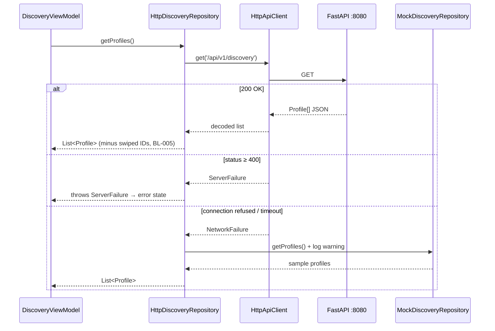

# BL-006 Dataflow

## Change history

| Date | CHG | Change |
|---|---|---|
| 2026-10-16 | [CHG-001](../../../changes/CHG-001-agentic-documentation-system.md) | Migrated from the TASK-006 sequence diagram; server-error branch added |
