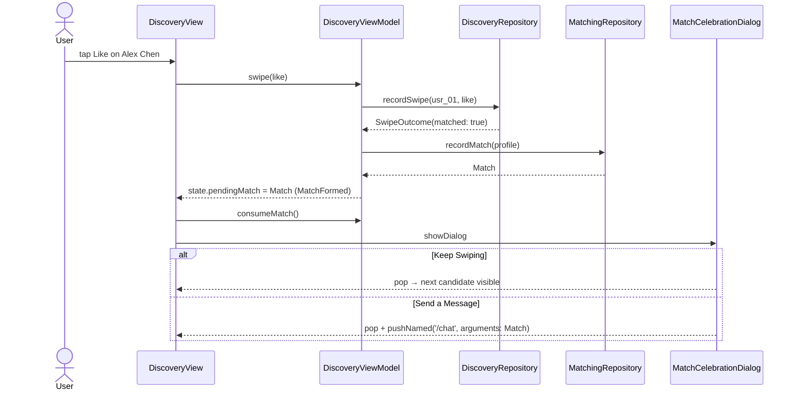

# BL-007 Event Stream

| Event | Emitter | Consumer | Payload | Lifetime |
|---|---|---|---|---|
| `MatchFormed` | `DiscoveryViewModel` after a swipe whose outcome is `matched: true` and `recordMatch` succeeded | `DiscoveryView` (shows the dialog once) | `Match` | One-shot. Cleared from state as soon as the view consumes it, so a rebuild never shows the dialog twice |

## Change history

| Date | CHG | Change |
|---|---|---|
| 2026-10-16 | [CHG-001](../../../changes/CHG-001-agentic-documentation-system.md) | Migrated from the TASK-007 sequence diagram; one-shot consumption made explicit |
