Garblo Flow Spec

v2 · 12 screens · 4 flows · 15 use cases

1. Foundation
2. [T0Journey & conflicts](#overview)
3. [T1Layout system](#layout)
4. [V1Nice-to-have scope](#scope)
5. [T2Data model](#data)
6. [T2+Data model · v2](#data-v2)
7. [T3Technical baseline](#tech)
8. [T4Offline-first data platform](#platform)
9. Flow A · Add → Wardrobe
10. [UC-01Add photos + consent](#uc-01)
11. [UC-02Choose analysis scope](#uc-02)
12. [UC-03Review & save items](#uc-03)
13. [UC-04Browse wardrobe](#uc-04)
14. Flow B · Gu Match
15. [UC-05Set styling context](#uc-05)
16. [UC-06Agent context analysis](#uc-06)
17. [UC-07Swipe: pass / like](#uc-07)
18. [UC-08Adjust & try on](#uc-08)
19. [UC-15Outfit chosen · thank you](#uc-15)
20. Flow C · Impact · nice-to-have
21. [UC-10View my impact](#uc-10)
22. [UC-11Earn XP, streaks, badges](#uc-11)
23. Flow D · Community · nice-to-have
24. [UC-12Share achievements](#uc-12)
25. [UC-13Browse community](#uc-13)
26. [UC-14Create a post](#uc-14)
27. Cross-cutting
28. [UC-09Delete my data](#uc-09)
29. Delivery
30. [T5Product backlog](#backlog)
31. [T6Development phases](#phases)
32. [T7Design spec · grid](#design)
33. [T11Traceability](#trace)

[ ] Screens only (hide extras) [ ] Must-have only (hide v2 nice-to-have)

Product & UX specification · MVP mobile app · v2

# Garblo Flow Spec

Four flows, written up as a build spec. The MUST-HAVE MVP: **Flow A** turns photos into structured wardrobe items, and **Flow B** styles outfits from those items only. Version 2 adds the NICE-TO-HAVE flows behind feature flags: **Flow C** rewards rewearing, and **Flow D** lets people share their progress with the community.

Each use case has a user story, acceptance criteria, a user flow, a data flow and a sequence diagram. Parts marked EXTRA go beyond what the screens show (empty, loading and error states, data erasure, API contracts). Use the switches in the index to hide extras, or to read only the must-have spec.

Flow A · violetFlow B · lime Flow C · ImpactFlow D · Community Source: 12 screen analyses (1a–5a, 1b–4b, 1c–3c)UI copy: English (pilot)v2.8 · 30 Oct 2026

T0 Inventory & journey map

## Twelve screens, four flows, one shared wardrobe

Flow A writes wardrobe items and Flow B only reads them. The ✨ *Style a new look* button on the Wardrobe screen is the bridge between them. The v2 flows are downstream only: they read wear logs and liked looks and never change wardrobe data.

### Screen inventory

| ID | Screen | Pillar | Entered by | Layout archetype | Primary action | Use case |
| --- | --- | --- | --- | --- | --- | --- |
| 1a | Add photos (empty) | Add | Tap *Add* in bottom nav | L1 Task funnel | Tap dropzone | UC-01 |
| 2a | Add photos (staged) | Add | Photos picked in 1a | L1 Task funnel | Analyze with AI › | UC-01 |
| 3a | Analysis scope sheet | Add · modal | Analyze with AI in 2a | L2 Decision sheet | OK | UC-02 |
| 4a | AI reads photos (review) | Add · pushed | OK in 3a, AI done | L3 Review workspace | Save 3 items to wardrobe | UC-03 |
| 5a | Wardrobe | Wardrobe | Auto after save in 4a, or tap *Wardrobe* | L4 Catalog grid | ✨ Style a new look | UC-04 |
| 1b | AI styling studio | Gu Match | Tap *Gu Match*, or FAB in 5a | L5 Hero prompt | Start swiping › | UC-05 |
| 2b | Context analysis | Gu Match | Start swiping in 1b | L6 Agent context stack | None (auto-advances) | UC-06 |
| 3b | Swipe deck | Gu Match | Agent finishes in 2b | L7 Immersive deck | Pass · Like · Adjust · Try on | UC-07, UC-08 |
| 4b | Outfit chosen · thank you NICE | Gu Match · full screen | "Yes, wearing it" after ♡ in 3b | L11 Celebration summary | Save to calendar › | UC-15 |
| 1c | Impact dashboard NICE | Impact | Tap *Impact* in bottom nav | L8 Metrics dashboard | Share achievements | UC-10, UC-11 |
| 2c | Share achievements (two states: outfit off · outfit on) NICE | Impact · pushed | Share achievements in 1c | L9 Share composer | Share | UC-12 |
| 3c | Community feed NICE | Community | Auto when 2c ends (Share), or tap *Community* | L10 Mixed-card feed | + Share | UC-13, UC-14 |

Entry triggers come from the attachments' file names (for example "5a: auto-switch to Wardrobe after step 4a or tap Wardrobe"). Two v2 files did not hold what their names say. 2c is a copy of 1c, so 2c is rebuilt from the 3c analysis, which covers the share screen in both toggle states and then the feed (N1). That file was first named "4c". It was renamed 3c on 29 Oct. The first 4b file repeated 2b's content. The real 4b screen (a thank-you with impact figures) arrived on 29 Oct and replaces the interim look check (N2, P1–P8).

### Journey map

```mermaid
flowchart LR
  subgraph A["Flow A · Add → Wardrobe"]
    direction LR
    s1a["1a Add photosempty"] -->|"pick 1–10 JPG/PNG"| s2a["2a Staged+ consent"]
    s2a -->|"× removes last photo"| s1a
    s2a -->|"Analyze with AI(photos ≥1 AND consent)"| s3a["3a Analysisscope sheet"]
    s3a -->|"Reselect photos"| s2a
    s3a -->|"OK"| s4a["4a AI review"]
    s4a -->|"Save N items(auto-switch)"| s5a["5a Wardrobe"]
  end
  subgraph B["Flow B · Gu Match"]
    direction LR
    s1b["1b Stylingstudio"] -->|"Start swipingprompt-led or zero-input"| s2b["2b Contextanalysis"]
    s2b -->|"agent done(auto)"| s3b["3b Swipe deck"]
    s3b -->|"Change context"| s1b
    s3b -.->|"♡ → Yes, wearing it (v2 flag)"| s4b["4b Thank you+ impact"]
    s4b -.->|"× or saved to calendar"| s3b
  end
  subgraph C["Flow C · Impact · nice-to-have"]
    direction LR
    s1c["1c Impactdashboard"] -->|"Share achievements"| s2c["2c Share achievementsoutfit off / on"]
    s2c -->|"toggle outfit"| s2c
  end
  subgraph D["Flow D · Community · nice-to-have"]
    s3c["3c Communityfeed"]
  end
  s5a ==>|"✨ Style a new look"| s1b
  s3b -.->|"Try on needs a body photo(C5)"| s1a
  s4b -.->|"the wear already loggedfeeds XP, streak, quest"| s1c
  s2c -.->|"Share (2c ends)"| s3c
  
```

Solid arrows are must-have paths. Dotted arrows exist only when a v2 feature flag is on. With every flag off, the app behaves exactly as in v1.

### Conflict register

These are places where two source screens disagree. Each one was decided by the product owner before the task that depended on it, and the decision is applied wherever the conflict appears.

| ID | Conflict | Screens | Blocks | Status |
| --- | --- | --- | --- | --- |
| C1 | Context data disagrees. 2b shows Tokyo, 16–19 °C, 80% rain at 13:00 and a Hackathon event. 1b and 3b use 29°, a coffee meetup and light rain, and the header shows 29° on every screen. | 1b 2b 3b | UC-06, UC-07 | Resolved · two paths |
| C2 | 4a says "From 1 photo, AI extracted 3 items", but 2a and 3a staged 3 separate flat-lay photos (tee, trousers, sneakers). | 2a 3a 4a | T2, UC-03 | Resolved · photo → 0..n items |
| C3 | 3b credits the violet shirt as "unworn for 41 days", but it was saved minutes earlier in 4a. On 5a the 41-day item is the white T-shirt. | 4a 5a 3b | UC-04, UC-07 | Resolved · Last worn in 4a |
| C4 | `wardrobe_items` is defined twice (1a and 4a) with different columns. Category is free text in 4a and a 5-value enum in 5a. The 4a item is pictured as a T-shirt but named "Violet shirt". | 1a 4a 5a | T2 | Resolved · two-level taxonomy |
| C5 | Virtual try-on on 3b needs a body reference photo, but Flow A uploaded only flat-lays with pose analysis off. | 3a 3b | UC-08 | Resolved · add body photo prompt |
| C6 | The 3a source is cut off partway through the `ai_processing_jobs` table definition. | 3a | T2, UC-02 | Resolved · photo × task jobs |
| C7 | 2b shows a "still gathering" agent message and a "Your context is analyzed" title in the same frame. | 2b | UC-06 | Resolved · progressive reveal |
| C8 | The UI copy is Vietnamese, but the pilot UI is English-only. | all | All | Resolved · English only |
| C9 | The Gu Match accent changes from screen to screen: a lime chip on 1b, a dark-green indicator on 2b, a neon indicator on 3b. Add and Wardrobe use violet. | 1b 2b 3b | T1 tokens | Resolved · lime for Gu Match → D1 |
| C10 | Occasion chips on 1b look single-select (one active), but the data model stores an array (multi-select). | 1b | UC-05 | Resolved · multi-select |
| C11 | "3/8 looks today" could mean a daily quota per user or the size of one session's deck. | 3b | UC-07 | Resolved · 8 per session |
| N1 | File 2c is byte-identical to 1c. The 3c analysis (first named "4c") describes the share screen in two states (toggle off and on) and then the feed. | 2c 3c | V0, UC-12 | Re-resolved · 2c = share (off/on), 3c = Community |
| N2 | File 4b ("after choosing a suitable lookbook in 3b") repeats 2b's context analysis. The real 4b screen was sent on 29 Oct. | 4b 2b | UC-15 | Re-resolved · real thank-you screen |
| N3 | "24 new looks" (ring target 30) and "68% rewear rate" have no single definition. The source gives two formulas for the rate. | 1c 2c | V3, UC-10 | Resolved · worn combos + coverage |
| N4 | "−2.1 fewer new purchases\*" needs purchase data that Garblo does not collect. | 1c | V3, UC-10 | Resolved · monthly self-report |
| N5 | The weekly quest shows 1/3 dormant items rescued, but the "30-day rescue" badge (threshold 1) is still locked. | 1c | V3, UC-11 | Resolved · unlock on first rescue |
| N6 | "Last worn" can be an estimate (C3). Backdating it would earn rescue XP, quest progress and badges. | 4a 1c | V3, UC-11 | Resolved · logged dormancy only |
| N7 | Share is described as posting to Community or opening the system share sheet, and the SQL creates an AI-lookbook post rather than the poster. | 2c 3c | UC-12 | Resolved · poster to Community |
| N8 | The "favorite outfit" shown on the poster is never defined. | 2c | UC-12 | Resolved · most-worn look this month |
| N9 | Posts are public by default, there is no moderation or reporting, and Copy link creates a public web URL. | 2c 3c | UC-13, UC-14 | Resolved · members opt-in · 30-day links · report |
| N10 | Green/lime now marks progress across Impact and Community, but C9 reserved lime for Gu Match. | 1c 2c 3c | V2 tokens | Resolved · lime = positive + Gu Match → D1 |
| P1 | Real 4b says "You chose a fitting outfit". It wasn't clear whether reaching it logs the wear. | 3b 4b | UC-15 | Resolved · after "Yes, wearing it" |
| P2 | Three new metrics with no definition: Top 8%, 6 kg CO₂e, 3 tree-months | 4b | T2+, UC-15 | Resolved · lifetime, from wears |
| P3 | A realistic photo of a person, with no provenance label | 4b | UC-15 | Resolved · try-on if it exists, else illustration |
| P4 | Full screen with no header, no nav and no close button | 4b | T1, UC-15 | Resolved · × close + return to deck |
| P5 | Save to calendar needs write access (v1 only reads the calendar) | 4b | T2+, UC-15 | Resolved · separate entry |
| P6 | A tie fits none of the five groups | 4b 5a | T2, UC-04 | Resolved · Accessories group |
| P7 | The meaning of ⭐, of "OUTFIT 03", and of the name "Tim" | 4b | UC-15 | Assumed · best match, deck position, first name |
| P8 | A dark-green primary button and nature theme break the violet/lime token rule | 4b | T1 tokens | Resolved · celebration-eco tokens → D1 |
| F1 | Fixed without a decision: the source tables hard-code demo values as column defaults (level 3, 340 XP, 5-day streak, "24 looks"). They store dashboard numbers rather than deriving them, and give XP only for rescues. | 1c 3c | V3 | Fixed in spec |
| D2 | The client used REST and SSE beside PowerSync (two data paths, Community and history over REST). | all | T3, T4 DB5, every UC | Resolved · one-piece data flow: PowerSync only, commands as rows |
| D3 | Object storage was unnamed ("object storage", CDN, signed URLs); infrastructure planned MinIO. | all | T4 DB6 | Resolved · RustFS, presigned tickets through sync |
| D1 | Adopting the Garblo design system: the spec used violet as the primary, the design system uses Acid Lime as the agentic primary, and 4b uses a forest-green button. | all | [T7](#design), T1 tokens | Resolved · forest green primary app-wide; violet = Garblo working; lime = anchor ring |

V1 Nice-to-have scope NICE-TO-HAVE

## Nice-to-haves sit downstream of the MVP and turn off cleanly

Version 2 adds six nice-to-have features, each behind a feature flag. They only read data the must-have flows already produce: wear logs, liked looks and dormancy. They never block a must-have path, and if one fails, the app falls back to its v1 behaviour.

### Priority tiers

| Tier | Meaning | Where it is marked |
| --- | --- | --- |
| MUST-HAVE | The v1 MVP: Flows A and B and data erasure. It ships for the pilot's first segment. | v1 use cases. Their ACs are all must-have, so no per-AC tag. |
| NICE · Should | The first nice-to-have slice. Build it once the must-have flows are stable in the pilot. | A Should tag on each AC in UC-10 to UC-15 |
| NICE · Could | Later, and only if the signal from the Should slice is good | A Could tag on each AC |

### Feature flags

| Flag | Use case · screens | Reads must-have data | When the flag is off | Pilot signal to watch |
| --- | --- | --- | --- | --- |
| ff_outfit_thanks | UC-15 · 4b | The wear event UC-07 saves, the candidate, the context snapshot, impact factors | After "Yes, wearing it", the deck shows the next card (v1) | Share of confirmed wears saved to the calendar · 7-day return after a thank-you |
| ff_impact_dashboard | UC-10 · 1c, top half | wear_logs, outfit_candidates, wardrobe_items | Impact tab shows "Your impact report is coming soon" | Weekly rewear rate per active user |
| ff_rewards | UC-11 · 1c, bottom half | wear_logs, dormancy (I8) | 1c shows only the hero ring, KPIs and chart | Day-7 return rate · median streak |
| ff_share_poster | UC-12 · 2c | UC-10 metrics, UC-11 badges, liked looks | The Share achievements button is hidden | Posters saved or shared per active user |
| ff_community_feed | UC-13 · 3c | Share cards, AI illustrations of liked looks | Community tab shows "Coming soon". Share only saves or copies a link. | Weekly feed visits · saves per visit |
| ff_community_create | UC-14 · + Share | UC-13, moderation queue | The FAB is hidden. Only posters shared from 2c appear. | Posts per week · reports per 100 posts |

### Release slices (proposal)

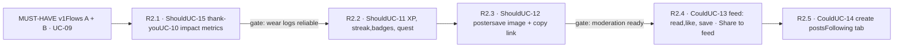

Each slice reads only what the slices before it produce, so the order is set by data dependencies. The gates are product checks, not dates.

### Rules for every nice-to-have

| # | Rule |
| --- | --- |
| R1 | No nice-to-have feature writes to a must-have table. UC-15 only reads the wear event UC-07 saved, except when the user swaps an item from Review outfit, which goes through the UC-08 endpoint. |
| R2 | A nice-to-have failure (timeout, flag off, missing data) hides the feature or shows its off state. It never shows an error on a must-have screen. |
| R3 | Every number in Impact can be traced back to the user's own logs. Estimates are labelled as estimates. |
| R4 | Nothing is shared outside the app without an explicit tap. Body photos are never shared, only AI illustrations. |
| R5 | Rewards never push buying. No quest, badge or post links to a shop (same principle as I6). |

T1 Layout systematization

## One app shell, eleven layout archetypes

Every screen stacks the same six zone roles from top to bottom. The archetypes differ only in which roles they use and how the shell is presented: solid, pushed, modal or immersive. Version 2 adds four archetypes: L8–L10, and L11 for the 4b celebration.

### Zone grammar

**Z0 Shell**Brand · weather · bell

**Z1 Wayfinding**Eyebrow · H1 · subcopy

**Z2 Input / content**What the user acts on

**Z3 Trust**Privacy, confidence, owned-only promise

**Z4 Commit**One primary action, often gated

**Z5 Pillar nav**Add · Wardrobe · Gu Match · Impact · Community

Rule: a **Z3 trust statement always sits right before or beside the Z4 action it reassures**. The privacy card sits above *Analyze with AI*. The owned-only promise sits above *Start swiping*. Confidence scores sit beside each item before *Save*.

### Zone maps by screen

Trust zoneCommit (enabled)Commit (disabled)AI outputShell / input target

Numbers match the zone numbering in each source screen analysis. 4a's source lists no bottom nav, so none is drawn. In 4b, the × close is added by this spec (P4). 1c is a long scroll, shown here compressed.

### Shell modes

| Mode | Header | Bottom nav | Screens | Rule |
| --- | --- | --- | --- | --- |
| Solid | Brand · 29° · bell (red dot) | Light, active tab has a top indicator | 1a 2a 5a 1b 2b | Default for pillar root screens |
| Pushed | ‹ Back · title · bell | Not specified | 4a | A task step one level below a pillar. Back returns to the previous step. |
| Modal | Previous screen dimmed and blurred behind | Covered by the scrim | 3a | A sub-decision that keeps the parent's context visible. Swipe down to dismiss. |
| Immersive | Floating glass pills over the image | Dark, with an accent indicator | 3b | Full-bleed media. The chrome steps back so the outfit fills the screen. |
| Solid · long scroll | Sticky. Content scrolls under it. | Light | 1c 3c | Dashboards and feeds longer than one screen keep the brand, weather and bell in reach |
| Full-screen celebration | None; × top right (P4) | Hidden | 4b | A one-off moment after a commitment. It closes back to where the user came from and never strands them. |
| Pushed · child | ‹ Back · title · bell | Visible, parent tab stays active | 2c | A tool opened from a pillar screen. Back returns to the pillar. |

### Layout archetypes

| ID | Archetype | Zone recipe | Interaction pattern | Screens |
| --- | --- | --- | --- | --- |
| L1 | Task funnel | Z0 · Z1 (stepper eyebrow) · Z2 dropzone/tray · Z3 consent card · Z4 gated CTA · Z5 | Compound gate: CTA enabled only when every precondition holds | 1a 2a |
| L2 | Decision sheet | Scrim · grabber · H2 question · read-only preview · option list · split footer (secondary \| primary) | Progressive disclosure and smart defaults. The left button rolls back, the right one commits. | 3a |
| L3 | Review workspace | Back header · provenance banner · active entity card · collapsed queue · sticky commit | Human-in-the-loop: AI proposes, the user corrects, then a bulk commit | 4a |
| L4 | Catalog grid | Z0 · module header with count · single-select chips · 2-column cards · FAB · Z5 | Faceted filtering. A FAB in the thumb zone bridges to the next pillar. | 5a |
| L5 | Hero prompt | Z0 · icon + eyebrow + H1 question · preset chips · free-text box · inventory assurance · CTA · Z5 | Hybrid input: structured chips plus free text | 1b |
| L6 | Agent context stack | Agent banner · provenance header · bento cards (event, weather, rain, commute) | Zero-input: the system fills the context and shows where each piece came from | 2b |
| L8 | Metrics dashboard NICE | Sticky Z0 · module header · hero ring · KPI pair (with footnote) · 4-week chart · level card · streak + badge shelf · quest card · share CTA · Z5 | Reads top to bottom from value to habit, progress, action and sharing. Each block answers "what did my wardrobe give me?" | 1c |
| L9 | Share composer NICE | Back header · poster preview (exact export) · privacy toggle with subnote · three-button export bar · Z5 | What you see is what gets shared. The toggle changes only the preview until an export button is tapped. | 2c (off · on) |
| L10 | Mixed-card feed NICE | Z0 · module header · feed chips · 2-column staggered grid of post cards (shared footer) · FAB · Z5 | Cards of different types share one footer (author, like, save), so the feed reads as one list | 3c |
| L11 | Celebration summary NICE | Gratitude hero (name) · impact trio with ⓘ · editorial banner · outfit summary card · two-button action bar (secondary \| eco primary) | Rewards a commitment just made, shows its effect, then offers one next step. Uses accent-primary (forest) for its one primary action (D1, [T7 inspect](#insp-4b)). | 4b |
| L7 | Immersive deck | Glass header · session HUD · full-bleed canvas · right-hand action rail · metadata overlay · dark nav | Swipe-deck decisions (pass/like) plus deeper tools (adjust, try on) | 3b |

### Component inventory

| Component | States / variants | Used in |
| --- | --- | --- |
| Utility header | solid · glass; bell badge on/off | 1a 2a 5a 1b 2b 3b |
| Weather chip | value (29°) · unavailable EXTRA | all shell screens |
| Stepper eyebrow | `STUDIO / 01` · module label (`YOUR COLLECTION`, `AI STYLING STUDIO`) | 1a 2a 5a 1b |
| Dropzone | empty · filled (counter + tray) · rejected file EXTRA | 1a 2a |
| Thumbnail tile | removable (×) · read-only | 2a 3a |
| Consent checkbox | unchecked · checked | 1a 2a |
| Primary CTA | disabled · enabled · loading EXTRA | 1a 2a 4a 1b |
| Split footer | secondary outline + primary fill | 3a |
| Option row | checked · unchecked · with constraint microcopy | 3a |
| Confidence badge | percentage value; low-confidence emphasis EXTRA | 4a |
| Attribute field | read · tap to edit (›) | 4a |
| Entity queue card | collapsed · peeking | 4a |
| Filter chip | active (inverted) · idle | 5a |
| Item card | image · placeholder; dormancy badge (≥ 30 days) | 5a |
| FAB | ✨ Style a new look | 5a |
| Occasion chip | active (accent) · idle | 1b |
| Prompt box | label `TELL GARBLO MORE` · empty · filled | 1b |
| Inventory assurance | count badge + promise lines | 1b |
| Agent banner | working · done (see C7) | 2b |
| Context card | event · weather (hourly rows) · rain risk · commute | 2b |
| Session HUD | progress counter · *Change context* link | 3b |
| Action rail button | Pass × · Like ♡ · Adjust ⊶ (highlighted) · Try on 👕 | 3b |
| Match badge / provenance label | `82% match` · `ILLUSTRATION` / `TRY-ON` / `WARDROBE PHOTO` | 3b |
| Bottom nav | light · dark; 5 tabs, one active | all except 3a, 4a |
| Progress ring | value / target, period label | 1c |
| KPI tile | value · label · optional footnote marker (\*) | 1c 2c |
| Weekly bar chart | 4 bars, current week highlighted; empty weeks shown as 0 | 1c |
| Level card | mascot · level name · XP bar (current/next) | 1c |
| Streak bar | active (n days) · broken · none yet EXTRA | 1c |
| Badge | unlocked (number) · locked (padlock) · just unlocked EXTRA | 1c 2c |
| Quest card | title · progress n/target · "More quests coming soon" | 1c |
| Poster canvas | metrics only · with outfit sticker | 2c |
| Toggle with subnote | off (default) · on | 2c |
| Export bar | Save image · Share (primary) · Copy link | 2c |
| Gratitude hero | personalized H1 · two lines of subcopy · decorative leaf art (static with reduced motion) | 4b |
| Impact trio | 3 tiles (icon · value · label) · ⓘ method sheet · rank tile falls back to rewear rate | 4b |
| Outfit summary card | context line · labelled image · OUTFIT nn chip · title ⭐ · item rows with group icons | 4b |
| Post card | AI lookbook (label AI-GENERATED IMAGE) · quote · milestone · poster; shared footer: initial, name, ♡ count, save | 3c |

### Accent tokens by pillar

| Token | Role | Used for |
| --- | --- | --- |
| accent-primary · forest #1F5A2E | Primary action, app-wide (D1) | Every full-width CTA, FAB, active nav indicator, toggles on, progress ring and level bar, 4b "Save to calendar". One primary per view. Values in [T7 › G0](#design-g0). |
| accent-synthesis-ai · violet | Garblo is working | Status-line dot (2b, 4a banner), progress while reading photos, selected context chips (1b), Gu Match hero icon |
| accent-social-pulse · cobalt | Community | Quote marks, appreciated ♡, follow, inbox count (3c) |
| accent-agentic-bg · lime (reduced) | Was Gu Match focus + wins (C9 → N10). Since D1: anchor-lock ring only | Gu Match: selected chips (1b), agent avatar (2b, 4b), tab indicator, Adjust ring (3b). Wins: progress ring and KPI tiles (1c), streak bar (1c), unlocked badges on the poster (2c), milestone post cards (3c). Since D1, only the 1.5 pt ring on a locked Piece (Adjust, 3b) stays lime; the rest moved to forest green or violet. |
| celebration-eco · forest | Celebration screens only (P8) | Folded into accent-primary by D1. The forest artwork on 4b remains an image, not a token. |
| status-warning | Attention | Dormancy badge (5a), low-confidence badge (4a) |

T2 Canonical data model

## One schema behind both flows

**Logical model (v2.4).** The tables and ERDs below describe entities and rules. The physical design is MongoDB collections synced to SQLite by PowerSync (T4). Postgres constructs such as triggers and CHECK constraints are implemented as backend validators, `$jsonSchema` rules and derived queries.

The eight screens add up to 16 tables in 4 groups: **Studio ingestion** (batch → photo → AI job → draft item), **Wardrobe** (items, taxonomy, wear log), **Gu Match** (session → context → candidates → interactions, try-on) and **Privacy** (consents). `wardrobe_items` is the shared table. Flow A writes it; Flow B reads it, and only for the signed-in user.

### Decisions applied

| ID | Decision | Effect on the model |
| --- | --- | --- |
| C2 | Any photo yields 0..n items | Each `extracted_items` and `wardrobe_items` row keeps its own `source_asset_id`. The 4a banner is computed per batch: "From {photos} photos, AI found {items} items". |
| C4 | Two-level taxonomy | The `item_groups` enum (TOPS, BOTTOMS, SHOES, BAGS, HATS, and ACCESSORIES since v2.1, P6) drives the 5a chips. The `item_types` lookup (Shirt, T-shirt, Wide-leg trousers, Sneakers…) is what the 4a *Type* field edits, and each type belongs to one group. The 4a item is named by its type ("Violet shirt"). |
| C6 | One job per photo × task | `ai_jobs` is unique on (batch, photo, task). Pose and background jobs end as `SKIPPED_NO_PERSON` when the photo has no person. |
| C3 | Ask "Last worn" during review | 4a gets an optional `last_worn_input` on `extracted_items`. Save copies it to `wardrobe_items.last_worn_at` with `last_worn_estimated = true`. |
| C10 | Occasion chips are multi-select | `gu_match_sessions.occasions` is an array of 0–5 values |
| C1 | Two context paths | `gu_match_sessions.path` is PROMPT_LED or ZERO_INPUT. Snapshot event fields are nullable. Weather records its own location, separate from the header's current location. |
| C7 | Progressive reveal | No schema change. Context cards are patched into the synced session row one by one, so each appears as soon as PowerSync delivers it (DB5). |
| D1 | Spec decision: draft items before save | The sources insert into `wardrobe_items` only when 4a's save runs, but the AI results must be stored somewhere before that. They live in `extracted_items`, which is editable and confirmed by the user. Save copies them over in one transaction. |
| D2 | Spec decision: batch state AWAITING_REVIEW | Added between AI_PROCESSING and COMPLETED, so a batch reads "ready for 4a" and stays resumable if the user leaves before saving. |
| D3 | Spec decision: one consent record per user and version | Consent is reused across batches and try-on, not inserted again on every submit. Each batch points at the consent that was active when it was submitted. |

### Entity-relationship diagram

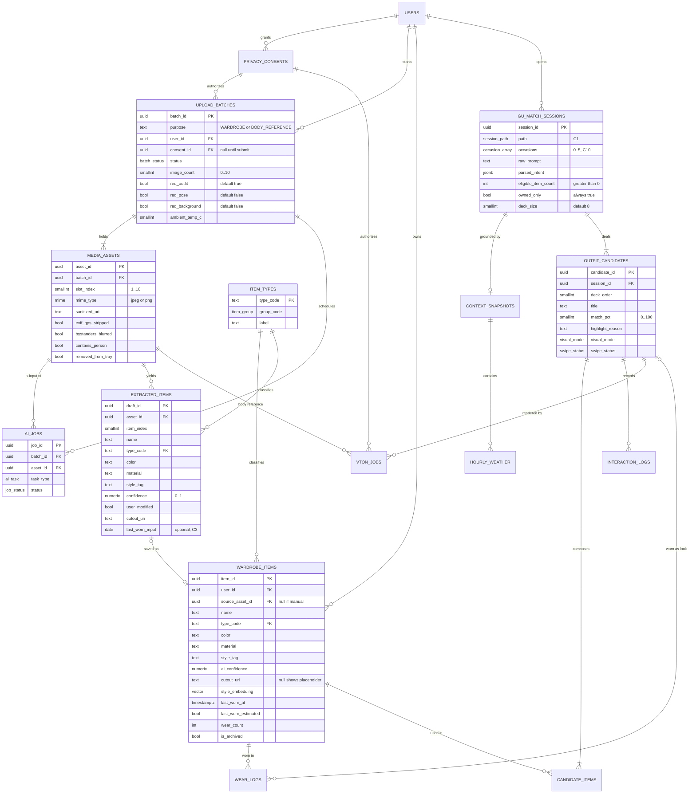

Key columns only. Tables not expanded above: USERS, PRIVACY_CONSENTS (version, includes_body, granted_at, revoked_at), WEAR_LOGS (worn_date, ambient_temp_c), CONTEXT_SNAPSHOTS, HOURLY_WEATHER, CANDIDATE_ITEMS (slot_role), INTERACTION_LOGS (action, dwell_ms), VTON_JOBS (status, output_uri).

### Where each merged `wardrobe_items` column came from

| Column | Source | Feeds | Merge note |
| --- | --- | --- | --- |
| source_asset_id | 1a, 4a | Provenance, erasure cascade | Now nullable, because 5a shows manual items with no photo |
| name | 4a, 5a | Card title, swipe item list | 4a `item_name` and 5a `item_name` merged |
| type_code → group | 1a, 4a, 5a | 5a chips, Gu Match slot roles | Replaces 1a `category`, 4a `category` and 5a `category_code` (C4) |
| color · material · style_tag | 4a | 4a attribute grid, Gu Match scoring | 5a's `sub_style_label` ("Basic", "Everyday") is the same idea as `style_tag` and merges into it |
| ai_confidence · user_modified | 4a | Audit, model retraining | Unchanged |
| cutout_uri | 1a, 4a, 5a | Card image, collage, try-on | 5a's `display_image_uri` merged into it; null shows the placeholder |
| style_embedding | 1a | Gu Match similarity | Unchanged |
| estimated_carbon_kg | 1a | Impact pillar | Kept, though no screen in this flow shows it |
| last_worn_at · wear_count | 5a, 4a input | Dormancy badge, Gu Match rescue score | Set first from the 4a "Last worn" input (C3), then derived from wear events, never stored as an editable field (T4, R2) |
| is_archived | 5a | Counts ("12 items") and owned-only checks | Unchanged |

### Enums

| Enum | Values | Shown as |
| --- | --- | --- |
| item_group | TOPS · BOTTOMS · SHOES · BAGS · HATS · ACCESSORIES | 5a chips: Tops, Bottoms, Shoes, Bags, Hats, Accessories (plus the virtual chip *All*). Accessories were added in v2.1 (P6). |
| batch_status | DRAFT · SANITIZING · QUEUED_FOR_AI · AI_PROCESSING · AWAITING_REVIEW · COMPLETED · FAILED · DELETED_BY_USER | Progress states between 2a and 4a |
| ai_task | OUTFIT_EXTRACTION · POSE_ESTIMATION · BACKGROUND_ANALYSIS | 3a options: Outfit, Pose, Background |
| job_status | PENDING · PROCESSING · COMPLETED · SKIPPED_NO_PERSON · FAILED | Shared by AI jobs and try-on jobs |
| occasion | WORK · COFFEE · AFTERNOON_RAIN · DATE · WEEKEND_OUTING | 1b chips, multi-select 0–5 (C10) |
| session_path | PROMPT_LED · ZERO_INPUT | Chosen on Start swiping: any chip or text means PROMPT_LED (C1) |
| mobility_mode | WALK_AND_TRANSIT · MOTORBIKE · CAR_TAXI · WALKING_ONLY · BICYCLE | 2b commute card |
| visual_mode | EDITORIAL_ILLUSTRATION · COLLAGE_FLATLAY · VIRTUAL_TRY_ON | 3b labels ILLUSTRATION · WARDROBE PHOTO · TRY-ON |
| swipe_status | PENDING_SWIPE · SWIPED_LEFT_PASSED · SWIPED_RIGHT_LIKED · SAVED_TO_LOOKBOOK | 3b deck outcome |
| card_action | DISMISS_PASS · LIKE_SAVE · CUSTOMIZE_EDIT · TRIGGER_VTON | 3b action rail |

### State machines

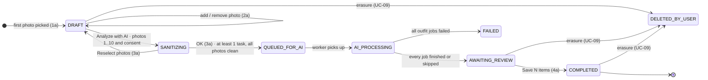

Upload batch lifecycle (Flow A). SANITIZING can run while the 3a sheet is open, so OK only waits for sanitizing that is still in progress.

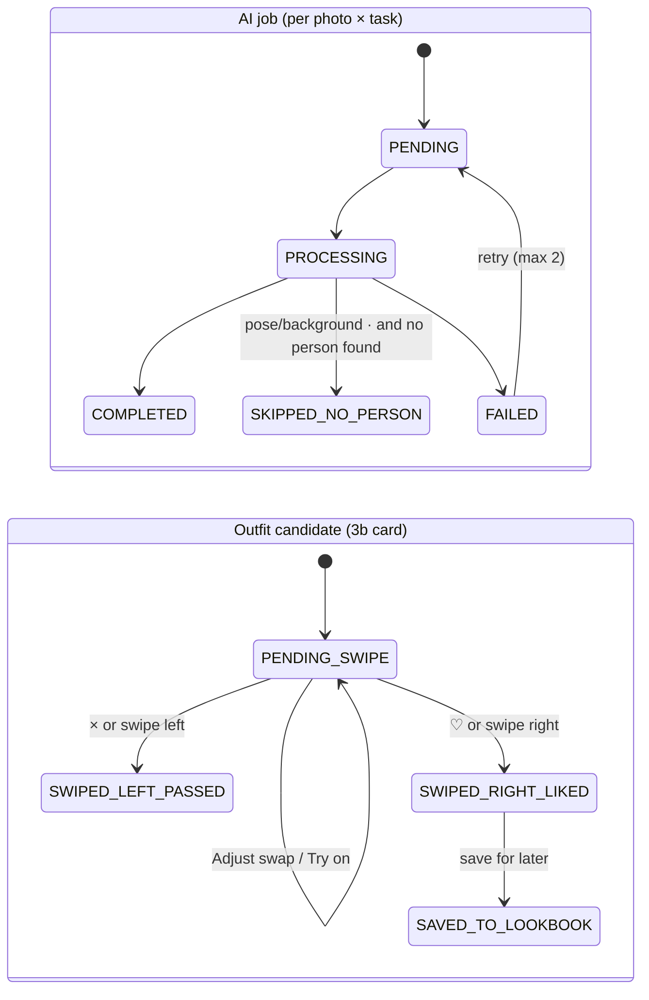

AI job and outfit candidate lifecycles. The retry cap of 2 is a placeholder for engineering to set.

### Invariants

| # | Rule | Enforced at | Screen |
| --- | --- | --- | --- |
| I1 | The Analyze CTA is enabled only when `1 ≤ photos ≤ 10 AND consent = true` | Client gate + backend validator on submit | 1a 2a |
| I2 | Only JPG and PNG are accepted, at most 10 per batch | Picker filter, API and `$jsonSchema` validator | 1a |
| I3 | No AI job reads a photo that still has EXIF/GPS or unblurred bystanders | On-device sanitizer + server verify worker before scheduling | 1a |
| I4 | At least one analysis task must be selected before QUEUED_FOR_AI | Sheet OK state + backend validator | 3a |
| I5 | Raw originals never leave the phone. Sanitizing runs on the phone and the server re-checks each upload (v2.3). | On-device sanitizer + verify worker | 1a |
| I6 | A Gu Match look may only contain the user's own, non-archived items | Generator assertion + write-handler check before insert | 1b 3b |
| I7 | Try-on requires an active consent with `includes_body = true` and a body reference photo | API precheck and FKs | 3b |
| I8 | The dormancy badge shows when days since `last_worn_at`, or since `created_at` if never worn, is at least 30 | Read query | 5a |
| I9 | The wardrobe count on 5a equals the "items ready to style" count on 1b | The same `COUNT(*)` on non-archived items | 5a 1b |

### Sync contract (replaces the API surface) EXTRA

| Was (REST, removed) | Phone writes (local DB → upload queue) | Server writes back (PowerSync) | UC |
| --- | --- | --- | --- |
| POST /v1/studio/batches | PUT upload_batches DRAFT | — | UC-01 |
| POST …/assets | PUT media_assets + attachments PHOTO | attachment_tickets (PUT, 15 min) · asset verification | UC-01 |
| DELETE …/assets/{assetId} | PATCH media_assets removed = 1 | — | UC-01 |
| POST …/submit | PUT consents + PATCH upload_batches SANITIZING (one transaction) | media_assets and attachments verified | UC-01 |
| POST …/analysis | PATCH upload_batches req\_\* + QUEUED_FOR_AI | ai_processing_jobs · batch status | UC-02 |
| POST …/reopen | PATCH upload_batches DRAFT | queued jobs cancelled | UC-02 |
| GET …/events (SSE) | — | job and batch rows (my_studio) | UC-02, UC-03 |
| GET …/extracted-items | — | extracted_items + cutout tickets (my_studio, my_files) | UC-03 |
| PATCH /extracted-items/{draftId} | PATCH extracted_items value.\*, last_worn_input | — | UC-03 |
| POST …/commit | PUT wardrobe_items ×N + PATCH upload_batches COMPLETED (one transaction) | item_embeddings | UC-03 |
| GET /v1/wardrobe/items | — (local query) | wardrobe_items (my_wardrobe) | UC-04 |
| POST /v1/wardrobe/wear-logs | PUT wear_events (deterministic ID) | rewards rows (my_progress) | UC-04, UC-07 |
| POST /v1/gu-match/sessions | PUT gu_match_sessions REQUESTED | session status and context | UC-05 |
| GET …/sessions/{id}/events (SSE) | — | gu_match_sessions.context, status (my_decks) | UC-06 |
| GET …/candidates | — | outfit_candidates (my_decks) | UC-07 |
| POST …/interactions | PUT interactions | swipe_status | UC-07, UC-08 |
| PUT …/items/{slot} | PUT interactions ADJUST (from, to) | candidate items + match_pct | UC-08 |
| POST …/try-on | PUT vton_jobs REQUESTED | vton_jobs status · RENDER attachment + ticket | UC-08 |
| POST /v1/privacy/erasure-requests | PUT privacy_requests (scope) | request status · data-free push when done | UC-09 |

One-piece data flow (DB5): the app has no REST or SSE calls. Every row above is written to the local database and sent by PowerSync's `uploadData()` to the one write endpoint, `POST /v1/sync/tx`. Results come back only through Sync Streams.

T2+ Data model · v2 NICE-TO-HAVE

## Impact is computed, rewards are a ledger, Community is members-only

Every Impact number is derived from wear events, wardrobe items and check-ins. The source stored them as columns with demo defaults, which this spec drops (F1). XP is a ledger of idempotent entries, so replays and retries can't double-count. Share and Community are a separate group of tables, members-only and opt-in.

### Decisions applied

| ID | Decision | Effect on the model |
| --- | --- | --- |
| N3 | Worn combinations + item coverage | A new `wear_events` table groups one day's outfit. Its `signature` (a hash of the sorted item IDs) identifies a combination. A "new look" is a signature first worn in the current month. Rewear rate = items worn in the last 30 days ÷ non-archived items. |
| N4 | Monthly self-report | `purchase_checkins` (one per user per month) and `baseline_monthly_purchases` from onboarding. The tile is hidden until 2 check-ins exist and is labelled "self-reported". |
| N5 | Rescue badge unlocks on first rescue | `RESCUE_30` has threshold 1. In the 1c example, the badge is shown **unlocked** beside the 1/3 quest. |
| N6 | Only logged dormancy earns rewards | A wear log is a rescue only if the gap of 30+ days is measured from a real earlier wear log or from the save date, never from an estimated "Last worn". `wear_logs.rescue_eligible` stores the result. |
| F1 | Derive, don't store | The source's `user_impact_dashboard` columns and their demo defaults are replaced by the `v_impact_month` view and a cache refreshed after each wear event |

**Example kept consistent.** The violet shirt in "Violet in the rain" (3b) has an *estimated* last-worn date, so wearing it boosts the look's score but earns no rescue (N6). The 1/3 on the weekly quest comes from the white T-shirt, whose 41 days are measured from its save date.

### Metric definitions

| Shown as | Definition | Source | Screen |
| --- | --- | --- | --- |
| "24 new looks · This month" (ring) | Count of distinct `signature`s whose first-ever wear event is in the current calendar month. Ring = count ÷ monthly goal (placeholder 30). | wear_events | 1c 2c |
| "68% rewear rate" | Non-archived items with at least 1 wear log in the last 30 days ÷ all non-archived items, rounded to a whole percent | wear_logs, wardrobe_items | 1c 2c |
| "−2.1 fewer new purchases · self-reported" | Average of the last 2 monthly check-ins minus the onboarding baseline. Hidden until 2 check-ins exist. | purchase_checkins, user_profiles | 1c |
| "Rewear rhythm · 4 WEEKS" | Wear events per ISO week for the last 4 weeks. W4 is the current week and is highlighted. Weeks with no events show 0. | wear_events | 1c |
| "5 days in a row" | Consecutive days with at least 1 wear event, ending today or yesterday. A streak breaks only after a full day with none. | wear_events | 1c |
| "Level 3 · 340/500 pts" | XP = sum of the user's ledger. Level = the highest level whose minimum XP ≤ XP. The bar shows XP against the next level's minimum. | xp_ledger, levels | 1c 2c |

### XP rules (values are placeholders for product to tune)

| Rule | Trigger | XP | Cap | Idempotency key |
| --- | --- | --- | --- | --- |
| SAVE_ITEM | Item saved to the wardrobe (UC-03) | 5 | 50 per day | item_id |
| WEAR_DAY | First wear event of the day (UC-07) | 10 | 1 per day | user + date |
| NEW_LOOK | A signature worn for the first time ever | 20 | — | signature |
| RESCUE | A rescue-eligible wear log (N6) | 50 (source value) | — | wear_log_id |
| QUEST_DONE | Weekly quest completed | 100 | 1 per quest per week | user_quest_id |

| Level | Name | Minimum XP |
| --- | --- | --- |
| 1 | Wardrobe Starter | 0 |
| 2 | Mix Explorer | 100 |
| 3 | Rewear Enthusiast (on 1c) | 300 |
| 4 | Style Remixer | 500 (the "/500" on 1c) |
| 5 | Circular Icon | 800 |

Only level 3's name and the 500 threshold come from the source. Every other name and number is a placeholder.

### Badges and quests

| Code | Shown as | Unlocks when | 1c example |
| --- | --- | --- | --- |
| FIRST_LOOK | "1" · First look | 1 new look, lifetime | Unlocked |
| TEN_LOOKS | "10" · 10 new looks | 10 new looks, lifetime | Unlocked |
| STREAK_7 | 🔒 · 7-day streak | A streak reaches 7 | Locked (5 of 7) |
| RESCUE_30 | 🔒 · 30-day rescue | The first rescue-eligible wear (N5, N6) | **Unlocked** (changed from the source, N5) |
| Quest RESCUE_3 | "WEEKLY QUEST · rewear 3 items unworn for 30 days" | 3 rescue-eligible wears between Monday and Sunday | 1/3 (white T-shirt) |

### Entity-relationship diagram · v2 additions

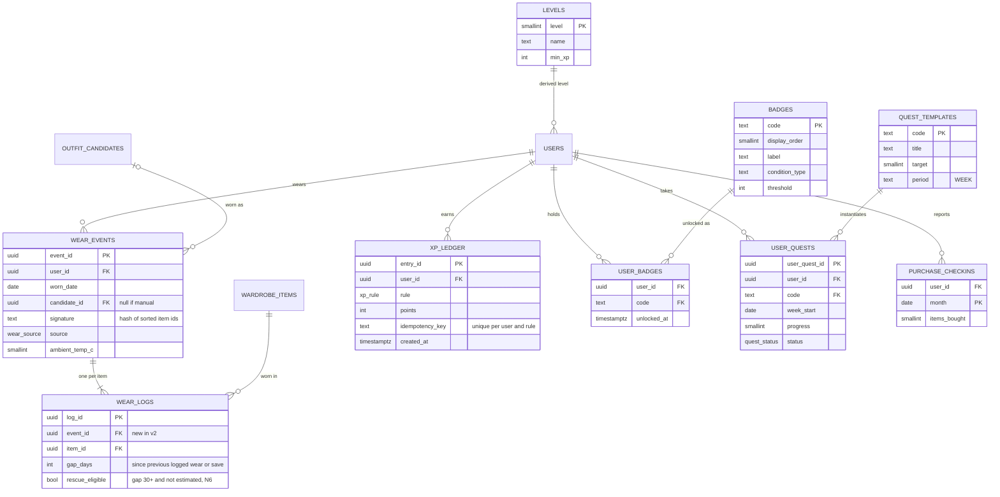

The v1 endpoint `POST /wardrobe/wear-logs` now creates one wear event plus one wear log per item. v1 behaviour is unchanged. Physically, the per-item logs are embedded in the wear event document (T4).

### Rewards pipeline

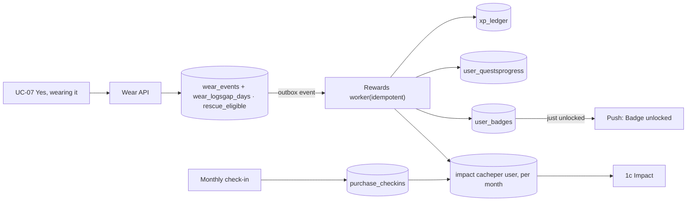

### State machines

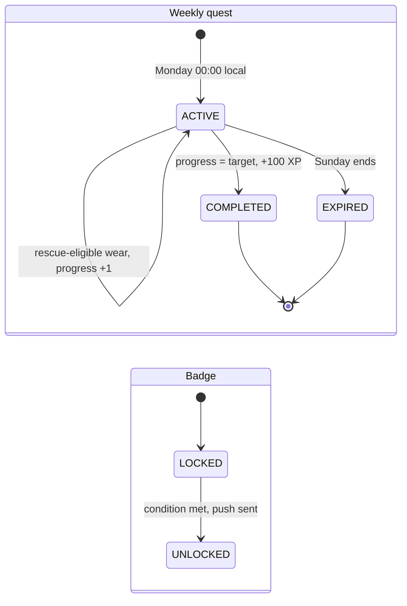

### Invariants · v2

| # | Rule | Enforced at |
| --- | --- | --- |
| I10 | Every Impact number is derived from the user's own events. No stored demo defaults. | Derived queries on the phone + server aggregation |
| I11 | An XP entry is unique per (user, rule, idempotency key) | Unique index on `xp_ledger` |
| I12 | A rescue counts only when the gap is 30+ days from a logged wear or the save date (N6) | Computed by the backend write handler when a wear event is saved |
| I13 | The purchases tile is labelled "self-reported" and hidden until 2 check-ins exist | Impact API |
| I14 | No reward, quest or badge links to a purchase (R5) | Content review of the catalog |

### Outfit thank-you (4b) · decisions applied

| ID | Decision | Effect on the model |
| --- | --- | --- |
| P1 | 4b follows "Yes, wearing it" | 4b reads an existing `wear_event` and writes nothing to it, except on a swap from Review outfit |
| P2 | Lifetime figures, estimated from wears | New `emission_factors` (one per item group) and `impact_factors` (displacement share, tree absorption, minimum cohort). `user_rank_daily` is computed nightly. |
| P3 | Try-on if it exists, else an illustration | The image is resolved from `vton_jobs` (COMPLETED, consent active), then the candidate's illustration, then the flat-lay. The provenance label is always returned. |
| P5 | Separate calendar entry | New `calendar_exports` table. Requires calendar write permission, asked at first use. The user's own events are never edited. |
| P6 | Accessories group | `item_group` gains `ACCESSORIES` (ties, belts, scarves, jewellery), a 6th chip on 5a and the Gu Match slot role `ACCESSORY` |
| P7 | Assumptions (not asked) | "OUTFIT 03" = `deck_order` padded to 2 digits. ⭐ = the highest `match_pct` in the session. "Tim" = `user_profiles.first_name`. |

### Eco metric definitions

| Shown as | Definition | Worked example |
| --- | --- | --- |
| "6 kg CO₂e · estimated emissions avoided" | Σ over all my wear logs of (the item group's kg CO₂e per new garment × displacement share), rounded to whole kg (one decimal under 10 kg is allowed) | 30 item-wears × average factor 10 kg × share 0.02 = 6.0 kg |
| "3 months · of a mature tree's CO₂ absorption" | CO₂e ÷ tree absorption per year × 12, rounded down to whole months. Under 1 month it is shown in weeks. | 6.0 ÷ 21.8 × 12 = 3.3, shown as 3 months |
| "Top 8% · of users making the most of their wardrobe" | My 30-day rewear rate (N3) ranked among users with at least 1 wear in the last 30 days. Shown only when that group has at least 100 users and I am in the top 50%. Otherwise the tile shows my rewear rate. | Rank 92nd percentile, shown as Top 8% |

| Factor | Value | Status |
| --- | --- | --- |
| Tree absorption per year | 21.8 kg CO₂ (48 lb) | This is the commonly cited figure that matches the design's "3 months". One Tree Planted traces it to a [European Environment Agency article](https://onetreeplanted.org/blogs/stories/how-much-co2-does-tree-absorb) and argues that about 10 kg per year is a better average over a tree's first 20 years. **The sustainability lead must choose and cite a factor before launch.** |
| Displacement share per wear | 0.02 | Placeholder. It is the share of a new purchase that one rewear is assumed to replace. Needs a sourced model. |
| kg CO₂e per new garment, by group | Tops 8 · Bottoms 20 · Shoes 14 · Bags 10 · Hats 4 · Accessories 2 | Placeholders, not sourced. They are versioned so that figures can be recomputed later. |
| Minimum group size for ranking | 100 active users | Placeholder |

### Entity-relationship diagram · 4b additions

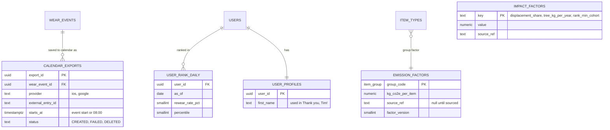

### Invariants · 4b

| # | Rule | Enforced at |
| --- | --- | --- |
| I21 | Eco figures are labelled "estimated", show their method behind ⓘ, and come from versioned factors | Impact API · `factor_version` |
| I22 | A body image (try-on) appears on 4b only with active body consent, and every 4b image carries a provenance label | Image resolver (P3) |
| I23 | Garblo writes only its own calendar entries, never edits the user's events, and lists its entries for removal | Calendar export service (P5) |
| I24 | A rank is never shown to users outside the top 50%, or when the ranked group is too small | Impact API (P2) |

### Share and Community · decisions applied

| ID | Decision | Effect on the model |
| --- | --- | --- |
| N7 | Share posts the poster to Community | A `POSTER` post type replaces the source's `IMPACT_POSTER_CARD`, and Share creates that post, not an AI-lookbook one. Sharing outside the app goes through Save image and Copy link only. |
| N8 | The favorite outfit is the most-worn look this month | `share_cards.outfit_signature` = the signature with the most wear events this month, ties broken by most recent. It is drawn as an AI illustration, never from a body photo. |
| N9a | Visible to Garblo members, opt-in | `community_profiles` records opt-in and the display name. `community_posts.visibility` is MEMBERS (default) or FOLLOWERS. The source's `is_public` is dropped. |
| N9b | Expiring link + report | `share_links` expire 30 days after creation and can be revoked. `post_reports` plus `moderation_status` handle reports. Quote text is screened before it shows. |

### Entity-relationship diagram · Share and Community

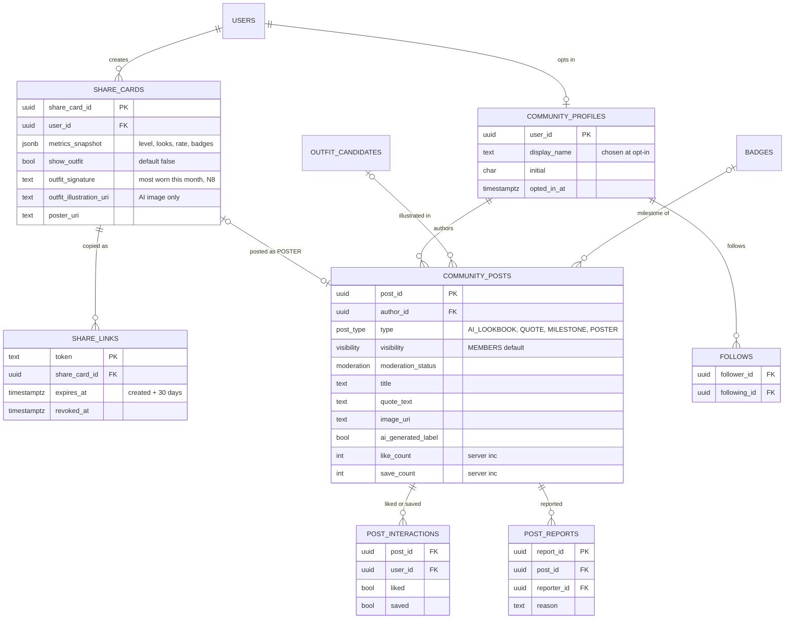

### Post lifecycle

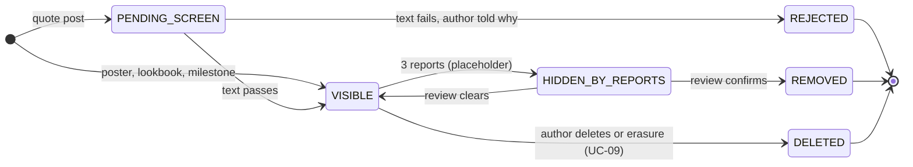

### Feed chips

| Chip | Shows | Order |
| --- | --- | --- |
| For you (default) | VISIBLE posts with MEMBERS visibility, plus FOLLOWERS posts from people I follow | Newest first (ranking is a later decision) |
| Following | VISIBLE posts by people I follow | Newest first |
| Lookbook | `AI_LOOKBOOK` only | Newest first |
| Achievements | `MILESTONE` and `POSTER` | Newest first |

### Invariants · Share and Community

| # | Rule | Enforced at |
| --- | --- | --- |
| I15 | A shared poster is a snapshot. Later metric changes never alter it. | `metrics_snapshot` is written once |
| I16 | No post, poster or link ever contains a body photo or try-on render. Outfit images are AI illustrations labelled "AI-GENERATED IMAGE". | Post API source check |
| I17 | Nothing is posted before the user has opted in. New posts default to MEMBERS visibility. | Post API and a column default |
| I18 | A share link expires after 30 days, can be revoked at any time, and shows the poster only (the outfit only if the toggle was on) | Link resolver |
| I19 | Quote text is screened before anyone else can see it | Post lifecycle |
| I20 | Like and save counts always equal the interaction rows | `$inc` in the same transaction + nightly reconciliation |

### Sync contract · Share and Community EXTRA

| Was (REST, removed) | Phone writes (local DB → upload queue) | Server writes back (PowerSync) | UC |
| --- | --- | --- | --- |
| POST /v1/share-cards | PUT share_cards | metrics_snapshot · poster attachment | UC-12 |
| PATCH /v1/share-cards/{id} | PATCH share_cards show_outfit | snapshot.outfit · sticker | UC-12 |
| POST /v1/share-cards/{id}/image | — (rendered on the phone for Save image) | — | UC-12 |
| POST …/links · DELETE …/links/{token} | PUT share_links · PATCH share_links revoked_at | token URL, expires_at | UC-12 |
| POST /v1/community/opt-in | PATCH profiles community_opt_in, display_name | — | UC-12, UC-14 |
| POST /v1/share-cards/{id}/post | PUT community_posts POSTER | post status | UC-12 |
| GET /v1/community/feed | PUT feed_requests (tab, cursor) | feed_entries (my_community) | UC-13 |
| PUT /v1/community/posts/{id}/like · /save | PUT / DELETE post_reactions | counts on community_posts | UC-13 |
| POST …/reports · /hide | PUT post_reports · PUT post_hides | post removed from feed_entries | UC-13 |
| POST /v1/community/posts | PUT community_posts | PENDING_SCREEN → VISIBLE | UC-14 |

### Sync contract · v2 rewards EXTRA

| Was (REST, removed) | Phone writes (local DB → upload queue) | Server writes back (PowerSync) | UC |
| --- | --- | --- | --- |
| GET /v1/impact/summary | — (local queries, shared rules) | — | UC-10 |
| POST /v1/impact/purchase-checkins | PUT purchase_checkins | — | UC-10 |
| GET /v1/rewards/profile | — | xp_ledger · user_badges · user_quests (my_progress) | UC-11 |
| GET /v1/impact/outfit-thanks | — (local queries + own user_rank_daily row) | user_rank_daily (my_progress) | UC-15 |
| POST /v1/calendar-exports | PUT calendar_exports | — | UC-15 |
| POST /v1/wardrobe/wear-logs | PUT wear_events | rewards rows | UC-07 |

T3 Technical baseline · local-first

## The phone is the working store; the cloud syncs, computes and shares

Every user, guest or signed in, reads and writes a local database on the phone, so the app works offline and responds instantly. The cloud does three things: heavy AI (extraction, styling, try-on), shared data (Community, links, ranks), and sync. **One-piece data flow (DB5):** the app reads and writes only its local PowerSync database. Every create, change, delete and command is a row that PowerSync uploads to one write endpoint; the backend applies it to MongoDB, runs any job, and the results come back through PowerSync. Files live in RustFS (DB6). For shared data and rewards, the server's copy is authoritative.

### System context

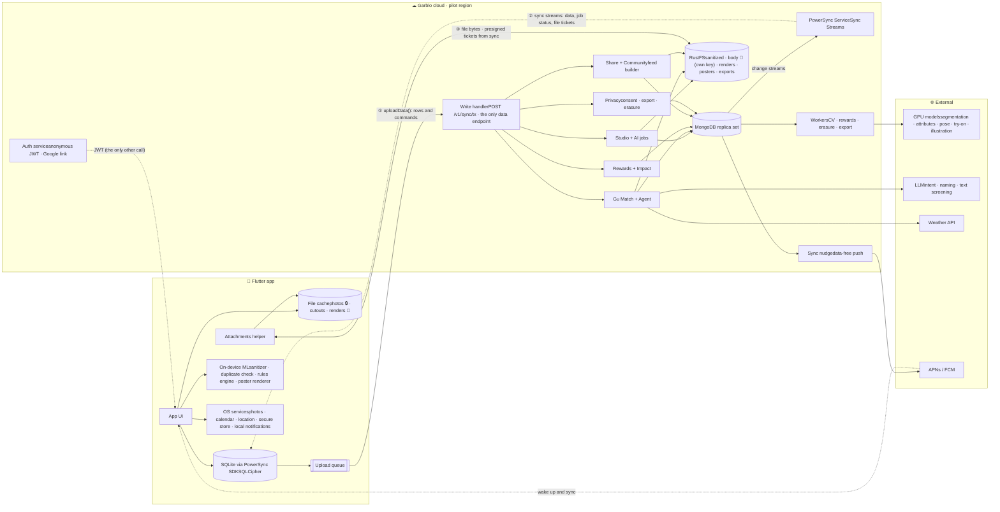

🔒 = personal data · 🧍 = body image. ① writes and commands, ② everything the phone reads, ③ file bytes only. Calendar events and precise location are read **on the phone**. Only derived fields leave it (event title, time window, city).

### Sync model

| Aspect | Rule |
| --- | --- |
| Engine | The PowerSync SDK keeps a SQLite database on the phone. PowerSync Service streams each user's buckets from MongoDB change streams. |
| Identity | First launch creates an **anonymous account** (JWT, sub = user_id) with its refresh token in the secure store. Google sign-in links to the same user_id (T4). |
| IDs | The phone generates ObjectIds and stores them as hex strings. Sync queries map `_id AS id`. |
| One-piece rule | The app talks to data only through its local database. There are no REST reads, no SSE and no direct MongoDB access. A command (analyze, draft Fits, try on, delete my data, share, load a feed page) is a row the phone inserts; the server completes it by writing result rows. |
| Uploads | Local writes go into PowerSync's upload queue. `uploadData()` sends one CRUD transaction at a time to the write handler (`POST /v1/sync/tx`), which applies it in a MongoDB transaction keyed by `tx_id` (idempotent) and starts any side effect. |
| Results | Workers write results (jobs, drafts, decks, renders, feed pages, file tickets) into MongoDB. Change streams carry them to PowerSync, which syncs them to the phone. When the app is in the background, a data-free push asks it to sync. |
| Files | Bytes go straight between the phone and RustFS using presigned URLs that arrive as synced `attachment_tickets` rows (PUT 15 min, GET 1 h; body renders 10 min). |
| Exceptions | Only three calls bypass PowerSync, and none reads or writes data: the auth service (token for PowerSync), file bytes to RustFS, and the public poster page for viewers outside the app. |
| When it syncs | Automatically for every account while online. "Sync now" forces an immediate upload and download. |
| Conflicts | PATCH applies only the changed fields, so the last upload wins per field. Append-only collections only insert. Deletes win. There are no editable counters (R2). |
| Authority | Wardrobe edits: the phone. Rewards, rank, posts, links and feed pages: the server (synced down read-only). Server results replace provisional local values. |
| Shared rules | One versioned rules library (dormancy, metrics, XP, eco) runs on both phone and server and is tested against the same fixtures |
| Encryption | Phone: SQLCipher + OS file protection. Network: TLS 1.3. Cloud: encryption at rest, with a separate key for body images. |

### Performance and reliability budgets (proposed placeholders for engineering to confirm)

| Budget | Target | Used by |
| --- | --- | --- |
| Local write visible in the UI | ≤ 100 ms p95 | All UCs |
| Screen render from the local DB | ≤ 300 ms p95 (500 items · 3,000 wear logs) | UC-03, 04, 10, 15 |
| On-device photo sanitizing | ≤ 1.5 s per photo p95 on a mid-range Android reference phone | UC-01, 08 |
| Upload applied (uploadData → MongoDB commit) | ≤ 500 ms p95 | All writes |
| Command round trip (local write → first result row on the phone, excluding model time) | ≤ 1.5 s p95 | All commands |
| RustFS photo PUT (≤ 2 MB) | ≤ 2 s p95 on 4G | UC-01, 08 |
| Outfit extraction | ≤ 8 s per photo · ≤ 30 s for 10 photos, p95 | UC-02 |
| Context: first card · all cards · deck ready (on the phone, from upload) | ≤ 2.5 s · ≤ 6 s · ≤ 7 s p95 | UC-06 |
| Try-on render | ≤ 20 s p95 | UC-08 |
| Feed page (request uploaded → rows on the phone) | ≤ 1.5 s p95 | UC-13 |
| Sync of 100 changes | ≤ 5 s p95 on 4G | All |
| PowerSync replication lag (MongoDB write → on the phone) | ≤ 1 s p95 while connected | All synced tables |
| Retries | Sync: exponential backoff, up to 5 · AI jobs: up to 2 | All |
| Erasure: hidden · hard-deleted | Immediately · ≤ 24 h (legal ceiling 30 days) | UC-09 |
| Availability · crash-free sessions | 99.5% per month · ≥ 99.5% | Pilot |

### How the technical acceptance criteria are written

| Category | Covers | Typical verification |
| --- | --- | --- |
| PERF | Latency, throughput, resource and GPU cost | Device benchmark · load test |
| REL | Idempotency, retries, partial failure, atomicity | Integration · chaos test |
| OFF | Offline behaviour, sync, conflicts, reconnects | E2E with network off · app-kill test |
| SEC | Authorization, what leaves the phone, encryption, retention, third parties | Security test · traffic capture · policy review |
| DATA | Constraints, invariants, parity between phone and server | Unit · property test · golden fixtures |
| OBS | Analytics events, metrics, alerts, logs without personal data | Analytics contract test · dashboard review |

IDs read TAC-\<use case>.\<n>. No analytics event or log line may contain images, names, prompt text or precise location.

T4 Offline-first data platform · SQLite + PowerSync + MongoDB + RustFS · one-piece data flow

## SQLite on the phone, PowerSync in the middle, one MongoDB replica set for the pilot

The Flutter app reads and writes a local SQLite database managed by the PowerSync SDK. PowerSync streams each user's data down from MongoDB through change streams. Writes go up through Garblo's write handler, which validates them before applying them to MongoDB. **This is the only data path** (DB5): there is no other API for reading or writing. Files sit in RustFS (DB6). Every account, anonymous or Google-linked, syncs from first launch.

### Decisions

| ID | Decision | Consequence |
| --- | --- | --- |
| DB1 | One MongoDB replica set for the pilot | One PowerSync Service instance. PowerSync can't connect to sharded clusters today ([docs](https://docs.powersync.com/sync/advanced/sharded-databases)), so growth is planned as phases (below). Every document carries `user_id` or `city_id` from day one, so it is shard-key ready. |
| DB2 | Anonymous JWT: guests sync from day one | First launch creates an anonymous account (the JWT `sub` = `user_id`). Google sign-in links the identity to that same `user_id`. **This replaces gap ①'s "guest data stays on the phone"**: guest data is now stored on the server, and the privacy dashboard says so. "Sync now" remains as a button that forces a sync. |
| DB3 | Flutter client | `powersync` Dart package (with SQLCipher for an encrypted local database) plus the PowerSync attachments helper for photos, cutouts and renders |
| DB5 | **One-piece data flow** (30 Oct) | The app reads and writes only its local PowerSync database. Commands are rows the phone inserts (`gu_match_sessions`, `vton_jobs`, `privacy_requests`, `share_cards`, `community_posts`, `feed_requests` …). `uploadData()` notifies the write handler, which applies the rows to MongoDB and starts the side effect. Results return through Sync Streams, plus a data-free push when the app is in the background. The REST and SSE API surface is removed. Exceptions that carry no data rows: the auth service, file bytes, the public poster page. |
| DB6 | **RustFS** object storage (30 Oct) | Self-hosted, S3-compatible, in the pilot region. Buckets: `sanitized`, `body` 🧍 (own encryption key, try-on worker only), `renders` 🧍, `posters`, `exports` (7-day lifecycle), `editorial`. Keys start with `users/{user_id}/`, so erasure deletes one prefix per bucket. Versioning off for personal buckets. The phone gets presigned PUT/GET URLs only through synced `attachment_tickets`. Spike SP-R1 confirms presigned PUT/GET, multipart, lifecycle and server-side encryption before P3. |
| DB4 | Full ripple | Every Postgres-specific construct in T2, T3, the data flows, sequences and technical criteria is replaced (see the table at the end of this section) |

### Review findings

| # | Finding in v2.3 | Severity | Resolution |
| --- | --- | --- | --- |
| R1 | The design relies on Postgres-only features (triggers, CHECK, generated columns, foreign keys). PowerSync's SQLite schema has none, and MongoDB has no triggers. | High | Rules move into the backend write handler, MongoDB `$jsonSchema` validators and unique indexes. On the phone they live in the app layer and the shared rules library. |
| R2 | Counters are stored as editable fields (`image_count`, `last_worn_at`, `wear_count`), so offline edits on two phones conflict | High | They are derived from append-only records. On the phone they are SQL queries over `wear_events` (see "Derived values" below). |
| R3 | Wide `wardrobe_items` rows (512-dimension vector, carbon fields) sync to every phone | Medium | Split into a lean synced row, a compact `item_embeddings` row (int8 × 128, for the on-device duplicate check), and a server-only `item_vectors` |
| R4 | All server-generated history would sync to the phone | Medium | A server-maintained `recent` flag limits sync to the last 7 days of decks. Older history is an on-demand stream (`deck_history`, subscribed with a session ID), not an API call. |
| R5 | Community is cross-user and ranked by city, which doesn't fit per-user sync | Medium | The feed builder materializes a page per user and tab into `feed_entries` (20 cards, 24 h TTL) when the phone inserts a `feed_requests` row. `my_community` syncs only that user's pages, so no cross-user query reaches the phone (DB5). |
| R6 | PowerSync needs a JWT, and guests have none | Medium | Anonymous JWT from first launch (DB2) |
| R7 | The spec plans per-field merge timestamps (HLC), which is over-built | Low | PowerSync PATCH operations carry only the changed fields, and the backend applies only those, so merging is per field. Append-only collections only ever insert. Deletes win. |
| R8 | IDs: server ObjectIds vs IDs made on the phone | Low | The app generates an ObjectId and stores it as a hex string in `id`. Sync queries use `SELECT _id AS id` ([docs](https://docs.powersync.com/sync/advanced/client-id)). |
| R9 | A custom photo upload pipeline | Low | The PowerSync attachments helper, which queues uploads offline and retries them, backed by RustFS with presigned tickets delivered through sync (DB6) |

### Pilot topology

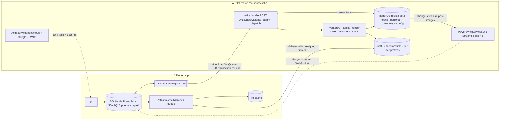

One path for data: phone → upload queue → write handler → MongoDB → PowerSync → phone. AI, Community and anything cross-user run as server-side side effects whose results are synced back as rows. Only file bytes (RustFS) and the login token (auth service) travel outside PowerSync.

### Growth path

| Phase | Topology | Trigger to move |
| --- | --- | --- |
| P1 · pilot | 1 replica set + 1 PowerSync instance + 1 write handler + 1 RustFS cluster, single region | Now |
| P2 · cells | One replica set + PowerSync + write handler + RustFS per region ("cell"). A small directory maps `user_id` to its cell, and the JWT carries the cell's PowerSync endpoint. | Write load near one primary's limit, or a data-residency requirement |
| P3 · global cluster | Community, interactions and analytics move to a **sharded cluster**. The feed builder reads it and still writes each user's `feed_entries` into their cell, so the phone keeps syncing only through PowerSync. Proposed shard keys: posts `{city_id: 1, _id: "hashed"}` · interactions `{post_id: "hashed"}` · events `{user_id: "hashed", ts: 1}`. Zones keep Vietnamese cities on APAC shards. | Community volume, or cross-region feeds |

Check data-residency duties with legal before P2: Vietnam's data rules can require some user data to be stored in Vietnam.

### Phone schema (SQLite through PowerSync)

| Class | Tables | Who writes |
| --- | --- | --- |
| SYNCED · read-write | profiles · wardrobe_items · upload_batches · media_assets · extracted_items (value.\* and last_worn_input only) · wear_events · purchase_checkins · calendar_exports · notifications (dismiss) · consents · interactions · attachments | The phone (through the upload queue). The write handler validates. |
| SYNCED · command rows | gu_match_sessions · vton_jobs · privacy_requests · share_cards · share_links · community_posts · post_reactions · post_reports · post_hides · feed_requests | The phone inserts the request (and may PATCH only its own fields). The server completes it by updating status and result fields (DB5). |
| SYNCED · read-only | item_types · badges · levels · quest_templates · emission_factors · impact_factors · item_embeddings · ai_processing_jobs · outfit_candidates · xp_ledger · user_badges · user_quests · user_rank_daily · attachment_tickets · feed_entries | The server only. Client writes are refused. (Until P4 the fakes write only to local-only `fake_*` mirror tables, never to these.) |
| LOCAL-ONLY | rewards_provisional · session_draft · ui_state · fake\_\* (P2–P3 only) | The phone. Never uploaded. |
| FILES · RustFS | photo · cutout · body 🧍 · render 🧍 · poster · export | Bytes through the attachments helper, with presigned tickets from sync |

```
// lib/data/schema.dart  (illustrative)
const schema = Schema([
  Table('wardrobe_items', [
    Column.text('user_id'), Column.text('name'), Column.text('type_code'),
    Column.text('color'), Column.text('material'), Column.text('style_tag'),
    Column.real('ai_confidence'), Column.text('cutout_attachment_id'),
    Column.text('last_worn_estimate'), Column.integer('archived'),
    Column.text('created_at'), Column.text('updated_at'),
  ], indexes: [Index('by_user_group', [IndexedColumn('user_id'), IndexedColumn('archived')])]),
  Table('wear_events', [                      // append-only
    Column.text('user_id'), Column.text('worn_date'), Column.text('candidate_id'),
    Column.text('source'), Column.text('signature'), Column.integer('ambient_temp_c'),
    Column.text('items'),                     // JSON: [{item_id, gap_days, rescue_eligible}]
    Column.text('created_at'),
  ], indexes: [Index('by_date', [IndexedColumn('worn_date')])]),
  Table('attachment_tickets', [                 // server-written, short-lived
    Column.text('attachment_id'), Column.text('op'), Column.text('url'), Column.text('expires_at'),
  ]),
  Table.localOnly('session_draft', [Column.text('occasions'), Column.text('prompt')]),
]);
```

### Derived values (no editable counters, R2)

| Value | Phone (SQLite) | Server (MongoDB) |
| --- | --- | --- |
| Last worn · wear count per item | SELECT json_extract(j.value,'$.item_id'), MAX(w.worn_date), COUNT(\*) FROM wear_events w, json_each(w.items) j GROUP BY 1 | $unwind items → $group by item_id |
| days_unworn · dormancy (I8) | From the query above, or the item's save date (shared rules library) | Same rules library |
| Photos in tray | COUNT(\*) FROM media_assets WHERE batch_id=? AND removed=0 | Validated on submit (1–10) |
| New looks · rewear rate · rhythm | Queries over `wear_events` + `wardrobe_items` | Aggregation pipeline (for rank only) |
| Like · save counts | Read from synced `feed_entries` | `$inc` in the same transaction as the interaction write, reconciled nightly (I20) |

### MongoDB collections

| Collection | Shape | Key indexes | Validator highlights |
| --- | --- | --- | --- |
| wardrobe_items | Flat. References `source_asset_id`. Server-only fields sit in `item_vectors`. | {user_id, archived, created_at} | `type_code` is in item_types; `user_id` = token owner |
| wear_events | Embeds `items[]` (the per-item logs). Insert-only. | {user_id, worn_date} · unique {user_id, worn_date, signature} | `items` holds 1–12 entries; each `item_id` is owned and not archived; `rescue_eligible` is computed by the server (I12) |
| upload_batches · media_assets | Separate collections, so removing one tray photo is a single-row change | unique {batch_id, slot_index} where removed=false | MIME ∈ {jpeg, png}; 1–10 photos on submit (I1, I2) |
| extracted_items | Embeds `ai{}` (the AI's originals) and `value{}` (the user's edits) | {batch_id, item_index} | Written by the server; the phone may patch only `value.*` and `last_worn_input` |
| gu_match_sessions | A command row: the phone inserts the request; the server adds `status`, the `context` cards and hourly weather. `recent` flag. TTL after 90 days. | {user_id, recent} · TTL expires_at | Phone may insert only path, occasions, raw_prompt, derived context and ambient_temp_c |
| outfit_candidates | Embeds `items[]` {slot_role, item_id} | {session_id, deck_order} | Owned-only check before insert (I6); the phone may change only `swipe_status`, through `interactions` |
| xp_ledger · user_badges · user_quests | Append-only or server-owned | unique {user_id, rule, idem_key} | Server-only writes (I11) |
| community\_\* · share\_\* | Authors sync only their own rows (my_community). Other people's posts reach a phone only as `feed_entries` snapshots. | {city_id, created_at} · {author_id, created_at} | Visibility · moderation_status · city ID only (never coordinates) |
| attachments · attachment_tickets | One row per file; tickets hold a presigned URL and expire (TTL index) | {user_id, owner_id} · TTL expires_at | Phone inserts PHOTO and BODY only; object keys start with `users/{user_id}/` |
| vton_jobs · privacy_requests · feed_requests | Command rows; status written by the worker | {user_id, created_at} | Allowed status transitions only; one active render per candidate (I7) |

```
// wear_events validator (excerpt)
{ $jsonSchema: { bsonType: "object",
  required: ["user_id","worn_date","source","signature","items","created_at"],
  properties: {
    source: { enum: ["LIKE_CONFIRM","ITEM","MULTI","CHECKIN","PHOTO","REMINDER","TREND"] },
    items:  { bsonType: "array", minItems: 1, maxItems: 12,
              items: { bsonType: "object", required: ["item_id"],
                       properties: { item_id: { bsonType: "objectId" },
                                     gap_days: { bsonType: "int" },
                                     rescue_eligible: { bsonType: "bool" } } } } } } }
```

### Sync Streams

```
config:
  edition: 3

streams:
  catalog:                       # one shared bucket for everyone
    auto_subscribe: true
    queries:
      - SELECT _id AS id, * FROM item_types
      - SELECT _id AS id, * FROM badges
      - SELECT _id AS id, * FROM levels
      - SELECT _id AS id, * FROM quest_templates
      - SELECT _id AS id, * FROM emission_factors
      - SELECT _id AS id, * FROM impact_factors

  my_wardrobe:                   # one bucket per user
    auto_subscribe: true
    queries:
      - SELECT _id AS id, * FROM profiles WHERE _id = auth.user_id()
      - SELECT _id AS id, * FROM wardrobe_items WHERE user_id = auth.user_id()
      - SELECT _id AS id, * FROM item_embeddings WHERE user_id = auth.user_id()
      - SELECT _id AS id, * FROM wear_events WHERE user_id = auth.user_id()
      - SELECT _id AS id, * FROM purchase_checkins WHERE user_id = auth.user_id()
      - SELECT _id AS id, * FROM calendar_exports WHERE user_id = auth.user_id()
      - SELECT _id AS id, * FROM consents WHERE user_id = auth.user_id()

  my_progress:
    auto_subscribe: true
    queries:
      - SELECT _id AS id, * FROM xp_ledger WHERE user_id = auth.user_id()
      - SELECT _id AS id, * FROM user_badges WHERE user_id = auth.user_id()
      - SELECT _id AS id, * FROM user_quests WHERE user_id = auth.user_id()
      - SELECT _id AS id, * FROM user_rank_daily WHERE user_id = auth.user_id()
      - SELECT _id AS id, * FROM notifications WHERE user_id = auth.user_id() AND dismissed = false

  my_studio:                     # open batches only; rows leave the phone when COMPLETED
    auto_subscribe: true
    with:
      open_batches: SELECT _id FROM upload_batches WHERE user_id = auth.user_id() AND status != 'COMPLETED'
    queries:
      - SELECT _id AS id, * FROM upload_batches WHERE _id IN open_batches
      - SELECT _id AS id, * FROM media_assets WHERE batch_id IN open_batches
      - SELECT _id AS id, * FROM extracted_items WHERE batch_id IN open_batches

  my_decks:                      # last 7 days for offline swiping
    auto_subscribe: true
    with:
      recent_sessions: SELECT _id FROM gu_match_sessions WHERE user_id = auth.user_id() AND recent = true
    queries:
      - SELECT _id AS id, * FROM gu_match_sessions WHERE _id IN recent_sessions
      - SELECT _id AS id, * FROM outfit_candidates WHERE session_id IN recent_sessions
      - SELECT _id AS id, * FROM interactions WHERE session_id IN recent_sessions
      - SELECT _id AS id, * FROM vton_jobs WHERE session_id IN recent_sessions

  my_studio_jobs:                # job progress for open batches (replaces SSE)
    auto_subscribe: true
    with:
      open_batches: SELECT _id FROM upload_batches WHERE user_id = auth.user_id() AND status != 'COMPLETED'
    queries:
      - SELECT _id AS id, * FROM ai_processing_jobs WHERE batch_id IN open_batches

  my_files:                      # file records and short-lived RustFS tickets
    auto_subscribe: true
    queries:
      - SELECT _id AS id, * FROM attachments WHERE user_id = auth.user_id()
      - SELECT _id AS id, * FROM attachment_tickets WHERE user_id = auth.user_id()
      - SELECT _id AS id, * FROM privacy_requests WHERE user_id = auth.user_id()

  my_community:                  # v2: own share rows + materialized feed pages
    auto_subscribe: true
    queries:
      - SELECT _id AS id, * FROM share_cards WHERE user_id = auth.user_id()
      - SELECT _id AS id, * FROM share_links WHERE user_id = auth.user_id()
      - SELECT _id AS id, * FROM community_posts WHERE author_id = auth.user_id()
      - SELECT _id AS id, * FROM post_reactions WHERE user_id = auth.user_id()
      - SELECT _id AS id, * FROM feed_entries WHERE user_id = auth.user_id()

  deck_history:                  # on demand: older decks (replaces the history API)
    auto_subscribe: false
    queries:
      - SELECT _id AS id, * FROM gu_match_sessions WHERE _id = subscription.parameter('session_id') AND user_id = auth.user_id()
      - SELECT _id AS id, * FROM outfit_candidates WHERE session_id = subscription.parameter('session_id') AND user_id = auth.user_id()
```

Estimated buckets per user: catalog 1 + my_wardrobe 1 + my_progress 1 + my_files 1 + my_community 1 + my_studio and my_studio_jobs up to 6 + my_decks up to about 10 recent sessions + deck_history up to 3 open ≈ 24, well under PowerSync's default limit of 1,000 ([docs](https://docs.powersync.com/sync/streams/bucket-count)).

### Write path

```
// lib/data/connector.dart  (illustrative)
class GarbloConnector extends PowerSyncBackendConnector {
  @override
  Future<PowerSyncCredentials?> fetchCredentials() async {
    final t = await auth.currentToken();            // anonymous or Google-linked, same sub
    return PowerSyncCredentials(endpoint: env.powerSyncUrl, token: t.jwt);
  }

  @override
  Future<void> uploadData(PowerSyncDatabase db) async {
    final tx = await db.getNextCrudTransaction();
    if (tx == null) return;
    final res = await api.applyTransaction(tx);    // POST /v1/sync/tx {tx_id, ops[]}
    if (res.applied || res.permanentlyRejected) {
      await tx.complete();                          // never block the queue on a 4xx
    } else {
      throw RetryableUploadError(res);              // 5xx/network: the SDK retries
    }
  }
}
```

| Operation | Backend action | Guards |
| --- | --- | --- |
| PUT | `insertOne` with the phone's `_id`. A duplicate key from the same owner counts as already applied. | Owner = token `sub` · collection is writable by the client · `$jsonSchema` |
| PATCH | `updateOne({_id, user_id}, {$set: changed fields})` | Per-collection allow-list of fields · append-only collections reject PATCH |
| DELETE | `deleteOne`; for items, an archive or delete per gap ② | Append-only collections reject DELETE (erasure goes through UC-09) |
| Whole transaction | One MongoDB multi-document transaction per CRUD transaction. `tx_id` is stored in `applied_tx` (TTL 7 days), so a replay is a no-op. | Business rules I1, I6, I7, I12 checked before commit |
| Rejection (4xx) | Logged to `sync_rejections`, and a notification ("Couldn't save … · Fix") reaches the user through `my_progress`. The transaction is completed so the queue moves on. | The phone's view is corrected by the next sync |

PowerSync's write checkpoints (it maintains `_powersync_checkpoints` in MongoDB) make sure the phone only shows server data that already includes its own uploaded writes.

### Side effects of the write handler (DB5)

| Row the phone writes | What the backend does | Rows synced back |
| --- | --- | --- |
| attachments PUT (PHOTO, BODY) | Issue a presigned PUT; after PATCH UPLOADED, verify the object (size, hash, no EXIF) | attachment_tickets · attachments.state |
| upload_batches PATCH SANITIZING · QUEUED_FOR_AI · DRAFT | Verify assets · create photo × task jobs and enqueue · cancel jobs | ai_processing_jobs · extracted_items · batch status |
| wardrobe_items PUT ×N + batch COMPLETED | Atomic commit, then embeddings | item_embeddings |
| wear_events PUT | Recompute rescue eligibility (I12), rewards worker | xp_ledger · user_quests · user_badges · notifications |
| gu_match_sessions PUT REQUESTED | Check eligible items, start the agent, patch context cards, generate the deck | session status and context · outfit_candidates |
| interactions PUT (DISMISS_PASS, LIKE_SAVE, ADJUST) | Set swipe_status; for ADJUST check I6 and recompute items and match % | outfit_candidates |
| vton_jobs PUT REQUESTED | Precheck I7, render, store in RustFS | vton_jobs · attachments RENDER · ticket |
| privacy_requests PUT | Revoke and soft-delete in one transaction, erasure or export worker | request status · EXPORT attachment + ticket |
| share_cards · share_links · community_posts · post_reactions · post_reports · feed_requests | Snapshot and poster · link token · linked check, screening · $inc · moderation · feed page | share rows · feed_entries · post status |

When a result row is written while the phone is in the background, a data-free push ("sync nudge") asks the app to sync. The push carries no personal data.

### Account lifecycle (anonymous → Google)

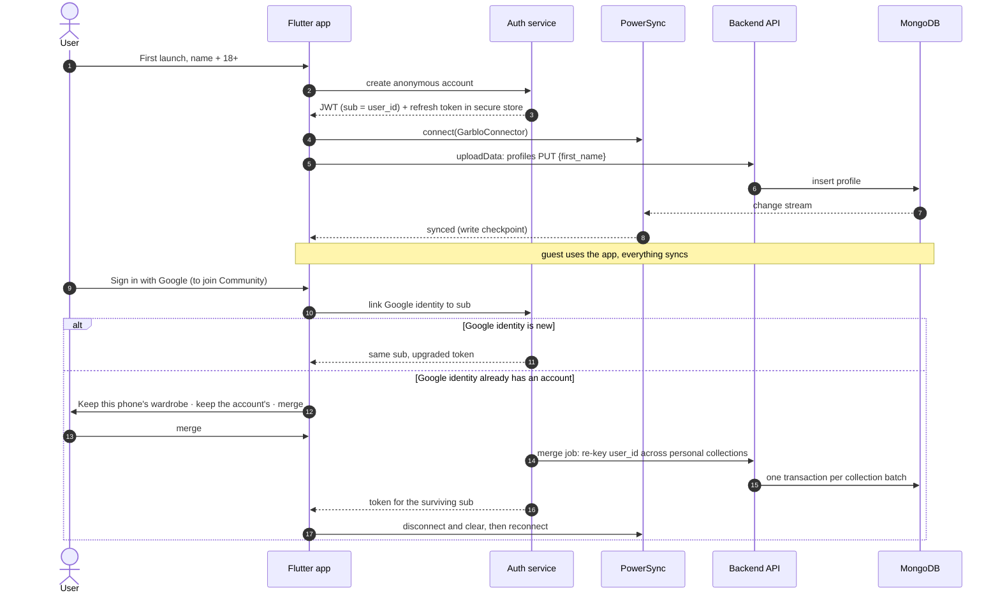

| Case | Behaviour |
| --- | --- |
| Reinstall | The refresh token survives in the iOS Keychain or Android Block Store, so the same anonymous account restores and re-syncs. If it was lost and the user never linked Google, the data can't be recovered (the privacy dashboard says so). |
| Inactive anonymous accounts | Deleted after 12 months without a sync (placeholder). Shown in "Where it lives". |
| Community | Still requires a Google-linked account (gap ①). The anonymous `sub` carries a claim `linked=false`, and the write handler checks it before applying any Community row. |

### What this changed elsewhere in the spec

| Where | Change |
| --- | --- |
| T2 invariants (v1) | "DB CHECK" and "trigger" became backend validators, `$jsonSchema` and server checks |
| T2 / T2+ notes | The ERDs are now **logical** models. Wear logs are embedded in wear events, and counters are derived. |
| T3 | The system context gained PowerSync. The sync model rows were rewritten. Guests sync automatically. |
| All data flows and sequences | Postgres became MongoDB. PowerSync delivers persisted data. Guest-payload paths were removed. |
| One-piece data flow (v2.8) | T2 API surfaces became sync contracts. Every UC data flow, sequence and API contract was redrawn as local write → upload → write handler → MongoDB → PowerSync. SSE, REST reads, the Community REST feed and the history API were removed. Object storage is RustFS. Budgets gained upload and round-trip targets; context and feed budgets now include replication. |
| Technical criteria | TAC-01.7, 01.8, 03.2, 03.4, 05.2, 06.5, 09.1 and 15.3 were reworded for MongoDB and anonymous accounts. T3 budgets gained PowerSync replication lag. |

UC-01 Flow A · screens 1a, 2a · archetype L1

## Add photos and give consent

The user drops in up to 10 photos of any kind, checks one consent box, and unlocks *Analyze with AI*. Nothing reaches an AI model until EXIF/GPS data is stripped and bystanders are blurred.

US-01.1**As a** new user **I want to** add a mix of garment, outfit and background photos without sorting them **so that** digitizing my wardrobe takes one step.

US-01.2**As a** privacy-conscious user **I want to** see what happens to my photos and agree before any AI runs **so that** I stay in control of images of my body.

US-01.3**As a** user who picked a wrong photo **I want to** remove just that one **so that** I don't have to pick the whole set again.

### Acceptance criteria

| ID | Given | When | Then |
| --- | --- | --- | --- |
| AC-01.1 | I open the Add tab with no draft batch | the screen loads | I see `STUDIO / 01`, "Add photos", the subcopy "Clothes, poses or backgrounds — mix them freely.", the dropzone "Tap to add photos" with "JPG, PNG · max 10 photos per batch", the consent box unchecked, and *Analyze with AI ›* disabled |
| AC-01.2 | the dropzone is visible | I tap it | the system photo picker opens, showing only JPEG and PNG, with a limit of 10 minus the photos already staged |
| AC-01.3 | I am in the picker | I confirm 3 photos | the tray shows "3 photos selected" and 3 thumbnails in the order I picked them (slots 1–3), each with × |
| AC-01.4 | 3 photos are staged | I tap × on slot 2 | only that photo is removed, the counter reads "2 photos selected", and the other thumbnails keep their order |
| AC-01.5 | 1 photo is staged | I remove it | the zone returns to the empty dropzone from AC-01.1 |
| AC-01.6 | at least 1 photo is staged | I check or uncheck consent | the CTA becomes enabled or disabled immediately (`enabled = 1 ≤ photos ≤ 10 AND consent`, I1) |
| AC-01.7 | consent is checked | the photo count drops to 0 | the CTA is disabled and consent stays checked |
| AC-01.8 | the CTA is enabled | I tap *Analyze with AI ›* | my consent is recorded with its version and time, the batch moves to SANITIZING, and the analysis sheet opens (UC-02) |
| AC-01.9 | a photo has been uploaded | any AI job is scheduled | the job reads only the sanitized copy. Sanitizing runs on the phone, so the raw file never leaves it, and the server re-checks every upload (I3, I5). |
| AC-01.10 | the privacy card is shown | — | it explains automatic metadata removal and bystander blurring, and shows the delete path "Avatar › Privacy & data" |

### User flow

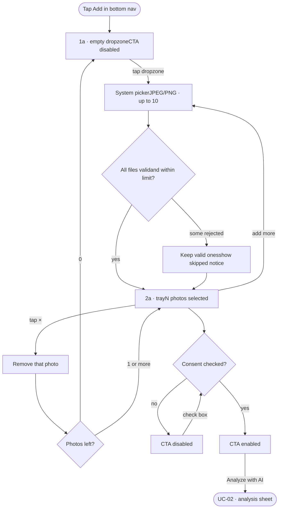

### Data flow · one-piece (PowerSync only)

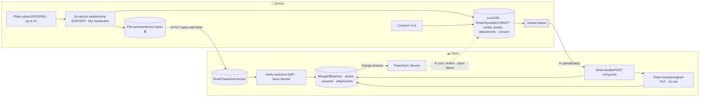

📱 phone · ☁ Garblo cloud · 🌐 external. Solid arrows are local writes and the upload queue (online, or queued offline); dotted arrows are PowerSync sync back to the phone. No REST or SSE (DB5). 🔒 personal · 🧍 body image.

### Sequence

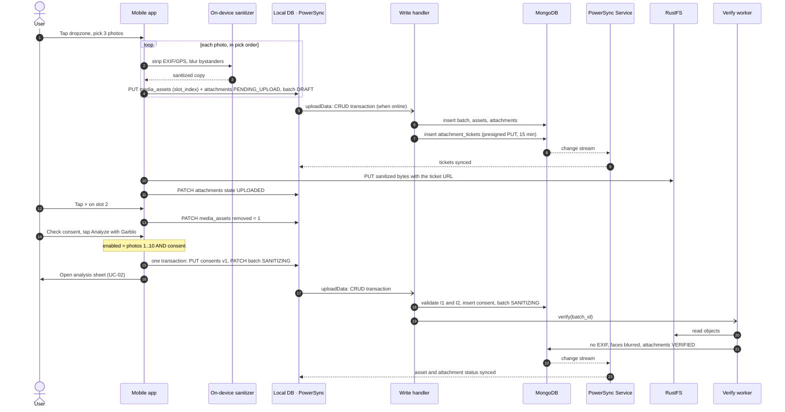

### Technical acceptance criteria

| ID | Category | Criterion | Verify by |
| --- | --- | --- | --- |
| TAC-01.1 | PERF | On-device sanitizing takes ≤ 1.5 s per photo p95 on the reference phone and runs off the UI thread. The tray stays interactive. | Device benchmark |
| TAC-01.2 | SEC | Raw originals never leave the phone. A traffic capture of the whole flow shows only sanitized images. | Traffic capture (E2E) |
| TAC-01.3 | SEC | The verify worker rejects any RustFS object that still has EXIF/GPS/maker notes (attachment REJECTED, object deleted) and flags any unblurred secondary face | Security test with fixture photos |
| TAC-01.4 | REL | Replaying the same CRUD transaction (same `tx_id`) creates no second consent or batch transition | Integration test |
| TAC-01.5 | REL | Photo bytes go straight to RustFS with a presigned PUT ticket (multipart above 5 MB), retried with backoff up to 5 times. An expired ticket is reissued through sync. Objects with no VERIFIED attachment are removed after 24 h. | Integration · chaos test |
| TAC-01.6 | OFF | Picking, removing, consenting and Analyze work offline: they are local writes that wait in the upload queue and survive an app kill. The status line reads "OFFLINE · ANALYSIS STARTS WHEN ONLINE". | E2E, network off + app kill |
| TAC-01.7 | DATA | 1 ≤ image_count ≤ 10 and MIME ∈ {jpeg, png} are enforced by the write handler and by MongoDB `$jsonSchema` validators (I1, I2) | Contract + validator test |
| TAC-01.8 | SEC | Consent rows are insert-only (version, timestamp, scope). Withdrawal is a new row; nothing is updated in place. | Write-handler test |
| TAC-01.9 | OBS | Events `photo_picked{n}`, `photo_rejected{reason}`, `consent_checked`, `analyze_tapped{n}`, with no image content or file names | Analytics contract test |

### Empty, loading and error states EXTRA

| State | Trigger | UI |
| --- | --- | --- |
| Uploading | Pre-upload in progress | Thumbnail shows a progress ring. The CTA can still enable, and submit waits for uploads to finish. |
| Upload failed | Network error on one photo | Tile shows "Didn't upload · Retry". Failed tiles don't count toward the gate. |
| File rejected | HEIC, GIF or video picked from the gallery | Notice: "Only JPG and PNG are supported. 1 file was skipped." |
| Over limit | More than 10 photos picked | The first photos up to 10 are kept. Notice: "You can add up to 10 photos per batch. 2 weren't added." |
| Full | 10 photos staged | The add target hides and the counter reads "10 photos selected · maximum reached" |
| Offline | No connection | Photos stay staged on the device. Analyze still works: it is saved locally and waits in the upload queue, and the status line reads "OFFLINE · ANALYSIS STARTS WHEN ONLINE". |
| Sanitizing failed | Worker error | The sheet's OK shows "Preparing photos failed · Try again". Nothing is sent to AI. |

### Sync contract EXTRA

#### Phone writes · local DB → upload queue

```
// one CRUD transaction, sent by uploadData()
PUT   consents       { id, user_id, version: "v1.0_studio_body_ai",
                       includes_body: 1, granted_at }
PATCH upload_batches { id, status: "SANITIZING", consent_id,
                       ambient_temp_c: 29 }
PATCH attachments    { id, state: "UPLOADED" }   // after the RustFS PUT
```

#### Server writes · synced back by PowerSync

```
attachment_tickets { attachment_id, op: "PUT", url, expires_at }
media_assets       { exif_gps_stripped: 1, bystanders_blurred: 1 }
attachments        { state: "VERIFIED" | "REJECTED" }
// refused (4xx): photos outside 1..10 or no consent
// → sync_rejections + notification "Couldn't analyze · Fix";
//   the next sync puts the batch back to DRAFT
```

UC-02 Flow A · screen 3a · archetype L2

## Choose what the AI analyzes

A bottom sheet asks which analyses to run. Outfit is on by default. Each checked option creates one AI job per photo, so 3 photos with only Outfit checked means 3 jobs. Pose and background jobs skip photos with no person in them.

US-02.1**As a** user **I want to** confirm which analyses run on my photos, with a sensible default **so that** I can just tap OK for ordinary garment photos.

US-02.2**As a** user **I want** pose and background analysis to stay off unless I ask for them **so that** body-related processing only happens when I choose it.

US-02.3**As a** user who notices a wrong photo at this point **I want to** go back to my selection **so that** I can fix it without starting over.

### Acceptance criteria

| ID | Given | When | Then |
| --- | --- | --- | --- |
| AC-02.1 | I tapped *Analyze with AI* (AC-01.8) | the sheet opens | the 2a screen stays visible, dimmed and blurred, behind a sheet with a grabber and the title "What should we analyze in these photos?" |
| AC-02.2 | the sheet is open | — | my staged photos appear as a read-only strip in the same order, with no × buttons |
| AC-02.3 | the sheet is open | — | "Outfit analysis · Separate clothes and read attributes" is checked. "Pose analysis" and "Background analysis" are unchecked, and each shows "Only when a person is in the photo". |
| AC-02.4 | all three options are unchecked | — | OK is disabled (I4) |
| AC-02.5 | the sheet is open | I tap *Reselect photos*, swipe the sheet down or tap the scrim | the sheet closes, the 2a tray is editable again with × buttons, consent stays checked, and the batch returns to DRAFT |
| AC-02.6 | at least one option is checked | I tap OK | the selection is saved on the batch, one job is created per photo × checked task, the batch moves to QUEUED_FOR_AI, and the app shows analysis progress |
| AC-02.7 | Pose or Background is checked and a photo has no person | its job runs | that job ends as `SKIPPED_NO_PERSON` and the batch does not fail |
| AC-02.8 | every job has finished or been skipped and at least one outfit job succeeded | — | the batch moves to AWAITING_REVIEW and the app opens "AI reads photos" (UC-03) |

### User flow

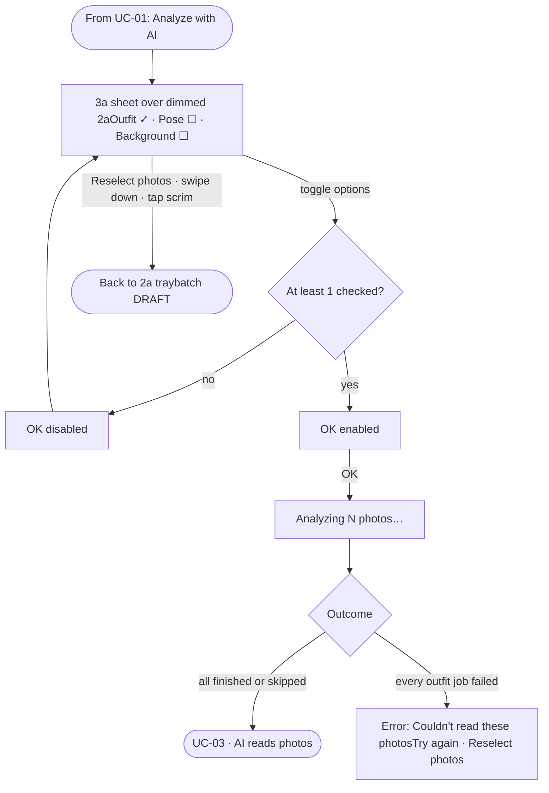

### Data flow · one-piece (PowerSync only)

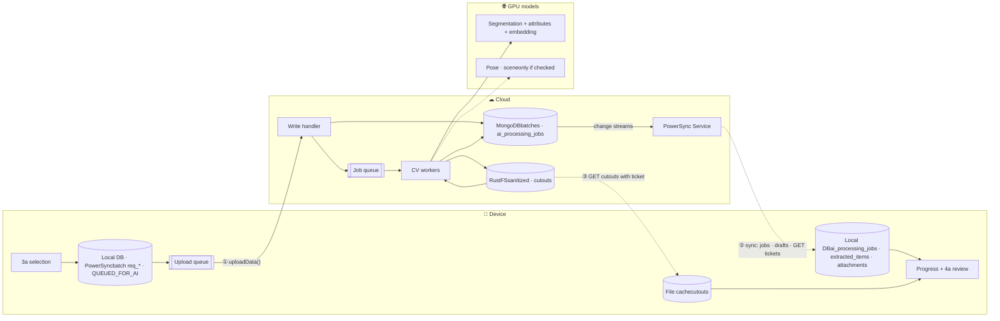

📱 phone · ☁ Garblo cloud · 🌐 external. Solid arrows are local writes and the upload queue (online, or queued offline); dotted arrows are PowerSync sync back to the phone. No REST or SSE (DB5). 🔒 personal · 🧍 body image.

### Sequence

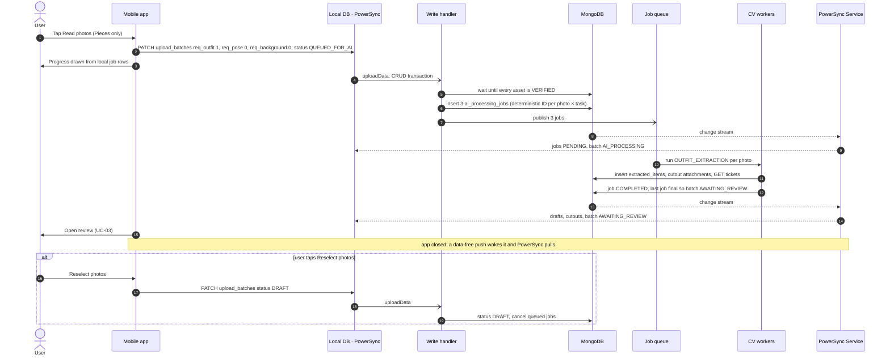

### Technical acceptance criteria

| ID | Category | Criterion | Verify by |
| --- | --- | --- | --- |
| TAC-02.1 | PERF | Outfit extraction takes ≤ 8 s per photo p95, and ≤ 30 s p95 for a 10-photo batch (photos run in parallel) | Load test |
| TAC-02.2 | PERF | Pose and background models are never called when unchecked. GPU seconds are recorded per job. | Unit + cost dashboard |
| TAC-02.3 | REL | At most one job exists per (batch, photo, task), enforced by a deterministic job ID (hash of batch, photo, task) and a MongoDB unique index. Re-enqueueing is a no-op. | Integration test |
| TAC-02.4 | REL | A failed job retries up to 2 times with backoff, then ends FAILED. Other jobs continue and a partial result is delivered. | Chaos test |
| TAC-02.5 | DATA | The batch moves to AWAITING_REVIEW only when every job is in a final state. The state-machine table rejects skipped transitions. | Unit test |
| TAC-02.6 | OFF | Progress comes only from synced job and batch rows; there is no event stream. If the app is closed, a data-free push wakes it and PowerSync pulls the drafts. A dropped connection resumes from the last sync checkpoint, with nothing lost or shown twice. | E2E |
| TAC-02.7 | SEC | Workers can read only the RustFS sanitized bucket; bucket policies deny every other bucket. Model calls carry no user ID. | Policy review · security test |
| TAC-02.8 | OBS | Per-job metrics: queue wait, run time, model version, confidence histogram. An alert fires when p95 exceeds budget for 15 minutes. | Dashboard review |

### States EXTRA

| State | Trigger | UI |
| --- | --- | --- |
| Still preparing | OK tapped while sanitizing is still running | OK shows a spinner labelled "Preparing photos…" and the sheet stays open |
| Analyzing | QUEUED_FOR_AI or AI_PROCESSING | Full-screen progress "Analyzing 3 photos…" with a per-photo tick. The user can leave, and a notification fires when results are ready. |
| Partial result | Some outfit jobs failed | Review opens with the items that succeeded and a note: "1 photo couldn't be read" |
| All failed | No outfit job succeeded | "Couldn't read these photos." with *Try again* and *Reselect photos*. The batch is FAILED. |
| Skipped | Pose or background requested on a photo with no person | Shown in review as "Pose skipped · no person in photo" |

### Sync contract EXTRA

#### Phone writes · local DB → upload queue

```
PATCH upload_batches { id,
  req_outfit: 1, req_pose: 0, req_background: 0,
  status: "QUEUED_FOR_AI" }
// Reselect photos:
PATCH upload_batches { id, status: "DRAFT" }
```

#### Server writes · synced back by PowerSync

```
ai_processing_jobs { batch_id, asset_id, task_type, status }
upload_batches     { status: "AI_PROCESSING" → "AWAITING_REVIEW" | "FAILED" }
extracted_items    { item_index, name, confidence, ai, value,
                     cutout_attachment_id }
// refused (4xx) if all three req_* are 0
```

UC-03 Flow A · screen 4a · archetype L3

## Review AI results and save to wardrobe

The AI proposes items, the user corrects them, and one tap saves them all. Each item shows its confidence so the user knows where to look closely. Save writes every confirmed item in one transaction and opens the Wardrobe.

US-03.1**As a** user **I want to** see what the AI found in my photos and how sure it is **so that** I know which items to double-check.

US-03.2**As a** user **I want to** correct a wrong type, colour, material or style with a tap **so that** my wardrobe data is accurate before it is saved.

US-03.3**As a** user **I want to** save every reviewed item at once **so that** I can see them in my wardrobe straight away.

**C3 applied.** Review adds an optional "Last worn" field, because clothes digitized today may have sat unworn for weeks. That is how the violet shirt in 3b can be "unworn for 41 days" on the day it is added.

**C2 applied.** The banner is computed for the whole batch. The design's "From 1 photo, AI extracted 3 items" becomes "From 3 photos, AI found 3 items" for this example. A single outfit photo would still read "From 1 photo, AI found 3 items".

### Acceptance criteria

| ID | Given | When | Then |
| --- | --- | --- | --- |
| AC-03.1 | the batch is AWAITING_REVIEW | "AI reads photos" opens | the header shows ‹ back, the title and the bell. The banner shows the source photo thumbnails labelled `ORIGINAL PHOTO`, "From {P} photos, AI found {N} items" and "Check and edit before saving". |
| AC-03.2 | N items were found | — | item 1 is expanded: background-removed cutout, "ITEM 1/N", name ("Violet shirt"), confidence ("94% confidence"), and four editable fields: Type, Color, Material, Style, each with ›. Below them is an optional **Last worn** field (C3). |
| AC-03.3 | items exist | — | items are ordered by photo slot, then by position within the photo. The others appear as collapsed cards ("ITEM 2/3 · 91% confidence · Wide-leg trousers ›") with the next one peeking. |
| AC-03.4 | a collapsed card is shown | I tap it | it expands and the previous item collapses. My edits on the previous item are kept. |
| AC-03.5 | an item is expanded | I tap Type | a picker lists item types grouped by Tops, Bottoms, Shoes, Bags, Hats and Accessories (C4, P6). Choosing one updates the field, and the item's group follows the new type. |
| AC-03.6 | an item is expanded | I tap Color, Material or Style | a picker opens with the AI suggestion first and a custom entry option. The change is saved to the draft and marks it `user_modified`. The confidence shown stays as the AI's score. |
| AC-03.7 | N items are ready | — | the sticky CTA reads "Save N items to wardrobe" and stays visible while scrolling |
| AC-03.8 | I tap Save | the save succeeds | all N items are inserted into the wardrobe in one transaction, the batch becomes COMPLETED, and the app switches to the Wardrobe tab. The new items appear first and the count goes up by N. |
| AC-03.9 | the save fails | — | no item is saved (all or nothing), my edits are kept, and an error with *Try again* is shown |
| AC-03.11 | an item is expanded | I tap Last worn (default "Don't remember") | I can pick This week, This month, 1–3 months ago, Over 3 months ago, or an exact date. On save it becomes the item's `last_worn_at` (marked as an estimate), so the Wardrobe can show dormancy right away. |
| AC-03.10 | I am reviewing | I tap ‹ back | I leave review without saving. The batch stays AWAITING_REVIEW and my draft edits are kept. |

### User flow

```mermaid
flowchart TD
  in(["From UC-02: batch AWAITING_REVIEW"]) --> rv["4a · banner + ITEM 1/N expanded"]
  rv --> chk{"Item correct?"}
  chk -->|"no"| ed["Tap attribute ›pick or type a value"] --> chk
  chk -->|"yes"| more{"More items?"}
  more -->|"yes"| nx["Tap next collapsed card"] --> rv
  more -->|"no"| save["Save N items to wardrobe"]
  save --> ok{"Saved?"}
  ok -->|"yes"| wd(["UC-04 · Wardrobe, new items first"])
  ok -->|"no"| er["Error · Try againedits kept"] --> save
  rv -->|"‹ back"| leave(["Leave · batch staysAWAITING_REVIEW"])
  
```

### Data flow · one-piece (PowerSync only)

```mermaid
flowchart LR
  subgraph DEV["📱 Device"]
    dr[("Local DBextracted_items, synced")] --> rv["4a review"]
    rv -->|"edit: PATCH value.*"| dr
    rv -->|"Index: one local transaction"| wi[("Local DBwardrobe_items PUT ×N · batch COMPLETED")]
    dr & wi --> uq[["Upload queue"]]
    cc[("File cachecutouts")] --> rv
  end
  subgraph CLD["☁ Cloud"]
    wh["Write handlerone MongoDB transaction"] --> mg[("MongoDBwardrobe_items · batch COMPLETED")]
    wh -.-> emb["Embedding worker"] --> mg
    mg --> ret["Retention jobdrafts 7 days after COMPLETED"]
    mg -->|"change streams"| pss["PowerSync Service"]
  end
  uq -->|"① uploadData()"| wh
  pss -.->|"② sync: items + embeddings (my_wardrobe)"| wi
  
```

📱 phone · ☁ Garblo cloud · 🌐 external. Solid arrows are local writes and the upload queue (online, or queued offline); dotted arrows are PowerSync sync back to the phone. No REST or SSE (DB5). 🔒 personal · 🧍 body image.

### Sequence

```mermaid
sequenceDiagram
  autonumber
  actor U as User
  participant App as Mobile app
  participant L as Local DB · PowerSync
  participant WH as Write handler
  participant MG as MongoDB
  participant E as Embedding worker
  participant PS as PowerSync Service
  App->>L: watch extracted_items of the batch, by slot and item_index
  L-->>App: banner (3 photos, 3 Pieces) + rows
  App->>U: Show PIECE 1/3 Violet shirt, 94%
  U->>App: Tap Material, choose Linen
  App->>L: PATCH extracted_items value.material = Linen
  U->>App: Review PIECE 2/3, then Index 3 Pieces
  App->>L: one transaction: PUT 3 wardrobe_items, PATCH batch COMPLETED
  App->>U: Switch to Archive (UC-04)
  L-)WH: uploadData: the edit, then the save transaction
  activate WH
  WH->>MG: BEGIN, insert 3 items with phone IDs, batch COMPLETED, COMMIT
  deactivate WH
  WH-)E: compute embeddings for 3 items
  E->>MG: write item_embeddings
  MG-->>PS: change stream
  PS-->>L: items confirmed + embeddings (write checkpoint)
  
```

### Technical acceptance criteria

| ID | Category | Criterion | Verify by |
| --- | --- | --- | --- |
| TAC-03.1 | PERF | Review renders from the local DB in ≤ 300 ms. Attribute edits show in ≤ 100 ms. | Device benchmark |
| TAC-03.2 | REL | Save is atomic: all N items or none, both locally (one SQLite write transaction, uploaded as one CRUD transaction) and on the server (one MongoDB multi-document transaction per CRUD transaction). A replay never duplicates items (deterministic item IDs, `tx_id`). | Integration test |
| TAC-03.3 | OFF | Once drafts are downloaded, review and save work fully offline. Items appear on 5a at once, and the upload queue sends the save later. | E2E, network off |
| TAC-03.4 | SEC | Draft rows are deleted 7 days after the batch is COMPLETED (placeholder) and leave the phone when the batch closes (my_studio stream). Sanitized photos and cutouts stay with the account until the item or the account is deleted. | Retention job test |
| TAC-03.5 | DATA | The AI's original values are kept beside each edit, field by field. `user_modified` is true only if a value differs. | Unit test |
| TAC-03.6 | DATA | `type_code` must exist in `item_types`. The group is derived from it, never stored separately. | Contract test |
| TAC-03.7 | PERF | Cutouts are WebP ≤ 300 KB, cached on the phone, and fetched from RustFS with presigned GET tickets that expire after 1 h and are renewed through sync | Payload test |
| TAC-03.8 | OBS | Events `review_opened`, `attribute_edited{field, confidence_bucket}`, `items_saved{n, edited}` | Analytics contract test |

### States EXTRA

| State | Trigger | UI |
| --- | --- | --- |
| Low confidence | Confidence under the review threshold (placeholder 0.80) | The confidence badge uses the warning colour and the card is listed first among the collapsed cards |
| Not clothing | The user says the AI detected something that isn't a garment | "Remove this item" link on the expanded card. The CTA count drops by one, and at 0 the CTA reads "Nothing to save". |
| Zero items | Outfit jobs succeeded but found nothing | "We couldn't find clothes in these photos." with *Add other photos* |
| Resumable | Left review before saving | The Add tab shows a banner "3 items waiting for review › Review" |
| Saving | Commit in flight | The CTA shows a spinner and attribute fields are locked |

### Sync contract EXTRA

#### Phone writes · local DB → upload queue

```
PATCH extracted_items { id, value: { "material": "Linen" },
                        last_worn_input: { "bucket": "MONTH" } }
// Index 3 Pieces = one CRUD transaction:
PUT   wardrobe_items ×3 { id: hash(draft id), user_id, name,
        type_code, color, material, style_tag, source_asset_id,
        cutout_attachment_id, last_worn_estimate, archived: 0 }
PATCH upload_batches    { id, status: "COMPLETED" }
```

#### Server writes · synced back by PowerSync

```
item_embeddings ×3      { item_id, vector_int8_128 }
extracted_items         // leave the phone when the batch closes,
                        // deleted on the server after 7 days
// refused (4xx): batch not AWAITING_REVIEW or unknown type_code
// → the whole transaction is refused, nothing is inserted
```

UC-04 Flow A · screen 5a · archetype L4

## Browse the wardrobe

The Wardrobe is the output of Flow A and the input to Flow B. It shows a total count, filters by group, and flags any item unworn for 30 days or more. A floating button leads to styling.

US-04.1**As a** user **I want to** see my whole collection and how many items it holds **so that** I know what I own.

US-04.2**As a** user **I want to** filter by tops, bottoms, shoes, bags or hats **so that** I can find an item quickly.

US-04.3**As a** user trying to wear what I own **I want to** see which items I haven't worn in a long time **so that** I wear them again instead of buying more.

US-04.4**As a** user **I want to** go from my wardrobe straight to styling a look **so that** I can act on what I see.

**C3 applied.** Dormancy counts from `last_worn_at`, which the user can set during review in 4a ("Last worn"), or from the save date when it is unknown. An old garment digitized today can therefore show "41 DAYS UNWORN" at once.

### Acceptance criteria

| ID | Given | When | Then |
| --- | --- | --- | --- |
| AC-04.1 | I saved items in UC-03, or I tapped the Wardrobe tab | the screen opens | I see `YOUR COLLECTION`, "Wardrobe" with the total ("12 items"), and my avatar initial. The Wardrobe tab is active. |
| AC-04.2 | the screen is open | — | chips read All, Tops, Bottoms, Shoes, Bags, Hats, Accessories (P6). *All* is active, and exactly one chip is active at a time. |
| AC-04.3 | All is active | I tap Tops | the grid shows only items whose type belongs to TOPS, without reloading the page. The header total stays at the full count. |
| AC-04.4 | items exist | — | the 2-column grid lists items newest first. Each card shows the cutout or a placeholder icon, the name, and "{Group} · {Style}" (e.g. "Tops · Basic"). |
| AC-04.5 | an item's `days_unworn = today − (last_worn_at, or created_at if never worn)` is 30 or more | its card renders | it shows the badge "{d} DAYS UNWORN" (I8). Under 30 days, no badge is shown. |
| AC-04.6 | I just saved items with "Last worn" set in 4a | the Wardrobe opens | their badges use that date (C3) |
| AC-04.7 | I scroll | more than 20 items exist | the next page loads by cursor, 20 at a time. The ✨ *Style a new look* button stays fixed above the nav. |
| AC-04.8 | the screen is open | I tap ✨ Style a new look | the Gu Match tab opens at the styling studio (UC-05) |
| AC-04.9 | the total is N | I open Gu Match | it shows "N items ready to style" (I9) |

### User flow

```mermaid
flowchart TD
  a(["Save in UC-03"]) --> g
  b(["Tap Wardrobe tab"]) --> g["5a · All · newest first"]
  g -->|"tap chip"| f["Filtered gridone group"] -->|"tap All"| g
  g -->|"scroll"| p["Load next 20"] --> g
  g --> d{"Item unworn30 days or more?"}
  d -->|"yes"| bd["Show {d} DAYS UNWORN"]
  d -->|"no"| nb["No badge"]
  g -->|"✨ Style a new look"| gm(["UC-05 · Gu Match"])
  
```

### Data flow · one-piece (PowerSync only)

```mermaid
flowchart LR
  subgraph DEV["📱 Device"]
    wi[("Local DB · PowerSyncwardrobe_items · wear_events")] --> qy["Grid querygroup · cursor · count"]
    rl["Shared rules libdays_unworn, dormancy ≥ 30"] --> qy
    qy --> ui["5a grid"]
    ic[("Image cache")] --> ui
    qy -->|"same count"| gm["1b ready count"]
    tk[("Local DBattachment_tickets")] --> ic
  end
  subgraph CLD["☁ Cloud"]
    mg[("MongoDB")] -->|"change streams"| pss["PowerSync Service"]
    rfs[("RustFScutouts")]
  end
  pss -.->|"other devices' changes · renewed tickets"| wi
  rfs -.->|"cache miss: GET with ticket"| ic
  
```

📱 phone · ☁ Garblo cloud · 🌐 external. Solid arrows are local writes and the upload queue (online, or queued offline); dotted arrows are PowerSync sync back to the phone. No REST or SSE (DB5). 🔒 personal · 🧍 body image.

### Sequence

```mermaid
sequenceDiagram
  autonumber
  actor U as User
  participant App as Mobile app
  participant L as Local DB · PowerSync
  participant FS as RustFS
  App->>L: watch items (group ALL, limit 20) + days_unworn + COUNT
  L-->>App: total 12, first 20 rows
  App->>FS: GET cutouts with presigned tickets (lazy, cache misses only)
  App->>U: Grid with placeholders, then images
  U->>App: Tap Tops
  App->>L: same query, group TOPS
  L-->>App: filtered rows, total 12
  Note over L: a change from another device arrives by sync and the watch emits again
  U->>App: Tap Draft a Fit
  App->>U: Open Gu Match studio (UC-05)
  
```

### Technical acceptance criteria

| ID | Category | Criterion | Verify by |
| --- | --- | --- | --- |
| TAC-04.1 | PERF | First paint of the grid takes ≤ 300 ms from the local DB with 500 items. Scrolling holds 60 fps and images load lazily. | Device benchmark |
| TAC-04.2 | DATA | `days_unworn` uses the phone's local date and timezone, and matches the server's value for the same date (shared rules library) | Golden fixtures |
| TAC-04.3 | OFF | Works fully offline. The 5a total and the 1b "ready to style" count come from the same local query (I9). | E2E |
| TAC-04.4 | OFF | Signed in on two phones: a change on one appears on the other ≤ 10 s after it comes to the foreground | Integration test |
| TAC-04.5 | DATA | Archived items are excluded from counts, chips and Gu Match. The chips come from `item_group`, including ACCESSORIES. | Unit test |
| TAC-04.6 | SEC | Image URLs are presigned RustFS GET tickets that expire after 1 h. The local image cache relies on OS file protection. | Security review |
| TAC-04.7 | OBS | Events `wardrobe_viewed{size_bucket}`, `chip_selected{group}`, `dormancy_badge_shown{n}` | Analytics contract test |

### States EXTRA

| State | Trigger | UI |
| --- | --- | --- |
| Empty wardrobe | 0 items | "Your wardrobe is empty" with *Add photos*. The FAB is hidden. |
| Empty group | A chip with 0 items | "No bags yet" with *Add photos* |
| Image loading or missing | Cutout loading, or a manual item with no photo | Grey placeholder with a photo icon (as on 5a) |
| Load error | Network failure | Cached grid is shown with "Couldn't refresh · Retry" |

### View model · built from local rows EXTRA

```
// local query on wardrobe_items + wear_events (my_wardrobe); no API call
{
  "meta": { "total": 12, "active_group": "ALL",
            "groups": ["ALL","TOPS","BOTTOMS","SHOES","BAGS","HATS","ACCESSORIES"] },
  "items": [
    { "item_id": "i9", "name": "White T-shirt", "subtitle": "Tops · Basic",
      "image_url": null, "days_unworn": 41, "dormancy_badge": "41 DAYS UNWORN" },
    { "item_id": "i8", "name": "Short-sleeve shirt", "subtitle": "Tops · Everyday",
      "image": "attachment://att_i8 (file cache, RustFS ticket on a miss)", "days_unworn": 5, "dormancy_badge": null }
  ],
  "next_cursor": null
}
```

UC-05 Flow B · screen 1b · archetype L5

## Set the styling context

The user describes the day with any number of occasion chips plus free text, or leaves both empty and lets Garblo read the calendar. Either way, Garblo styles only from the clothes the user already owns.

US-05.1**As a** user **I want to** tap the occasions that describe my day **so that** I don't have to type.

US-05.2**As a** user **I want to** add details in my own words **so that** the looks fit who I'm meeting, the weather and the vibe I want.

US-05.3**As a** busy user **I want to** start without entering anything **so that** Garblo works out my day from my calendar and location.

US-05.4**As a** user who cares about sustainability **I want to** know suggestions only use clothes I own **so that** I'm never pushed to buy more.

**C10 and C1 applied.** Chips are multi-select (0–5). With at least one chip or any text, the session is **prompt-led**. With neither, it is **zero-input**, and the agent takes the occasion from the calendar. UC-06 covers both paths.

### Acceptance criteria

| ID | Given | When | Then |
| --- | --- | --- | --- |
| AC-05.1 | I tap the Gu Match tab, or ✨ in the Wardrobe | the studio opens | I see the ✨ icon, `AI STYLING STUDIO`, "What do you want to wear today?" and "Pick a context so garblo styles from exactly the items you own." |
| AC-05.2 | the studio opens fresh | — | chips Work, Coffee, Afternoon rain, Date and Weekend outing are all unselected, and the prompt box `TELL GARBLO MORE` is empty |
| AC-05.3 | chips are shown | I tap Coffee, then Afternoon rain | both are selected (accent fill). Tapping a selected chip unselects it (C10). |
| AC-05.4 | the prompt box is focused | I type "coffee with friends, light rain, want to look energetic" | the text is kept, up to 280 characters (placeholder limit) |
| AC-05.5 | I own N non-archived items | — | the assurance block shows a badge "N", "items ready to style" and "No suggestions to buy more." N matches the Wardrobe total (I9). |
| AC-05.6 | N = 0 | — | *Start swiping* is disabled and the block reads "Add clothes to your wardrobe first › Add" |
| AC-05.7 | N ≥ 1 and I selected chips or typed text | I tap *Start swiping ›* | a session is created with path `PROMPT_LED`, my occasions, my text, the current temperature and N, with owned-only set to true. Context analysis opens (UC-06). |
| AC-05.8 | N ≥ 1, no chip and no text | I tap *Start swiping ›* | a session is created with path `ZERO_INPUT`. If calendar or location permission is missing, I am asked once, and the flow continues even if I decline. |
| AC-05.9 | I came back from 3b with *Change context* | the studio opens | my previous chips and text are pre-filled |

### User flow

```mermaid
flowchart TD
  s1(["Gu Match tab"]) --> st
  s2(["✨ Style a new look (5a)"]) --> st
  s3(["Change context (3b)"]) -->|"pre-filled"| st
  st["1b · studio"] --> n{"Items ready N ≥ 1?"}
  n -->|"no"| add["CTA disabledAdd clothes first ›"] --> a1(["UC-01"])
  n -->|"yes"| in["Toggle any chips · type optional text"]
  in -->|"Start swiping"| p{"Any chip or text?"}
  p -->|"yes"| pl["Path PROMPT_LED"]
  p -->|"no"| zi["Path ZERO_INPUT"]
  zi --> perm{"Calendar + locationpermission?"}
  perm -->|"ask once"| go
  perm -->|"granted"| go
  pl --> go(["UC-06 · context analysis"])
  
```

### Data flow · one-piece (PowerSync only)

```mermaid
flowchart LR
  subgraph DEV["📱 Device"]
    ch["Chips + prompt"] --> dft[("Local-onlysession_draft")]
    wi[("Local DBeligible items")] --> cnt["Ready count"]
    cal["Calendar · locationread on the phone"] --> der["Derived contextevent title · window · city"]
    dft & der --> req["Draft Fits"]
    req -->|"PUT gu_match_sessions REQUESTED"| ldb[("Local DB · PowerSync")]
    ldb --> uq[["Upload queue"]]
  end
  subgraph CLD["☁ Cloud"]
    wh["Write handlereligible count ≥ 1"] --> ses[("MongoDBgu_match_sessions")]
    wh --> scr["PII scrubber"] --> ag["Agent orchestrator"]
    ses -->|"change streams"| pss["PowerSync Service"]
  end
  uq -->|"① uploadData()"| wh
  pss -.->|"② sync: session status (my_decks)"| ldb
  
```

📱 phone · ☁ Garblo cloud · 🌐 external. Solid arrows are local writes and the upload queue (online, or queued offline); dotted arrows are PowerSync sync back to the phone. No REST or SSE (DB5). 🔒 personal · 🧍 body image.

### Sequence

```mermaid
sequenceDiagram
  autonumber
  actor U as User
  participant App as Mobile app
  participant L as Local DB · PowerSync
  participant WH as Write handler
  participant MG as MongoDB
  participant AG as Agent orchestrator
  participant PS as PowerSync Service
  App->>L: COUNT non-archived items
  L-->>App: 12
  App->>U: 12 PIECES READY
  U->>App: Tap Coffee, type a prompt
  U->>App: Tap Draft Fits
  App->>App: path = chips or text ? PROMPT_LED : ZERO_INPUT
  App->>L: PUT gu_match_sessions (path, occasions, raw_prompt, derived context, ambient_temp_c 29, status REQUESTED)
  App->>U: Open context analysis (UC-06), DRAFTING
  L-)WH: uploadData: CRUD transaction
  WH->>MG: count eligible items (must be ≥ 1)
  WH->>MG: insert session (owned_only), status GATHERING
  WH-)AG: start(session_id)
  MG-->>PS: change stream
  PS-->>L: session status GATHERING
  
```

### Technical acceptance criteria

| ID | Category | Criterion | Verify by |
| --- | --- | --- | --- |
| TAC-05.1 | PERF | The session row is written locally in ≤ 100 ms and the app moves to 2b at once. The server applies it ≤ 500 ms p95 after upload, and 2b fills in as synced rows arrive. | Load test |
| TAC-05.2 | SEC | The server builds the deck from the user's synced wardrobe in MongoDB, for anonymous and Google-linked accounts alike. The session row carries no item data or images. | Contract + retention test |
| TAC-05.3 | SEC | Calendar and precise location are read on the phone. Only event title, time window and a city-level location are sent. | Traffic capture |
| TAC-05.4 | SEC | Emails, phone numbers and names are scrubbed from the prompt before any LLM call | Unit test with fixtures |
| TAC-05.5 | DATA | The server enforces: eligible count > 0 (status NO_ELIGIBLE_ITEMS), occasions within the enum and at most 5, prompt ≤ 280 characters | Contract test |
| TAC-05.6 | REL | A double tap on Draft Fits creates one session: the phone generates the session ID once per tap, and a replay is a no-op | Integration test |
| TAC-05.7 | OFF | Offline, the CTA reads "Connect to start", no session row is written, and the chips and text stay in the local-only draft | E2E, network off |
| TAC-05.8 | OBS | Event `session_started{path, occasions_n, prompt_len_bucket}`, with no prompt text | Analytics contract test |

### States EXTRA

| State | Trigger | UI |
| --- | --- | --- |
| Too few items to style | N ≥ 1 but no complete look is possible (for example only tops) | Allowed. The deck explains what is missing ("Add a pair of shoes to unlock more looks"), with no shopping links. |
| Prompt too long | More than 280 characters | Counter turns to the warning colour and input stops |
| Offline | No connection | CTA reads "Connect to start" |

### Sync contract EXTRA

#### Phone writes · local DB → upload queue

```
PUT gu_match_sessions {
  id, user_id, path: "PROMPT_LED", occasions: ["COFFEE"],
  raw_prompt: "coffee with friends, light rain, want to look energetic",
  event_title, window_start, window_end, city_id,
  ambient_temp_c: 29, status: "REQUESTED" }
```

#### Server writes · synced back by PowerSync

```
gu_match_sessions {
  status: "GATHERING" → "ANALYZED" → "DECK_READY",
  eligible_item_count: 12, deck_size: 8, owned_only: 1,
  context: { event, weather, rain, commute } }
// no eligible items: status "NO_ELIGIBLE_ITEMS" (no error code)
```

UC-06 Flow B · screen 2b · archetype L6

## Agent gathers today's context

While the user waits, the agent fetches calendar, weather, location and commute habits, and shows each card as it arrives. It turns them into hard rules (rain, walking) and soft preferences (dress code), builds the deck, and moves on to swiping by itself.

US-06.1**As a** user **I want** Garblo to read my day for me **so that** I don't fill in a form about events and weather.

US-06.2**As a** user **I want to** see what the suggestions are based on **so that** I trust them, or notice when something is wrong.

US-06.3**As a** user waiting for results **I want to** see progress as it happens **so that** the wait doesn't feel stuck.

**C1 and C7 applied.** The 2b design shows the **zero-input** path: the occasion comes from the calendar (Hackathon Pitching Day, Tokyo). The prompt-led path from the 1b example shows a "Your request" card first and uses the current location (29°). Cards are revealed one by one. The title changes from "Analyzing your context…" to "Your context is analyzed" only when every card is in.

### Path comparison

| Card (order) | Zero-input path · 2b design | Prompt-led path · 1b example |
| --- | --- | --- |
| 1 · Occasion | **Today's event** from calendar: Hackathon Pitching Day · 09:00–18:00 · Tokyo, Japan | **Your request**: Coffee · "coffee with friends, light rain, want to look energetic". A calendar event is added only if one exists today. |
| 2 · Weather | Event location and hours only: 16–19 °C · Mostly cloudy with sunny spells · 10:00 Cloudy 17° · 13:00 Rain 80% · 16:00 Cloudy 16° | Current location, next 9 hours: around 29 °C, with hourly rows |
| 3 · Chance of rain | 80% · around 13:00 | Peak probability and time from the same forecast, with light rain also read from the prompt |
| 4 · Commute | Walking + train · between stations and on foot to the venue | Inferred from habits (for example motorbike) |
| Rules derived | Layering · water-resistant preferred · walkable shoes only · smart-casual for pitching | Breathable fabrics · darker colours for rain · casual "energetic" styles |

### Acceptance criteria

| ID | Given | When | Then |
| --- | --- | --- | --- |
| AC-06.1 | a session started (UC-05) | 2b opens | the agent banner reads "I'm gathering information to suggest the best outfit for you…", the title reads "Analyzing your context…", and four card skeletons are shown in order |
| AC-06.2 | a source returns | — | its card replaces its skeleton straight away, without waiting for the others. Cards keep their fixed order. |
| AC-06.3 | path is ZERO_INPUT and today's calendar has an event | the event card fills | it shows "Today's event", the title, the time range "09:00 - 18:00" and the location with a pin |
| AC-06.4 | the event has a location and time window | the weather card fills | the forecast is for that location, and the hourly rows fall inside the event window (10:00, 13:00, 16:00). Each row shows temperature, or rain probability when rain is forecast. The card names the location so it isn't confused with the header's current temperature. |
| AC-06.5 | the weather card has filled | — | the rain card shows the peak probability in large type ("80%") and its time ("around 13:00") |
| AC-06.11 | the commute source returns | — | the commute card shows the mode ("Walking + train") and a one-line description ("Expected to travel between stations and walk to the venue") |
| AC-06.6 | path is PROMPT_LED | — | card 1 is "Your request" with my chips and text. Weather uses my current location. |
| AC-06.7 | every card has filled or timed out | — | the title becomes "Your context is analyzed", the subtitle reads "Based on your schedule, weather, location and commute habits", and the banner reads "Putting together your looks…" |
| AC-06.8 | the deck has been generated from my owned items only (I6) | — | the app moves to the swipe deck (UC-07) without a tap |
| AC-06.9 | a source fails, is denied or times out (placeholder 5 s) | — | that card shows what is missing ("Calendar not connected · Connect"), and the flow continues with the other sources |
| AC-06.10 | path is ZERO_INPUT and there is no event and no permission | — | the occasion card reads "No event found · styling for an everyday day" and the deck is still built |

### User flow

```mermaid
flowchart TD
  in(["From UC-05"]) --> l["2b · Analyzing your context…4 skeleton cards"]
  l --> pth{"Session path"}
  pth -->|"ZERO_INPUT"| c1z["Card 1 · Today's eventfrom calendar"]
  pth -->|"PROMPT_LED"| c1p["Card 1 · Your requestchips + text"]
  c1z & c1p --> c2["Card 2 · Weatherhourly in window"]
  c2 --> c3["Card 3 · Chance of rain"]
  c3 --> c4["Card 4 · Commute"]
  c4 --> done["Your context is analyzedPutting together your looks…"]
  done --> deck(["UC-07 · swipe deck (auto)"])
  l -.->|"source fails"| miss["Card shows what's missingflow continues"] -.-> done
  
```

Cards are drawn in their display order. In practice they fill in parallel, in whatever order their sources return.

### Data flow · one-piece (PowerSync only)

```mermaid
flowchart LR
  subgraph DEV["📱 Device"]
    ses[("Local DB · PowerSyncgu_match_sessions status · context")] --> ui["2b progressive reveal"]
    deck[("Local DBoutfit_candidates")] --> ui
  end
  subgraph CLD["☁ Cloud"]
    ag["Agent orchestratorparallel, 5 s timeout per source"] -->|"PATCH context card by card"| mg[("MongoDBgu_match_sessions")]
    mob["Mobility model"] --> ag
    mg --> cb["Constraint builder"]
    cb --> gen["Outfit generatorowned items only"]
    feat[("MongoDBwardrobe_items + item_vectors")] --> gen
    gen --> cand[("outfit_candidates")]
    wc[("Weather cachecity-hour, 30 min")] --> ag
    mg & cand -->|"change streams"| pss["PowerSync Service"]
  end
  subgraph EXT["🌐 External"]
    wx["Weather API"]
    llm["LLMintent · naming"]
  end
  ag --> wx --> wc
  ag -->|"prompt-led only"| llm
  gen --> llm
  pss -.->|"sync: status · cards (my_decks)"| ses
  pss -.->|"sync: deck"| deck
  
```

📱 phone · ☁ Garblo cloud · 🌐 external. Solid arrows are local writes and the upload queue (online, or queued offline); dotted arrows are PowerSync sync back to the phone. No REST or SSE (DB5). 🔒 personal · 🧍 body image.

### Sequence · zero-input path

```mermaid
sequenceDiagram
  autonumber
  participant App as Mobile app
  participant L as Local DB · PowerSync
  participant PS as PowerSync Service
  participant AG as Agent orchestrator
  participant WX as Weather
  participant MOB as Mobility model
  participant GEN as Outfit generator
  participant MG as MongoDB
  App->>L: watch the session row + its candidates
  L-->>App: status GATHERING (status line + skeletons)
  par fill the context
    AG->>MG: PATCH context.event (title, window, city came in the session row)
  and
    AG->>WX: forecast Tokyo, 09:00-18:00
    WX-->>AG: 16-19 °C, hourly, rain 80% at 13:00
    AG->>MG: PATCH context.weather, context.rain
  and
    AG->>MOB: commute for the Tokyo venue
    MOB-->>AG: walking + train
    AG->>MG: PATCH context.commute
  end
  MG-->>PS: change stream (each patch)
  PS-->>L: cards synced one by one
  L-->>App: reveal each card
  AG->>MG: status ANALYZED
  AG->>GEN: constraints + session
  GEN->>MG: read owned non-archived items
  GEN->>MG: insert 8 candidates (owned-only check I6), status DECK_READY
  MG-->>PS: change stream
  PS-->>L: deck synced (my_decks)
  App->>App: open the deck (UC-07)
  
```

### Technical acceptance criteria

| ID | Category | Criterion | Verify by |
| --- | --- | --- | --- |
| TAC-06.1 | PERF | Measured on the phone from upload: first card ≤ 2.5 s p95, all cards ≤ 6 s (5 s timeout per source), deck ready ≤ 7 s p95 (includes ≤ 1 s replication) | Load test |
| TAC-06.2 | REL | Sources run in parallel. A failed or slow source degrades only its own card, never the session. | Chaos test per source |
| TAC-06.3 | REL | Weather responses are cached per city-hour for 30 minutes to stay within provider quota | Integration test |
| TAC-06.4 | SEC | LLM calls carry no user ID, attendees or event notes, only title, time, city and the scrubbed prompt, sent under a zero-retention agreement | Contract + vendor review |
| TAC-06.5 | DATA | Every candidate item belongs to the user's eligible set (I6): a generator assertion plus a write-handler check before candidates are saved | Property test |
| TAC-06.6 | DATA | Hourly rows fall inside the event window, and the peak rain chance is the maximum probability in that window | Golden fixtures |
| TAC-06.7 | OFF | Cards are fields of the synced session row, so a dropped connection loses nothing: PowerSync resumes from its last checkpoint, and each card has a stable key, so none is shown twice. | Integration test |
| TAC-06.8 | OBS | Metrics per source (latency, errors), LLM tokens per session and deck generation time. An alert fires when a budget is exceeded. | Dashboard review |

### Synced session row, patch by patch EXTRA

```
// gu_match_sessions as PowerSync delivers it (my_decks); each line is one server PATCH
{ "status": "GATHERING" }
{ "context": { "event": { "label": "Today's event", "title": "Hackathon Pitching Day",
                          "time_range": "09:00 - 18:00", "location": "Tokyo, Japan" } } }
{ "context": { "weather": { "location": "Tokyo", "temp_range": "16–19 °C",
                            "summary": "Mostly cloudy with sunny spells",
                            "hourly": [ {"time":"10:00","condition":"Cloudy","value":"17°"},
                                        {"time":"13:00","condition":"Rain","value":"80%"},
                                        {"time":"16:00","condition":"Cloudy","value":"16°"} ] },
               "rain": { "probability": "80%", "time_note": "around 13:00" } } }
{ "context": { "commute": { "headline": "Walking + train",
                            "subtext": "Expected to travel between stations and walk to the venue" } } }
{ "status": "ANALYZED" }
{ "status": "DECK_READY", "deck_size": 8 }   // outfit_candidates arrive in the same checkpoint
```

Derived constraints stay on the server (`layering_required`, `water_resistant_preferred`, `high_walkability_shoes_only`, `occasion_formality`) and come back to the user as reasons on each card in 3b.

UC-07 Flow B · screen 3b · archetype L7

## Swipe looks: pass or like

Each session deals 8 looks built only from the user's own clothes. Each card says why it was picked: match score, context, and any long-unworn item it brings back. A like the user confirms as worn today resets that item's dormancy.

US-07.1**As a** user **I want to** decide on each look with a swipe or a tap **so that** choosing an outfit takes seconds.

US-07.2**As a** user **I want to** see why a look fits and which forgotten item it uses **so that** I trust it and wear more of what I own.

US-07.3**As a** user **I want to** know how many looks are left and change my context if they don't fit **so that** I don't swipe forever.

US-07.4**As a** user **I want** liking and wearing a look to count as wearing those items **so that** my wardrobe and Impact stats stay accurate.

**C11, C3 and C9 applied.** 8 is the deck size per session, so the HUD reads "3/8 looks", and *Change context* deals a new deck. The dormancy reason comes from the item data: the violet shirt qualifies because its "Last worn" was set in 4a. The Gu Match accent is lime.

### Acceptance criteria

| ID | Given | When | Then |
| --- | --- | --- | --- |
| AC-07.1 | the deck is ready (AC-06.8) | 3b opens | it is full-bleed. The header floats as glass pills (brand, temperature, bell), the bottom nav is dark with a lime indicator on Gu Match, and the HUD shows "1/8 looks" and an underlined *Change context*. |
| AC-07.2 | a card shows an editorial image | — | it carries the label `ILLUSTRATION`. A try-on image is labelled `TRY-ON` and a flat-lay collage `WARDROBE PHOTO`. |
| AC-07.3 | a card is shown | — | the overlay shows the look's title ("Violet in the rain"), "{p}% match", and up to one highlight reason |
| AC-07.4 | a look includes an item unworn for 30+ days | — | the reason names the most dormant item: "Uses a top unworn for 41 days" (C3) |
| AC-07.5 | a card is shown | I swipe left or tap × | the card is marked passed, the action is logged with my viewing time, and the next card appears ("4/8 looks") |
| AC-07.6 | a card is shown | I swipe right or tap ♡ | the card is marked liked and a prompt asks "Wearing this today?" |
| AC-07.7 | the prompt is shown | I tap *Yes, wearing it* | one wear log per item is saved with today's temperature, each item's dormancy resets to 0, and its wear count goes up by 1. Impact stats include it. v2 The logs are grouped into one wear event, and with ff_rewards on, the rewards in UC-11 apply. With ff_outfit_thanks on, the thank-you screen (UC-15) opens next. |
| AC-07.8 | the prompt is shown | I tap *Save for later* | the look is saved to my lookbook and no wear log is written |
| AC-07.9 | the deck is showing | I tap *Change context* | the session closes and the studio opens with my chips and text pre-filled (AC-05.9). Starting again deals a new deck of 8. |
| AC-07.10 | any card | — | every item in it is mine and not archived (I6). No card shows a shop link, price or "buy" action. |

### User flow

```mermaid
flowchart TD
  in(["From UC-06: deck ready"]) --> c["3b · card k of 8"]
  c -->|"swipe left · ×"| ps["Passed"] --> nx
  c -->|"swipe right · ♡"| lk["Liked"] --> wear{"Wearing this today?"}
  wear -->|"Yes"| wl["Log wear per itemdormancy resets"] --> nx
  wear -->|"Save for later"| lb["Save to lookbook"] --> nx
  c -->|"⊶ Adjust · 👕 Try on"| u8(["UC-08"]) --> c
  c -->|"Change context"| ctx(["UC-05 · pre-filled"])
  nx{"k = 8?"} -->|"no"| c
  nx -->|"yes"| end8["End of deck · You liked N looksChange context · Go to wardrobe"]
  
```

### Data flow · one-piece (PowerSync only)

```mermaid
flowchart LR
  subgraph DEV["📱 Device"]
    deck[("Local DBoutfit_candidates")] --> card["3b card"]
    card -->|"Pass / Add to Rotation: PUT interactions"| ix[("Local DBinteractions")]
    card -->|"Wear today: PUT wear_events"| we[("Local DBwear_events")]
    we --> rr["Rules engineprovisional XP"]
    ix & we --> uq[["Upload queue"]]
  end
  subgraph CLD["☁ Cloud"]
    wh["Write handler"] --> mg[("MongoDBinteractions · swipe_status · wear_events")]
    mg --> rw["Rewards workerauthoritative"]
    mg --> fb["Taste feedbackaggregated"]
    rw --> mg
    mg -->|"change streams"| pss["PowerSync Service"]
  end
  uq -->|"① uploadData(), in order"| wh
  pss -.->|"② sync: swipe_status · ledger"| rr
  
```

📱 phone · ☁ Garblo cloud · 🌐 external. Solid arrows are local writes and the upload queue (online, or queued offline); dotted arrows are PowerSync sync back to the phone. No REST or SSE (DB5). 🔒 personal · 🧍 body image.

### Sequence

```mermaid
sequenceDiagram
  autonumber
  actor U as User
  participant App as Mobile app
  participant L as Local DB · PowerSync
  participant WH as Write handler
  participant MG as MongoDB
  participant PS as PowerSync Service
  App->>L: watch candidates by deck_order + items + days_unworn
  L-->>App: 8 cards
  App->>U: Card 3/8 Violet in the rain, 82% FIT
  alt Pass
    U->>App: Swipe left
    App->>L: PUT interactions (candidate_id, DISMISS_PASS, dwell_ms)
  else Add to Rotation and wear today
    U->>App: Tap Add to Rotation
    App->>L: PUT interactions (candidate_id, LIKE_SAVE, dwell_ms)
    App->>U: Wearing this Fit today?
    U->>App: Wear today
    App->>L: PUT wear_events (ID = hash of owner, date, signature)
    Note over L: last worn is derived from wear events, so days_unworn = 0 at once
  end
  App->>U: Next card 4/8
  L-)WH: uploadData: one CRUD transaction per decision, in order
  WH->>MG: insert interactions, set swipe_status, insert wear_event (same ID = already applied)
  MG-->>PS: change stream
  PS-->>L: swipe_status + authoritative rewards
  
```

### Technical acceptance criteria

| ID | Category | Criterion | Verify by |
| --- | --- | --- | --- |
| TAC-07.1 | PERF | The next card appears ≤ 100 ms after a swipe. Images for the next 2 cards are pre-fetched. | Device benchmark |
| TAC-07.2 | OFF | Each decision is saved locally before the swipe animation ends, so none is lost on an app kill. The upload queue replays them in order once online. | E2E, app kill |
| TAC-07.3 | REL | Interactions are idempotent by their phone-generated ID; a replayed transaction is a no-op (`tx_id`) | Integration test |
| TAC-07.4 | DATA | One wear event per (user, date, signature): its ID is a hash of the three, so confirming the same Fit twice on one day is a no-op on the phone and on the server. | Unit test |
| TAC-07.5 | DATA | The phone and server use the same rules version. Server totals replace the provisional ones on sync, with no double counting (I11). | Property test |
| TAC-07.6 | SEC | Card payloads have no commerce fields (no shop URL or price), so R5 is enforced by the schema | Contract test |
| TAC-07.7 | OBS | Events `card_viewed{order, dwell_ms}`, `card_passed`, `card_liked`, `wear_confirmed{source}` | Analytics contract test |

### States EXTRA

| State | Trigger | UI |
| --- | --- | --- |
| End of deck | All 8 decided | "You liked 2 looks" with *Change context* and *Go to wardrobe* |
| Short deck | The wardrobe supports fewer than 8 distinct looks | HUD shows the real total ("1/5 looks"), plus a final card "Add shoes to unlock more looks" |
| Image loading | Editorial image not cached yet | Flat-lay collage of the item cutouts first, then a cross-fade to the illustration |
| Action failed | Network error on pass or like | The decision is queued on the device and synced later. The card still advances. |

### View model · built from local rows EXTRA

```
// local query on outfit_candidates of the session (my_decks); no API call
{
  "hud": { "total": 8, "current_index": 3, "label": "3/8 looks", "can_change_context": true },
  "cards": [{
    "candidate_id": "cand_03", "deck_order": 3,
    "visual_mode": "EDITORIAL_ILLUSTRATION", "visual_label": "ILLUSTRATION",
    "image": "attachment://att_cafe_rain (editorial bucket)",
    "title": "Violet in the rain", "match_pct": 82,
    "highlight_reason": "Uses a top unworn for 41 days",
    "items": [
      { "slot_role": "TOP", "item_id": "i_violet", "name": "Violet shirt", "days_unworn": 41 },
      { "slot_role": "BOTTOM", "item_id": "i_wide", "name": "Wide-leg trousers", "days_unworn": 12 },
      { "slot_role": "FOOTWEAR", "item_id": "i_sneaker", "name": "Cream sneakers", "days_unworn": 6 }
    ]
  }]
}
```

UC-08 Flow B · screen 3b · archetype L7

## Adjust a look or try it on

From the rail, the user can swap one item in a look for another item they own, or render the look on a photo of their own body. Try-on runs only for the card that was tapped. If no body photo exists yet, the user is asked to add one, with consent.

US-08.1**As a** user who likes most of a look **I want to** swap one item for another I own **so that** I don't throw away a nearly right look.

US-08.2**As a** user **I want to** see a look on my own body **so that** I can judge fit and proportions before dressing.

US-08.3**As a** privacy-conscious user **I want** my body photo used only after I agree, and only when I ask for a try-on **so that** I control my body data.

**C5 applied.** When there is no body reference photo, Try on opens a short add-photo step (pose analysis on, body consent required) and then renders. It is never disabled without an explanation.

### Acceptance criteria

| ID | Given | When | Then |
| --- | --- | --- | --- |
| AC-08.1 | a card is shown | — | Adjust ⊶ has a lime ring to suggest tweaking before passing |
| AC-08.2 | a card is shown | I tap Adjust | a sheet lists the look's items by slot (Top · Violet shirt, Bottom · Wide-leg trousers, Shoes · Cream sneakers), each with *Swap* |
| AC-08.3 | the sheet is open | I tap Swap on Shoes | a carousel shows my other non-archived items in the same group, ranked by fit to the session context |
| AC-08.4 | the carousel is open | I pick an item | the card updates its items and recalculates the match %. The swap is logged as an adjust action with the old and new item. The card stays undecided. |
| AC-08.5 | I have an active consent that includes body processing, and a body reference photo | I tap Try on 👕 | a render job starts for this card only. The card shows "Creating your try-on…" over the current image. |
| AC-08.6 | the render finishes | — | the image is replaced with the render and labelled `TRY-ON`. Passing, liking or adjusting the card works as before. |
| AC-08.7 | I have no body reference photo | I tap Try on | a sheet explains "Add a full-body photo to try looks on" with *Add photo* and *Not now* (C5) |
| AC-08.8 | I tapped Add photo | I pick one photo | I see the consent card (body processing) unless it is already active. The photo is sanitized and pose analysis runs. If a person is found, I return to the same card and the render starts. |
| AC-08.9 | pose analysis finds no person | — | "We couldn't find a person in this photo. Try a full-body photo." Nothing is rendered. |
| AC-08.10 | the render fails | — | the card keeps its illustration with "Try-on didn't work · Retry" |
| AC-08.11 | I revoked body consent (UC-09) | I tap Try on | I am asked for consent again. Earlier try-on images are already deleted. |

### User flow

```mermaid
flowchart TD
  c(["3b card"]) -->|"⊶ Adjust"| sh["Items by slot · Swap"]
  sh -->|"Swap"| car["Owned items, same groupranked by context"] -->|"pick"| upd["Card updated · match % recalculated"] --> c
  c -->|"👕 Try on"| has{"Body photo +body consent?"}
  has -->|"yes"| rend["Creating your try-on…"]
  has -->|"no"| ask["Add a full-body phototo try looks on"]
  ask -->|"Not now"| c
  ask -->|"Add photo"| mini["Pick 1 photo · consentsanitize · pose analysis"]
  mini --> per{"Person found?"}
  per -->|"no"| np["Try a full-body photo"] --> ask
  per -->|"yes"| rend
  rend --> ok{"Render ok?"}
  ok -->|"yes"| vt["Card image = TRY-ON"] --> c
  ok -->|"no"| rt["Didn't work · Retry"] --> c
  
```

### Data flow · one-piece (PowerSync only)

```mermaid
flowchart LR
  subgraph DEV["📱 Device"]
    sw["Swap carousel"] --> wi[("Local DBowned items")]
    sw -->|"swap: PUT interactions ADJUST"| ix[("Local DBinteractions")]
    tr["Try on"] -->|"PUT vton_jobs REQUESTED"| rj[("Local DBvton_jobs")]
    bp["Body photosanitized on the phone 🧍"] -->|"PUT attachments BODY"| at[("Local DBattachments")]
    ix & rj & at --> uq[["Upload queue"]]
    rc[("Render cache 🧍")]
  end
  subgraph CLD["☁ Cloud"]
    wh["Write handlerI6 owned-only · I7 precheck"] --> mg[("MongoDBcandidates · consents · vton_jobs")]
    wh --> q[["Render queue"]] --> vw["Try-on worker"]
    bs[("RustFS body bucket 🧍own key")] --> vw
    vw --> rs[("RustFS renders bucket 🧍")]
    vw --> mg
    mg -->|"change streams"| pss["PowerSync Service"]
  end
  subgraph EXT["🌐 GPU"]
    vt["Try-on model"]
  end
  uq -->|"① uploadData()"| wh
  vw --> vt
  pss -.->|"② sync: match % · job status · 10-min ticket"| rj
  rs -.->|"③ GET render with ticket"| rc
  at -.->|"PUT bytes with ticket"| bs
  
```

📱 phone · ☁ Garblo cloud · 🌐 external. Solid arrows are local writes and the upload queue (online, or queued offline); dotted arrows are PowerSync sync back to the phone. No REST or SSE (DB5). 🔒 personal · 🧍 body image.

### Sequence · try on without a body photo

```mermaid
sequenceDiagram
  autonumber
  actor U as User
  participant App as Mobile app
  participant L as Local DB · PowerSync
  participant WH as Write handler
  participant MG as MongoDB
  participant PS as PowerSync Service
  participant FS as RustFS
  participant W as Sanitize + pose workers
  participant R as Try-on renderer
  U->>App: Tap Try on
  App->>L: look up consents.includes_body and a verified body asset
  L-->>App: none
  App->>U: Add a full-body photo to try Fits on
  U->>App: Add photo, pick 1, check consent
  App->>L: PUT batch BODY_REFERENCE, media_asset, attachment BODY, consent includes_body
  L-)WH: uploadData
  WH->>MG: insert rows, PUT ticket for the body bucket
  MG-->>PS: change stream
  PS-->>L: ticket
  App->>FS: PUT body photo bytes
  App->>L: PATCH attachment UPLOADED
  L-)WH: uploadData
  WH-)W: verify, then POSE_ESTIMATION
  W->>MG: contains_person = 1, keypoints, asset VERIFIED
  MG-->>PS: change stream
  PS-->>L: body asset VERIFIED
  App->>L: PUT vton_jobs (candidate_id, body_asset_id, REQUESTED)
  App->>U: Creating your try-on…
  L-)WH: uploadData
  WH->>MG: precheck I7 (consent active, includes_body), job PENDING
  WH-)R: render(candidate items, body asset)
  R->>FS: write render
  R->>MG: job COMPLETED, RENDER attachment, 10-min GET ticket, visual_mode TRY-ON
  MG-->>PS: change stream
  PS-->>L: job + ticket
  App->>FS: GET render with the ticket
  App->>U: Card shows the TRY-ON image
  
```

### Technical acceptance criteria

| ID | Category | Criterion | Verify by |
| --- | --- | --- | --- |
| TAC-08.1 | PERF | The swap carousel opens in ≤ 200 ms from the local DB. The server's match % arrives by sync ≤ 1.5 s p95 after upload, with a local estimate shown first. | Benchmark |
| TAC-08.2 | PERF | A try-on render takes ≤ 20 s p95, shows progress and can be cancelled | Load test |
| TAC-08.3 | SEC | Body photos and renders sit in their own RustFS buckets with their own encryption key. Only the try-on worker role reads the body bucket. The phone gets 10-minute presigned GET tickets for its own renders only, and nothing is public. | Policy review · security test |
| TAC-08.4 | SEC | Every render request is prechecked on the server (consent active, includes_body). Withdrawing consent cancels queued jobs within 1 minute. | Integration test |
| TAC-08.5 | SEC | An external try-on provider must accept no-retention and no-training terms and delete its inputs after each render | Vendor review |
| TAC-08.6 | DATA | A swap is allowed only to an owned, non-archived item in the same group (I6). Anything else is refused by the write handler and the candidate stays unchanged. | Contract test |
| TAC-08.7 | REL | At most one active render per candidate. Up to 2 retries, after which the illustration stays. | Integration test |
| TAC-08.8 | OBS | Events `vton_requested`, `vton_completed{ms}`, `vton_failed{reason}`, plus GPU cost per render | Dashboard review |

### Sync contract EXTRA

#### Phone writes · local DB → upload queue

```
// Adjust: swap one Piece
PUT interactions { id, candidate_id, action: "ADJUST",
                   from_item_id: "i_white_sneaker",
                   to_item_id: "i_black_loafer" }
// Try on
PUT vton_jobs  { id, candidate_id, body_asset_id,
                   status: "REQUESTED" }
```

#### Server writes · synced back by PowerSync

```
outfit_candidates  { items: [ … ], match_pct: 79 }   // after ADJUST
vton_jobs        { status: "PENDING" → "COMPLETED",
                     output_attachment_id }
attachment_tickets { op: "GET", url, expires_at: +10 min }
// refused swap (not owned or archived, I6): candidate unchanged
// + notification; render without consent: status
// "BODY_CONSENT_REQUIRED" or "BODY_REFERENCE_REQUIRED"
```

The body reference batch reuses the Studio pipeline with `purpose = BODY_REFERENCE`. Pose analysis is forced on, and no wardrobe items are extracted from it.

UC-15 Flow B extension · screen 4b · archetype L11 NICE · ff_outfit_thanks

## Confirm the outfit and see my impact

Once the user confirms they're wearing a look, a full-screen thank-you shows what that choice adds up to: their rank among users, estimated CO₂e avoided, and a tree equivalent. It also recaps the outfit for today's event, which can be saved to the calendar. With the flag off, the user returns to the deck as in v1.

US-15.1**As a** user who just chose an outfit from my own wardrobe **I want to** be thanked and see the impact of that choice **so that** rewearing feels worth it.

US-15.2**As a** user dressing for an event **I want to** see the outfit and its items next to the event name **so that** I know exactly what to put on.

US-15.3**As a** planner **I want to** save the outfit to my calendar **so that** it's waiting for me when the event comes.

US-15.4**As a** careful user **I want** impact figures to say how they're estimated **so that** I can trust them.

**Real 4b applied (N2 re-resolved), with P1–P8.** 4b appears after "Yes, wearing it" (P1). Figures are lifetime and estimated from wears (P2). The image is the user's try-on render if one exists, otherwise an illustration, and always labelled (P3). A × close was added (P4). Save to calendar creates a separate entry (P5). The tie sits in a new Accessories group (P6). The screen uses the celebration-eco token set (P8). The example is a **zero-input** session (C1): Hackathon Pitching Day, card 3 of 8.

### Acceptance criteria

| ID | Tier | Given | When | Then |
| --- | --- | --- | --- | --- |
| AC-15.1 | Should | ff_outfit_thanks is on and I liked a card in 3b | I tap *Yes, wearing it* and the wear event is saved | 4b opens full screen, with no app header or bottom nav, reading "Thank you, Tim!", "You chose a fitting outfit from your own wardrobe." and "Every smarter wear is a step toward a greener planet." |
| AC-15.2 | Should | 4b is open | I tap × or swipe down | 4b closes and the deck shows the next card (P4) |
| AC-15.3 | Should | my lifetime wears give 6 kg CO₂e avoided | — | the `YOUR GARBLO IMPACT` card shows "6 kg CO₂e · estimated emissions avoided" and "3 months · of a mature tree's CO₂ absorption". Both figures include today's wear. |
| AC-15.4 | Should | at least 100 active users exist (placeholder) and I am in the top half by 30-day rewear rate | — | the first tile shows "Top 8% · of users making the most of their wardrobe". Otherwise it shows my rewear rate ("68% · rewear rate"), never a low rank. |
| AC-15.5 | Could | the impact card is shown | I tap ⓘ | a sheet explains each figure in plain words, lists the factors and their sources, and says the figures are estimates (R3) |
| AC-15.6 | Should | 4b is open | — | the outfit card shows "Selected outfit" and "Today · Hackathon Pitching Day" (zero-input path) or "Today · Coffee" (prompt-led path), the chip `OUTFIT 03` (deck position), the title "CONFIDENT & ELEGANT", ⭐ only if it is the best-scoring look in the deck, and one row per item with its group icon |
| AC-15.7 | Should | I made a try-on for this look and my body consent is active | — | the image is my try-on render labelled `TRY-ON`. Otherwise it is the AI illustration labelled `ILLUSTRATION`, or the flat-lay labelled `WARDROBE PHOTO` (P3). |
| AC-15.8 | Should | the look includes a tie | — | it is listed with the Accessories icon as "Black tie with small grey diagonal stripes" (P6) |
| AC-15.9 | Could | 4b is open | I tap *Review outfit* | a sheet lists the items with *Swap* (UC-08). A swap replaces today's wear logs for that slot and recalculates the impact figures. |
| AC-15.10 | Could | 4b is open | I tap *Save to calendar ›* | the first time, calendar write permission is requested. A separate entry "Outfit: Confident & elegant" is created at the event's start (08:00 if there is no event, placeholder), listing the items with a link back to Garblo. My own event is never edited (P5). A toast "Saved to calendar" appears and I return to the deck (P4). |
| AC-15.11 | Should | calendar write permission is denied | I tap *Save to calendar* | a toast reads "Calendar access is off · Open settings" and 4b stays open |
| AC-15.12 | Should | the device has reduced motion on | 4b opens | the leaf artwork is static. Celebration-eco tokens are used only on this screen (P8). |
| AC-15.13 | Should | ff_outfit_thanks is off, or loading impact fails | the wear is saved | I return to the deck as in v1. The wear is already saved and nothing is lost (R2). |

### User flow

```mermaid
flowchart TD
  lk(["3b · ♡ Like"]) --> ask["Wearing this today?"]
  ask -->|"Save for later"| lb(["Lookbook · back to deck"])
  ask -->|"Yes, wearing it"| save["Wear event savedrewards UC-11"]
  save --> ff{"ff_outfit_thanks onand impact loaded?"}
  ff -->|"no"| deck(["Next card in 3b"])
  ff -->|"yes"| ty["4b · Thank you, Tim!impact trio · outfit card"]
  ty -->|"ⓘ"| how["How we estimate"] --> ty
  ty -->|"Review outfit"| rv["Items · Swap (UC-08)"] -->|"swap"| recalc["Update today's wearrecalculate impact"] --> ty
  ty -->|"Save to calendar"| perm{"Calendar writeallowed?"}
  perm -->|"yes"| cal["Separate outfit entryat event start"] --> toast["Saved to calendar"] --> deck
  perm -->|"no"| off["Calendar access is off"] --> ty
  ty -->|"× or swipe down"| deck
  
```

### Data flow · one-piece (PowerSync only)

```mermaid
flowchart LR
  subgraph DEV["📱 Device"]
    we[("Local DBtoday's wear event")] --> eco["Rules engineCO₂e · tree months"]
    fct[("Local DBfactors, catalog stream")] --> eco
    rk[("Local DBown user_rank_daily row")] --> ty["4b"]
    img[("Render · illustration cache")] --> ty
    eco --> ty
    ty -->|"Save to calendar"| cal["OS calendarseparate entry"]
    cal -->|"PUT calendar_exports"| ce[("Local DB")] --> uq[["Upload queue"]]
  end
  subgraph CLD["☁ Cloud"]
    wh["Write handler"] --> mg[("MongoDBcalendar_exports")]
    rkj["Nightly rank job"] --> mg2[("MongoDBuser_rank_daily")]
    mg & mg2 -->|"change streams"| pss["PowerSync Service"]
  end
  uq -->|"uploadData()"| wh
  pss -.->|"sync: own rank row · factors (my_progress, catalog)"| rk
  
```

📱 phone · ☁ Garblo cloud · 🌐 external. Solid arrows are local writes and the upload queue (online, or queued offline); dotted arrows are PowerSync sync back to the phone. No REST or SSE (DB5). 🔒 personal · 🧍 body image.

### Sequence

```mermaid
sequenceDiagram
  autonumber
  actor U as User
  participant App as Mobile app
  participant L as Local DB · PowerSync
  participant WH as Write handler
  participant MG as MongoDB
  participant CAL as Device calendar
  U->>App: Wear today (FIT 03)
  App->>L: PUT wear_events (deterministic ID)
  App->>L: lifetime wear events × group factors × displacement share
  App->>L: own user_rank_daily row, candidate, items, image, first name
  L-->>App: top 8%, 6.0 kg, 3 months, Fit card
  App->>U: Show 4b
  U->>App: Save to calendar
  App->>CAL: request write permission (first time)
  CAL-->>App: granted
  App->>CAL: create entry "Fit: Confident and elegant" at 09:00
  CAL-->>App: external entry id
  App->>L: PUT calendar_exports (wear_event_id, external_id)
  App->>U: Toast Saved to calendar, next card
  L-)WH: uploadData: the wear event, then the calendar export
  WH->>MG: insert both (same ID = already applied)
  
```

### Technical acceptance criteria

| ID | Category | Criterion | Verify by |
| --- | --- | --- | --- |
| TAC-15.1 | PERF | 4b renders ≤ 500 ms after the wear is confirmed, from local data. The rank tile reads the synced `user_rank_daily` row, or shows the rewear rate when there is none. | Device benchmark |
| TAC-15.2 | DATA | Eco figures come from the shared, versioned rules. `factor_version` is recorded with each displayed value, and the phone and server agree for the same inputs. | Golden fixtures |
| TAC-15.3 | SEC | The rank is computed nightly on the server for every account, anonymous or linked (`user_rank_daily`). The phone reads only its own row, through the my_progress stream. | Contract test |
| TAC-15.4 | SEC | The calendar is written only after an explicit tap and OS permission. The external entry ID is stored so the entry can be removed later (I23). | E2E |
| TAC-15.5 | REL | Save to calendar is idempotent per wear event: a double tap never creates two entries | Device integration test |
| TAC-15.6 | DATA | The rank is hidden when the group has fewer than 100 users or the user is below the 50th percentile (I24) | Unit test |
| TAC-15.7 | OBS | Events `thanks_shown`, `impact_info_opened`, `calendar_saved`, `calendar_denied` | Analytics contract test |

### View model · built from local rows EXTRA

```
// local queries: wear_events × factors (catalog) + own user_rank_daily row; no API call
{
  "greeting": { "first_name": "Tim" },
  "impact": {
    "rank":  { "visible": true, "top_pct": 8, "basis": "30-day rewear rate" },
    "co2e":  { "kg": 6.0, "label": "estimated emissions avoided", "scope": "lifetime" },
    "tree":  { "months": 3, "label": "of a mature tree's CO₂ absorption" },
    "method_url": "/impact/method"
  },
  "outfit": {
    "context": "Today · Hackathon Pitching Day",
    "chip": "OUTFIT 03", "title": "Confident & elegant", "top_match": true,
    "image": { "mode": "TRY-ON", "label": "TRY-ON", "image": "attachment://att_render (10-min RustFS ticket)" },
    "items": [
      { "group": "TOPS", "name": "White shirt" },
      { "group": "TOPS", "name": "Black blazer" },
      { "group": "BOTTOMS", "name": "Black dress trousers" },
      { "group": "SHOES", "name": "Black leather shoes" },
      { "group": "ACCESSORIES", "name": "Black tie with small grey diagonal stripes" }
    ]
  },
  "calendar": { "suggested_start": "2026-10-29T09:00:00+09:00" }
}
```

UC-10 Flow C · screen 1c (top half) · archetype L8 NICE · ff_impact_dashboard

## View my impact

The Impact tab opens with what the user gained, not with environmental statistics: new looks made this month from clothes they already own. Under that come rewear rate, self-reported purchases and a 4-week rhythm. Each number can be traced to the user's own wear events (R3).

US-10.1**As a** user **I want to** see how many new looks I've made from my own clothes this month **so that** I feel the value of not buying more.

US-10.2**As a** user **I want to** see how much of my wardrobe I actually wear, and how that changes week to week **so that** I notice my progress.

US-10.3**As a** user **I want** every figure to be honest about where it comes from **so that** I can trust it and share it.

**N3 and N4 applied.** A new look is an item combination first worn this month. Rewear rate is the share of the wardrobe worn in the last 30 days. The purchases figure is the user's own monthly check-in compared with their onboarding baseline, labelled "self-reported" and hidden until 2 check-ins exist. It replaces the source's "\*expected, measured in pilot".

### Acceptance criteria

| ID | Tier | Given | When | Then |
| --- | --- | --- | --- | --- |
| AC-10.1 | Should | ff_impact_dashboard is on | I tap the Impact tab | I see `YOUR FOOTPRINT` and "Impact". The brand, temperature and bell header stays fixed while I scroll. |
| AC-10.2 | Should | I have made 24 new looks this month | — | the dark hero card shows a lime ring at 24/30 (monthly goal, placeholder), "24 new looks", `YOUR WARDROBE, BUT NEW`, "From clothes you already own" and "This month" |
| AC-10.3 | Should | I own non-archived items | — | the left KPI tile shows "68% rewear rate" as defined in N3 |
| AC-10.4 | Could | I have at least 2 monthly check-ins | — | the right KPI tile shows "−2.1 fewer new purchases" with the label "self-reported". With fewer check-ins, it shows "Track what you buy · Check in". |
| AC-10.5 | Could | a new month has started and I haven't checked in | I open Impact | a card asks "How many new clothes did you buy last month?" with a 0–20+ stepper and *Skip*. Skipping doesn't ask again that month. |
| AC-10.6 | Should | I have wear events in the last 4 weeks | — | "Rewear rhythm · 4 WEEKS" shows bars W1–W4 scaled to the highest week. W4 (this week) is highlighted. Weeks with none show a stub. |
| AC-10.7 | Could | a KPI is shown | I tap it | a sheet explains in plain words how it is calculated (R3) |
| AC-10.8 | Should | I have no wear events yet | I open Impact | the ring reads 0, the rewear rate shows "—", and the chart reads "Wear a look from Gu Match to start your rhythm" with a link to UC-05 |
| AC-10.9 | Should | ff_impact_dashboard is off | I tap Impact | I see "Your impact report is coming soon" and no error (R2) |

### User flow

```mermaid
flowchart TD
  t(["Tap Impact tab"]) --> f{"ff_impact_dashboard?"}
  f -->|"off"| soon["Coming soon"]
  f -->|"on"| d["1c · hero ring · KPIs · rhythm"]
  d --> ci{"New month andno check-in?"}
  ci -->|"yes"| card["Check-in cardstepper · Skip"] --> d
  ci -->|"no"| d2["Scroll to rewards (UC-11)"]
  d -->|"tap KPI"| ex["How it's calculated"] --> d
  d -->|"no wear yet"| emp["Empty state → Gu Match"] --> gm(["UC-05"])
  
```

### Data flow · one-piece (PowerSync only)

```mermaid
flowchart LR
  subgraph DEV["📱 Device"]
    we[("Local DBwear_events · wardrobe_items")] --> rl["Shared rules libnew Fits · rewear % · rhythm"]
    pc[("Local DBpurchase_checkins")] --> rl
    rl --> ui["1c top half"]
    ui -->|"monthly check-in: PUT"| pc
    pc --> uq[["Upload queue"]]
  end
  subgraph CLD["☁ Cloud"]
    wh["Write handler"] --> mg[("MongoDBpurchase_checkins")]
    mg --> par["Parity jobsame rules library"]
    mg -->|"change streams"| pss["PowerSync Service"]
  end
  uq -->|"uploadData()"| wh
  pss -.->|"sync: check-ins from other devices"| pc
  
```

📱 phone · ☁ Garblo cloud · 🌐 external. Solid arrows are local writes and the upload queue (online, or queued offline); dotted arrows are PowerSync sync back to the phone. No REST or SSE (DB5). 🔒 personal · 🧍 body image.

### Sequence

```mermaid
sequenceDiagram
  autonumber
  actor U as User
  participant App as Mobile app
  participant L as Local DB · PowerSync
  participant WH as Write handler
  participant MG as MongoDB
  U->>App: Tap Impact
  App->>L: queries over wear_events, wardrobe_items, purchase_checkins (shared rules)
  L-->>App: ring 24/30, rewear 68, purchases −2.1 self-reported, weeks W1..W4
  App->>U: Render hero, KPIs, chart
  opt new month, no check-in
    U->>App: Bought 1 piece last month
    App->>L: PUT purchase_checkins (month 2026-09, items_bought 1)
    App->>U: KPIs recompute at once
    L-)WH: uploadData
    WH->>MG: insert (one per user per month)
  end
  
```

### Technical acceptance criteria

| ID | Category | Criterion | Verify by |
| --- | --- | --- | --- |
| TAC-10.1 | PERF | Impact renders ≤ 500 ms from the local DB with 2 years of history (about 3,000 wear logs) | Device benchmark |
| TAC-10.2 | DATA | The phone and server compute identical values from the same data (shared rules library) | Golden fixtures |
| TAC-10.3 | DATA | Weeks are ISO weeks (Monday start) and months are calendar months, both in the user's local timezone | Unit test |
| TAC-10.4 | DATA | The purchases tile is hidden until 2 check-ins exist and is labelled self-reported (I13) | Unit test |
| TAC-10.5 | OFF | Works fully offline. A check-in made offline syncs later. | E2E, network off |
| TAC-10.6 | OBS | Events `impact_viewed`, `kpi_info_opened{kpi}`, `checkin_submitted`, `checkin_skipped` | Analytics contract test |

### View model · built from local rows EXTRA

```
// local queries with the shared rules library (month 2026-10); no API call
{
  "header": { "eyebrow": "YOUR FOOTPRINT", "title": "Impact" },
  "new_looks": { "count": 24, "goal": 30, "period": "This month" },
  "rewear_rate": { "pct": 68, "window_days": 30 },
  "purchases": { "visible": true, "delta": -2.1, "label": "fewer new purchases", "basis": "self-reported" },
  "rhythm": { "weeks": [ {"label":"W1","events":11}, {"label":"W2","events":16},
                         {"label":"W3","events":13}, {"label":"W4","events":19,"current":true} ] }
}
```

The weekly counts above are example values that roughly match the source chart's bar heights. They are not real data.

UC-11 Flow C · screen 1c (bottom half) + rewards engine · archetype L8 NICE · ff_rewards

## Earn XP, streaks, badges and quests

Rewearing earns progress: XP toward a level, a daily streak, badges and a weekly quest. Every reward comes from a wear event the user confirmed. Rescues count only when dormancy was actually logged (N6), and the ledger makes double counting impossible.

US-11.1**As a** user **I want to** see my level and how close the next one is **so that** I have a reason to keep styling from my own wardrobe.

US-11.2**As a** user **I want to** keep a daily streak and see which badge it unlocks next **so that** rewearing becomes a habit.

US-11.3**As a** user **I want** a weekly quest to rescue forgotten items **so that** the clothes I neglect get worn.

US-11.4**As a** user **I want** rewards to be fair and hard to game **so that** they mean something when I share them.

**N5 and N6 applied.** The 30-day rescue badge unlocks on the first eligible rescue, so with the quest at 1/3 the badge is unlocked. A rescue counts only when the 30+ day gap is measured from a logged wear or the save date. In the example that is the white T-shirt; the violet shirt's last-worn date is an estimate, so it doesn't count.

### Acceptance criteria

| ID | Tier | Given | When | Then |
| --- | --- | --- | --- | --- |
| AC-11.1 | Should | my ledger sums to 340 XP | I scroll past the chart | the level card shows the hanger mascot, `CURRENT LEVEL`, "Level 3 · Rewear Enthusiast" and a bar at 340/500 pts |
| AC-11.2 | Should | I logged a wear on each of the last 5 days | — | the streak bar reads "5 days in a row rewearing what you own". With no streak it reads "Start a streak today". |
| AC-11.3 | Should | badges are loaded | — | 4 badges appear in display order. Unlocked badges show their symbol in the positive accent. Locked ones show a padlock in grey with their label. |
| AC-11.4 | Could | a badge is shown | I tap it | a sheet shows what it takes and my progress ("5 of 7 days") |
| AC-11.5 | Should | a quest is active this week | — | the quest card reads `WEEKLY QUEST` · "rewear 3 items unworn for 30 days" · "1/3" · "More quests coming soon" |
| AC-11.6 | Could | the quest card is shown | I tap *Find looks* | Gu Match opens (UC-05) and the deck favours items with logged dormancy of 30+ days |
| AC-11.7 | Should | I confirm wearing a look that includes the white T-shirt (41 days since saved, logged) | the wear is saved | +50 XP for the rescue, the quest moves to 1/3, RESCUE_30 unlocks if this is my first rescue, and a toast reads "Rescued! White T-shirt was unworn for 41 days · +50 XP" |
| AC-11.8 | Should | I confirm wearing an item whose last-worn date is an estimate | the wear is saved | no rescue XP or quest progress is given, and no penalty message is shown. The usual wear-day XP still applies. |
| AC-11.9 | Should | the same wear request arrives twice | — | XP is counted once (I11) |
| AC-11.10 | Should | Sunday ends | — | an unfinished quest expires, a new one starts on Monday at 0/3, and badges and XP are kept |
| AC-11.11 | Could | my XP crosses a level minimum | — | a one-time sheet celebrates "Level 4 · Style Remixer" |
| AC-11.12 | Should | ff_share_poster is on | I tap *Share achievements* | the share composer opens (UC-12) |

### User flow

```mermaid
flowchart TD
  wear(["Yes, wearing it · UC-07"]) --> ev["Wear event saved"]
  ev --> day{"First wear today?"}
  day -->|"yes"| xd["+10 XP · streak +1"]
  day -->|"no"| nl
  xd --> nl{"Combination neverworn before?"}
  nl -->|"yes"| xn["+20 XP · new look"]
  nl -->|"no"| rs
  xn --> rs{"Any item rescue-eligible?gap 30+ and logged"}
  rs -->|"yes"| xr["+50 XP · quest +1RESCUE_30 if first"]
  rs -->|"no"| bd
  xr --> qd{"Quest at target?"}
  qd -->|"yes"| xq["+100 XP · quest done"] --> bd
  qd -->|"no"| bd{"Badge or levelthreshold crossed?"}
  bd -->|"yes"| cel["Toast or level-up sheet"]
  bd -->|"no"| toast["Summary toast"]
  cel & toast --> v(["1c shows new totals"])
  
```

### Data flow · one-piece (PowerSync only)

```mermaid
flowchart LR
  subgraph DEV["📱 Device"]
    we[("Local DBwear events")] --> re["Rules enginesigned rules config"]
    re --> pl[("Local-onlyrewards_provisional")]
    pl --> ui["1c bottom half"]
    led[("Local DBxp_ledger · user_quests · user_badges")] --> ui
    re --> ln["Local notificationbadge unlocked"]
    we --> uq[["Upload queue"]]
  end
  subgraph CLD["☁ Cloud"]
    wh["Write handler"] --> mg[("MongoDBwear_events")]
    mg --> rw["Rewards workerauthoritative ledger"]
    rw --> led2[("xp_ledger · user_quests · user_badges")]
    led2 -->|"change streams"| pss["PowerSync Service"]
  end
  uq -->|"uploadData()"| wh
  pss -.->|"sync replaces provisional (my_progress)"| led
  
```

📱 phone · ☁ Garblo cloud · 🌐 external. Solid arrows are local writes and the upload queue (online, or queued offline); dotted arrows are PowerSync sync back to the phone. No REST or SSE (DB5). 🔒 personal · 🧍 body image.

### Sequence

```mermaid
sequenceDiagram
  autonumber
  actor U as User
  participant App as Mobile app
  participant L as Local DB · PowerSync
  participant WH as Write handler
  participant MG as MongoDB
  participant RW as Rewards worker
  participant PS as PowerSync Service
  U->>App: Wear today (Fit with the White T-shirt)
  App->>L: PUT wear_events (signature, provisional gap_days 41, rescue_eligible)
  App->>L: provisional XP +60, quest 1/3 (local-only)
  L-)WH: uploadData
  WH->>MG: BEGIN, insert wear_event, recompute rescue_eligible (I12), COMMIT
  WH-)RW: wear event applied
  RW->>MG: ledger WEAR_DAY +10, RESCUE +50 (unique user, rule, key)
  RW->>MG: user_quests 1/3, unlock RESCUE_30 (first rescue), notification row
  MG-->>PS: change stream
  PS-->>L: ledger, quests, badges, notification (my_progress)
  L-->>App: server totals replace provisional
  Note over App,PS: in the background a data-free push wakes the app to sync
  
```

### Technical acceptance criteria

| ID | Category | Criterion | Verify by |
| --- | --- | --- | --- |
| TAC-11.1 | REL | Ledger entries are unique per (user, rule, key). Replaying all events gives identical totals. | Property test |
| TAC-11.2 | DATA | Server totals replace provisional ones on sync. XP only goes down when an event was removed (deletion), and a discrepancy is logged. | Integration test |
| TAC-11.3 | DATA | A rescue uses the gap from a logged wear or the save date, never an estimate (I12). When manual logging ships, back-filled logs older than 48 h earn nothing. | Unit test |
| TAC-11.4 | PERF | Evaluating the rules on the phone takes ≤ 50 ms per wear event | Device benchmark |
| TAC-11.5 | DATA | Quest weeks and streak days follow the user's local timezone, with no quest or streak lost across a timezone change | Unit test |
| TAC-11.6 | SEC | The rules config is signed by the server, and the phone rejects a tampered config. Anything shared (poster, posts) uses server totals only. | Security test |
| TAC-11.7 | OBS | Events `xp_awarded{rule}`, `badge_unlocked{code}`, `quest_completed`, `streak_broken{days}` | Analytics contract test |

### States EXTRA

| State | Trigger | UI |
| --- | --- | --- |
| Streak broken | A full day with no wear | "Your 5-day streak ended. Start a new one today." No shame wording, no loss animation. |
| Just unlocked | Badge unlocked since the last visit | The badge pulses once (respects reduced motion) and is shown as "New" |
| Worker delayed | Rewards not yet applied | 1c shows the last totals with "Updating…". The wear itself is already saved. |

### View model · built from local rows EXTRA

```
// local query on xp_ledger · user_badges · user_quests (my_progress); no API call
{
  "level": { "number": 3, "name": "Rewear Enthusiast", "xp": 340, "next_min_xp": 500 },
  "streak": { "days": 5, "message": "days in a row rewearing what you own" },
  "badges": [
    { "code": "FIRST_LOOK", "label": "First look", "symbol": "1", "unlocked": true },
    { "code": "TEN_LOOKS", "label": "10 new looks", "symbol": "10", "unlocked": true },
    { "code": "STREAK_7", "label": "7-day streak", "unlocked": false, "progress": "5/7" },
    { "code": "RESCUE_30", "label": "30-day rescue", "unlocked": true }
  ],
  "quest": { "eyebrow": "WEEKLY QUEST", "title": "rewear 3 items unworn for 30 days",
             "progress": 1, "target": 3, "subnote": "More quests coming soon" }
}
```

UC-12 Flow D · screen 2c (two states) · archetype L9 NICE · ff_share_poster

## Share achievements

One poster turns Impact into something worth sharing: level, new looks, rewear rate and badges. The user chooses whether to show their most-worn outfit, as an AI illustration only. Nothing leaves the phone until they tap Save image, Copy link or Share.

US-12.1**As a** proud user **I want to** turn my progress into a poster **so that** I can show that rewearing works.

US-12.2**As a** private user **I want to** choose whether my outfit appears **so that** I can share numbers without showing my style.

US-12.3**As a** user **I want to** save the image, send a link, or post to Community **so that** I reach people where they are.

**N7, N8, N9 and N5 applied.** Share posts the poster itself to Community. The favorite outfit is the look worn most this month. Links expire after 30 days. Because the rescue badge is now unlocked (N5), the example poster shows **3 badges** where the source showed 2.

### Acceptance criteria

| ID | Tier | Given | When | Then |
| --- | --- | --- | --- | --- |
| AC-12.1 | Should | ff_share_poster is on and I'm on Impact | I tap *Share achievements* | a child screen opens with "‹ Share achievements" and the bell. The Impact tab stays active. |
| AC-12.2 | Should | the screen opens | — | the poster shows the garblo mark, the mascot, `LEVEL 3 · REWEAR ENTHUSIAST`, "Old clothes. New style.", "24 new looks" next to "68% rewear rate", my unlocked badges and "3 BADGES" |
| AC-12.3 | Should | the screen opens | — | "Show favorite outfit · Only shared when you tap" is **off** (2c, outfit off) and the poster shows numbers only |
| AC-12.4 | Should | I wore at least one look this month | I turn the toggle on | an AI-illustrated sticker of my most-worn look this month appears bottom right, without covering any number (2c, outfit on, N8) |
| AC-12.5 | Should | I wore no look this month | — | the toggle is disabled and reads "Wear a look this month to show it here" |
| AC-12.6 | Should | I change the toggle | — | only the preview changes. Nothing is uploaded or shared (R4). |
| AC-12.7 | Should | the preview is ready | I tap *Save image* | the exact poster is saved to my photos at story size (1080×1920), after the system photo permission if needed |
| AC-12.8 | Should | the preview is ready | I tap *Copy link* | a link to a poster-only web page is copied. The toast reads "Link copied · expires in 30 days". The outfit is included only if the toggle is on (I18). |
| AC-12.9 | Could | ff_community_feed is on and I haven't joined Community | I tap *Share* | an opt-in sheet explains that posts are visible to Garblo members only and asks for a display name (I17) |
| AC-12.10 | Could | I have joined Community | I tap *Share* | a POSTER post is created from this snapshot, and the Community tab opens with it first and a toast "Posted to Community · Undo" (5 s) |
| AC-12.11 | Should | ff_community_feed is off | — | the *Share* button is hidden. Save image and Copy link still work. |
| AC-12.12 | Should | I shared a poster yesterday | my numbers change today | the shared poster and its link still show yesterday's snapshot (I15) |

### User flow

```mermaid
flowchart TD
  in(["1c · Share achievements"]) --> c2["2c · outfit offnumbers only"]
  c2 -->|"toggle on"| has{"Worn a lookthis month?"}
  has -->|"no"| dis["Toggle disabled + hint"] --> c2
  has -->|"yes"| c3["2c · outfit on+ sticker"]
  c3 -->|"toggle off"| c2
  c2 & c3 -->|"Save image"| sv["Saved to photos"]
  c2 & c3 -->|"Copy link"| lk["Link copied · 30 days"]
  c2 & c3 -->|"Share"| ff{"Community on?"}
  ff -->|"no"| hide["Share hidden"]
  ff -->|"yes"| op{"Joined Community?"}
  op -->|"no"| opt["Opt-in sheetmembers only · display name"] --> post
  op -->|"yes"| post["Create POSTER post"]
  post --> feed(["3c · post on top · Undo 5 s"])
  
```

### Data flow · one-piece (PowerSync only)

```mermaid
flowchart LR
  subgraph DEV["📱 Device"]
    sn[("Local DBshare_cards snapshot")] --> rd["Poster rendereron the phone"]
    il[("Illustration cache")] --> rd
    rd -->|"Save image"| ph["OS photo library"]
    rd -->|"Copy link / Share: PUT rows"| ldb[("Local DB · PowerSync")]
    ldb --> uq[["Upload queue"]]
  end
  subgraph CLD["☁ Cloud"]
    wh["Write handlerlinked-account check"] --> mg[("MongoDBshare_cards · share_links · community_posts")]
    wh --> rnd["Poster rendererserver totals"] --> rfs[("RustFSposters")]
    rfs --> web["Public poster page30-day token"]
    mg -->|"change streams"| pss["PowerSync Service"]
  end
  uq -->|"① uploadData()"| wh
  pss -.->|"② sync: snapshot · link URL · post status (my_community)"| ldb
  
```

📱 phone · ☁ Garblo cloud · 🌐 external. Solid arrows are local writes and the upload queue (online, or queued offline); dotted arrows are PowerSync sync back to the phone. No REST or SSE (DB5). 🔒 personal · 🧍 body image.

### Sequence

```mermaid
sequenceDiagram
  autonumber
  actor U as User
  participant App as Mobile app
  participant L as Local DB · PowerSync
  participant WH as Write handler
  participant IL as Illustration service
  participant MG as MongoDB
  participant PS as PowerSync Service
  U->>App: Share progress
  App->>L: PUT share_cards (show_outfit 0)
  App->>U: Poster preview from local totals (provisional)
  L-)WH: uploadData
  WH->>MG: snapshot server totals (level 3, 24 Fits, 68%, 3 badges)
  MG-->>PS: change stream
  PS-->>L: snapshot, preview switches to it
  U->>App: Turn on Show favourite Fit
  App->>L: PATCH share_cards show_outfit 1
  L-)WH: uploadData
  WH->>MG: most-worn signature this month
  WH->>IL: illustration for the signature (cached)
  IL-->>WH: sticker attachment
  WH->>MG: snapshot.outfit + GET ticket
  MG-->>PS: change stream
  PS-->>L: sticker
  U->>App: Share
  App->>L: PATCH profiles community_opt_in 1, display_name (first time only)
  App->>L: PUT community_posts (type POSTER, share_card_id, visibility MEMBERS)
  App->>U: Open Community, post on top, Undo 5 s
  L-)WH: uploadData
  WH->>MG: check the linked claim, insert post VISIBLE
  
```

### Sync contract EXTRA

#### Phone writes · local DB → upload queue

```
PUT   share_cards     { id, show_outfit: 0 }
PATCH share_cards     { id, show_outfit: 1 }
PUT   share_links     { id, share_card_id }      // Copy link
PATCH share_links     { id, revoked_at }         // Revoke
PATCH profiles        { id, community_opt_in: 1, display_name }
PUT   community_posts { id, type: "POSTER", share_card_id,
                        visibility: "MEMBERS" }
```

#### Server writes · synced back by PowerSync

```
share_cards     { metrics_snapshot, outfit_signature,
                  poster_attachment_id }
share_links     { token_url, expires_at: +30 days }
community_posts { status: "VISIBLE" }
// refused: account not Google-linked → notification
// "Sign in with Google to share"
```

### Technical acceptance criteria

| ID | Category | Criterion | Verify by |
| --- | --- | --- | --- |
| TAC-12.1 | PERF | The poster preview renders in ≤ 300 ms and the toggle switches in ≤ 100 ms. The illustration is fetched once and cached. | Device benchmark |
| TAC-12.2 | SEC | Save image writes nothing to the upload queue. Only Copy link and Share create rows, and the server renders the shared poster from the snapshot. | Traffic capture |
| TAC-12.3 | DATA | The snapshot is immutable once created (I15). The web page serves the stored image, never live data. | Integration test |
| TAC-12.4 | SEC | Link tokens are random with at least 128 bits and expire after 30 days (I18). Revoking is a PATCH of `share_links.revoked_at`; the public page returns 410 within 1 minute. | Security test |
| TAC-12.5 | SEC | The renderer accepts only AI illustrations for the sticker and rejects try-on or body images (I16) | Unit test |
| TAC-12.6 | REL | Share creates at most one post per share card unless that post is deleted (idempotent) | Integration test |
| TAC-12.7 | OBS | Events `poster_opened`, `outfit_toggled`, `image_saved`, `link_copied`, `poster_posted` | Analytics contract test |

UC-13 Flow D · screen 3c · archetype L10 NICE · ff_community_feed

## Browse the community

A members-only feed of four card types (AI lookbooks, quotes, milestones and posters) shows how other people rewear what they own. Every outfit image is an AI illustration, every post can be reported or hidden, and no card links to a shop.

US-13.1**As a** user **I want to** see how others restyle old clothes **so that** I get ideas for my own wardrobe.

US-13.2**As a** user **I want to** filter to lookbooks, achievements or people I follow **so that** I find what I came for.

US-13.3**As a** user **I want to** like, save and report posts **so that** I can keep inspiration and keep the space safe.

**N9 applied.** Only signed-in Garblo members see posts. Posts default to MEMBERS visibility, and authors can choose FOLLOWERS. Posts are never public. Every card has Report and Hide.

### Acceptance criteria

| ID | Tier | Given | When | Then |
| --- | --- | --- | --- | --- |
| AC-13.1 | Could | ff_community_feed is on | I tap Community, or I just shared from UC-12 | I see `INSPIRED BY THE COMMUNITY`, "Community", and chips For you (active), Following, Lookbook, Achievements, one active at a time |
| AC-13.2 | Could | posts exist | — | a 2-column staggered grid shows cards. AI lookbook: image labelled `AI-GENERATED IMAGE` plus title ("A little violet for a rainy day"). Quote: dark card with a lime quote mark ("Rewearing isn't boring. I just hadn't tried styling it differently."). Milestone: lime card with the mascot and "10 NEW LOOKS". Poster: the shared poster. |
| AC-13.3 | Could | any card | — | its footer shows the author's initial and display name, ♡ with a count, and a save icon |
| AC-13.4 | Could | a card is shown | I tap ♡ or save | the state and count update straight away, and the server confirms (I20). Saved posts appear under Saved in my profile. |
| AC-13.5 | Could | I tap Lookbook, Achievements or Following | — | the grid filters as in the feed chips table. With no follows, Following reads "Follow people from their posts to see them here". |
| AC-13.6 | Could | a card is shown | I choose … › Report and pick a reason | the post disappears for me at once. After 3 reports (placeholder), it is hidden for everyone until reviewed. |
| AC-13.7 | Could | a card is shown | I choose … › Hide | the post disappears for me only |
| AC-13.8 | Could | I open an AI lookbook card | I tap *Try this idea* | Gu Match (UC-05) opens with a prompt describing the look, so the deck is built from my own wardrobe. No shop links (R5). |
| AC-13.9 | Could | any post | — | no body photo or try-on render ever appears (I16) |
| AC-13.10 | Could | I scroll to the end | more posts exist | the next 20 load by cursor |
| AC-13.11 | Could | ff_community_create is on | — | the floating *+ Share* button is shown (UC-14). Otherwise it is hidden. |

### User flow

```mermaid
flowchart TD
  a(["Community tab"]) --> f["3c · For you"]
  b(["Share in UC-12"]) -->|"post on top"| f
  f -->|"chip"| fl["Following · Lookbook · Achievements"] --> f
  f -->|"♡ / save"| en["Optimistic toggle"] --> f
  f -->|"… Report"| rp["Reason → hidden for me3 reports → hidden for all"] --> f
  f -->|"… Hide"| hd["Hidden for me"] --> f
  f -->|"open AI lookbook"| det["Detail"] -->|"Try this idea"| gm(["UC-05 with prompt"])
  f -->|"+ Share"| cr(["UC-14"])
  
```

### Data flow · one-piece (PowerSync only)

```mermaid
flowchart LR
  subgraph DEV["📱 Device"]
    fe[("Local DBfeed_entries, synced read-only")] --> ui["3c feed"]
    ui -->|"open tab / scroll: PUT feed_requests"| ldb[("Local DB · PowerSync")]
    ui -->|"♡ / save: PUT or DELETE post_reactions"| ldb
    ui -->|"Report · Hide: PUT"| ldb
    ldb --> uq[["Upload queue"]]
  end
  subgraph CLD["☁ Cloud"]
    wh["Write handler"] --> fb["Feed buildervisibility · follows · hidesrank: city ▸ country ▸ global"]
    fb --> rr[("MongoDB secondaryread preference")]
    fb --> fe2[("feed_entriesper user · tab · 24 h")]
    wh --> pr[("post_reactions")] -->|"$inc, same transaction"| cp[("community_posts")]
    wh --> rp[("post_reports")] --> mq["Moderation queue"]
    fe2 & cp -->|"change streams"| pss["PowerSync Service"]
  end
  uq -->|"① uploadData()"| wh
  pss -.->|"② sync: feed page · counts (my_community)"| fe
  
```

📱 phone · ☁ Garblo cloud · 🌐 external. Solid arrows are local writes and the upload queue (online, or queued offline); dotted arrows are PowerSync sync back to the phone. No REST or SSE (DB5). 🔒 personal · 🧍 body image.

### Sequence

```mermaid
sequenceDiagram
  autonumber
  actor U as User
  participant App as Mobile app
  participant L as Local DB · PowerSync
  participant WH as Write handler
  participant MG as MongoDB
  participant PS as PowerSync Service
  participant MQ as Moderation queue
  U->>App: Open Community, For you
  App->>L: watch feed_entries tab FOR_YOU (the synced page shows at once)
  App->>L: PUT feed_requests (tab FOR_YOU, cursor none)
  L-)WH: uploadData
  WH->>MG: VISIBLE posts, MEMBERS or followed FOLLOWERS, minus my hides, ranked by city
  WH->>MG: replace my FOR_YOU feed_entries (20 cards)
  MG-->>PS: change stream
  PS-->>L: 20 cards
  U->>App: ♡ on Morning coffee, new mood
  App->>L: PUT post_reactions (ID = hash of user, post, LIKE)
  App->>U: count 69 to 70 at once
  L-)WH: uploadData
  WH->>MG: insert reaction + $inc like_count (one transaction)
  U->>App: … Report, reason Spam
  App->>L: PUT post_reports (post_id, reason)
  L-)WH: uploadData
  WH->>MG: insert report, count = 3
  WH-)MQ: hide pending review
  MG-->>PS: change stream
  PS-->>L: post removed from my feed_entries
  
```

### Sync contract EXTRA

#### Phone writes · local DB → upload queue

```
PUT    feed_requests  { id, tab: "FOR_YOU", cursor: null }
PUT    post_reactions { id: hash(user, post, "LIKE"), post_id,
                        kind: "LIKE" }
DELETE post_reactions { id }                    // unlike
PUT    post_reports   { id, post_id, reason: "SPAM" }
PUT    post_hides     { id, post_id }
```

#### Server writes · synced back by PowerSync

```
feed_entries    { tab, rank, post snapshot, author initial,
                  like_count, saved }       // 20 per page, 24 h
community_posts { like_count, save_count }  // $inc, reconciled nightly
// reaching the report threshold removes the post from every
// feed_entries page within 1 minute
```

### Technical acceptance criteria

| ID | Category | Criterion | Verify by |
| --- | --- | --- | --- |
| TAC-13.1 | PERF | A feed page reaches the phone ≤ 1.5 s p95 after its request is uploaded (≤ 800 ms to build on the server). The synced first page shows instantly. | Load test |
| TAC-13.2 | SEC | Visibility is enforced on the server for every tab. Private posts are never returned to anyone else. | Authorization test matrix |
| TAC-13.3 | SEC | Location is stored only as a city ID. Coordinates never appear in posts or synced rows. | Contract test |
| TAC-13.4 | DATA | Like counts equal the interaction rows (I20), converging within 5 s under load | Load + consistency test |
| TAC-13.5 | REL | Like and save are rows with a deterministic ID (user, post, kind): PUT to like, DELETE to unlike, so replays are idempotent | Contract test |
| TAC-13.6 | SEC | Reaching the report threshold hides a post within 1 minute. The reporter's identity is never shown to the author. | Integration test |
| TAC-13.7 | OFF | Offline, the synced feed can be read and actions wait in the upload queue. A refused write is corrected by the next sync, which reverts the UI. | E2E, network off |
| TAC-13.8 | OBS | Events `feed_viewed{tab}`, `post_liked`, `post_saved`, `post_reported{reason}` | Analytics contract test |

UC-14 Flow D · + Share button NICE · ff_community_create EXTRA

## Create a post

The + Share button on 3c needs a creation flow, which the source never designed. This spec proposes one sheet with three post types that match the feed cards. Every type is built from the user's own Garblo data, and quote text is screened before it shows.

US-14.1**As a** member **I want to** share a look I wore, a thought or a milestone **so that** I add to the community, not just read it.

US-14.2**As a** member **I want to** choose who sees each post **so that** I stay comfortable sharing.

### Acceptance criteria

| ID | Tier | Given | When | Then |
| --- | --- | --- | --- | --- |
| AC-14.1 | Could | I've joined Community | I tap *+ Share* | a sheet offers Share a look, Share a thought, and Share a milestone |
| AC-14.2 | Could | I choose Share a look | — | I pick from looks I wore or liked. The image is the look's AI illustration, labelled `AI-GENERATED IMAGE`, and I add a title of up to 60 characters. |
| AC-14.3 | Could | I choose Share a thought | I write up to 140 characters | after posting it shows to me as "Checking…". It becomes visible once screening passes. If screening fails, I see why and can edit (I19). |
| AC-14.4 | Could | I choose Share a milestone | — | only badges I have unlocked can be picked, and they render as the lime milestone card |
| AC-14.5 | Could | I'm on the preview | I tap Post | Members is selected by default and Followers is the alternative. The post appears at the top of my feed. |
| AC-14.6 | Could | I posted | I open … on my post | I can change visibility or delete it. Deleting removes it everywhere at once. |

### User flow

```mermaid
flowchart TD
  p(["3c · + Share"]) --> j{"Joined Community?"}
  j -->|"no"| opt["Opt-in sheet"] --> s
  j -->|"yes"| s["Choose type"]
  s -->|"Look"| lk["Pick worn or liked lookAI illustration + title"]
  s -->|"Thought"| th["Write up to 140 characters"]
  s -->|"Milestone"| ms["Pick an unlocked badge"]
  lk & th & ms --> pv["Preview · visibilityMembers or Followers"]
  pv -->|"Post"| ty{"Quote?"}
  ty -->|"yes"| scr["Screening"] -->|"pass"| vis(["Visible in feed"])
  scr -->|"fail"| fix["Reason shown · edit"] --> pv
  ty -->|"no"| vis
  
```

### Data flow · one-piece (PowerSync only)

```mermaid
flowchart LR
  subgraph DEV["📱 Device"]
    cp["Composelook · thought · milestone"] -->|"PUT community_posts"| ldb[("Local DB · PowerSync")]
    il[("Illustration cache")] --> cp
    ldb --> uq[["Upload queue"]]
  end
  subgraph CLD["☁ Cloud"]
    wh["Write handlersource check I16"] --> pg[("community_postsPENDING_SCREEN or VISIBLE")]
    wh --> scq[["Screening queue"]]
    pg -->|"change streams"| pss["PowerSync Service"]
  end
  subgraph EXT["🌐 External"]
    mod["Text screeningLLM classifier"]
  end
  uq -->|"① uploadData()"| wh
  scq --> mod -->|"pass / fail"| pg
  pss -.->|"② sync: post status (my_community)"| ldb
  
```

📱 phone · ☁ Garblo cloud · 🌐 external. Solid arrows are local writes and the upload queue (online, or queued offline); dotted arrows are PowerSync sync back to the phone. No REST or SSE (DB5). 🔒 personal · 🧍 body image.

### Sequence

```mermaid
sequenceDiagram
  autonumber
  actor U as User
  participant App as Mobile app
  participant L as Local DB · PowerSync
  participant WH as Write handler
  participant SC as Text screening
  participant MG as MongoDB
  participant PS as PowerSync Service
  U->>App: + Share, Share a thought
  U->>App: Type a quote, Members, Post
  App->>L: PUT community_posts (type QUOTE, text, visibility MEMBERS)
  App->>U: Shown to me as Checking…
  L-)WH: uploadData
  WH->>MG: insert post PENDING_SCREEN
  WH-)SC: screen(text)
  SC-->>WH: pass
  WH->>MG: status VISIBLE
  MG-->>PS: change stream
  PS-->>L: status VISIBLE, the post shows to members
  
```

### Technical acceptance criteria

| ID | Category | Criterion | Verify by |
| --- | --- | --- | --- |
| TAC-14.1 | SEC | Quote text is screened before anyone else sees it (I19). If screening takes more than 10 s, the post stays PENDING and is retried. | Integration test |
| TAC-14.2 | SEC | Images must come from Garblo's illustration service or badge renderer (the server checks the source ID). Arbitrary uploads are impossible (I16). | Contract test |
| TAC-14.3 | REL | Post creation is idempotent by the phone-generated post ID | Integration test |
| TAC-14.4 | PERF | A non-quote post appears in the author's feed ≤ 1 s after posting | Load test |
| TAC-14.5 | DATA | Title ≤ 60 and quote ≤ 140 characters are enforced on the server | Contract test |
| TAC-14.6 | OBS | Events `post_created{type, visibility}` and `screening_result{outcome}`, with no text in logs | Analytics contract test |

UC-09 Cross-cutting · Settings EXTRA

## Delete my data

The 1a privacy card promises deletion via Avatar › Privacy & data. Users can revoke body consent only, which removes body photos and try-on renders, or erase everything built from their photos. Either way, consent is revoked first and storage is purged afterwards.

US-09.1**As a** user **I want to** withdraw consent for body images **so that** my body photos and try-on renders are deleted while my wardrobe stays.

US-09.2**As a** user **I want to** delete every photo and item made from them **so that** nothing of mine is left in Garblo's storage.

### Acceptance criteria

| ID | Given | When | Then |
| --- | --- | --- | --- |
| AC-09.1 | I tap my avatar | I open Privacy & data | I see "Withdraw body-photo consent" and "Delete all my photos and wardrobe data", each with what it removes |
| AC-09.2 | I chose either action | — | a confirmation step on the page lists the counts ("23 photos, 12 items, 2 try-on images") and needs a second, explicit tap. No system dialog is used. |
| AC-09.3 | I confirm "Withdraw body-photo consent" | — | the consent's `revoked_at` is set, body reference photos and try-on renders are deleted, try-on cards fall back to illustrations, and wardrobe items stay |
| AC-09.4 | I confirm "Delete all" | — | consents are revoked, all batches become DELETED_BY_USER, and photos, cutouts, renders, wardrobe items, wear logs and Gu Match history are deleted. RustFS objects under the user's prefix are deleted. v2 Community posts, share cards and links, XP, badges, quests and purchase check-ins are deleted too, and any shared link stops working at once. Calendar entries Garblo created are removed, or listed for the user to remove if calendar access was revoked (I23). |
| AC-09.5 | the deletion was requested | — | the data disappears from the app straight away, and I get a notification when the purge is complete (target set by legal) |
| AC-09.6 | a batch or render job is still in flight | I confirm | those jobs are cancelled and their outputs are discarded |

### User flow

```mermaid
flowchart TD
  b(["Bell"]) --> g["Gear · Settings"] --> pv["Privacy"]
  pv -->|"Withdraw body-photo consent"| c1["Confirm · shows counts"]
  pv -->|"Delete all my photos and data"| c2["Confirm · shows counts"]
  c1 -->|"confirm"| r1["Body photos + renders deletedwardrobe kept"]
  c2 -->|"confirm"| r2["Everything from photos deleted"]
  c1 & c2 -->|"cancel"| pv
  r1 & r2 --> n(["Notification: deletion complete"])
  
```

### Data flow · one-piece (PowerSync only)

```mermaid
flowchart LR
  subgraph DEV["📱 Device"]
    pv["Avatar › Privacy & data"] -->|"counts from local rows"| pre["Preview23 photos · 12 Pieces · 2 try-ons"]
    pv -->|"PUT privacy_requests (scope)"| ldb[("Local DB · PowerSync")]
    ldb --> uq[["Upload queue"]]
    uq -->|"after the upload is acknowledged"| wipe["Local wipePowerSync DB · file cache · auth token"]
    gc["Garblo calendar entries"] --> wipe
  end
  subgraph CLD["☁ Cloud"]
    wh["Write handler"] --> tx{{"Transactionrevoke · soft-delete · DELETED_BY_USER"}}
    tx --> pg[("MongoDB")]
    tx --> q[["Erasure queue"]] --> ew["Erasure workerresumable"]
    ew --> os[("RustFSevery object under users/id/")]
    ew --> al[("Audit logrequest id · time · scope only")]
  end
  uq -->|"uploadData()"| wh
  ew -.->|"data-free push: done"| pv
  
```

📱 phone · ☁ Garblo cloud · 🌐 external. Solid arrows are local writes and the upload queue (online, or queued offline); dotted arrows are PowerSync sync back to the phone. No REST or SSE (DB5). 🔒 personal · 🧍 body image.

### Sequence

```mermaid
sequenceDiagram
  autonumber
  actor U as User
  participant App as Mobile app
  participant L as Local DB · PowerSync
  participant WH as Write handler
  participant MG as MongoDB
  participant EW as Erasure worker
  participant FS as RustFS
  U->>App: Avatar, Privacy and data, Delete all
  App->>L: count local rows and attachments
  L-->>App: 23 photos, 12 Pieces, 2 try-ons
  U->>App: Confirm deletion
  App->>L: PUT privacy_requests (scope ALL)
  App->>U: Data hidden in the app
  L-)WH: uploadData
  WH->>MG: BEGIN, revoke consents, batches DELETED_BY_USER, soft-delete rows, COMMIT
  WH-)EW: erase(user_id, ALL)
  L-->>App: upload acknowledged (write checkpoint)
  App->>App: disconnect and clear the PowerSync DB, delete file cache and auth token
  EW->>FS: delete every object under the user's prefix
  EW->>MG: hard-delete rows
  EW-->>App: data-free push, deletion complete
  
```

### Technical acceptance criteria

| ID | Category | Criterion | Verify by |
| --- | --- | --- | --- |
| TAC-09.1 | SEC | The local wipe runs once the request's upload is acknowledged, takes ≤ 5 s and covers the PowerSync database (disconnect and clear), file cache, render cache and the secure-store auth token | Device test |
| TAC-09.2 | SEC | Server hard delete takes ≤ 24 h (placeholder; legal ceiling 30 days). An automated check proves zero rows and objects remain for the user ID. | Automated erasure test |
| TAC-09.3 | SEC | Database backups age out within the backup retention window (placeholder 35 days). Every restore re-applies the erasure log. | Ops runbook test |
| TAC-09.4 | REL | The erasure job is idempotent and resumable. Failed steps retry, and the status is visible in the account hub. | Chaos test |
| TAC-09.5 | SEC | Community posts leave every `feed_entries` page within 5 minutes. Garblo's calendar entries are removed on the phone. | E2E |
| TAC-09.6 | OBS | Events `erasure_requested{scope}` and `erasure_completed{duration}`. The audit log holds no personal data. | Log review |

T5 Product backlog · for engineering analysis

## 103 backlog items, each pointing to the spec it comes from

Every item lists what to read before analysing it: the use case, its acceptance criteria (AC) and technical criteria (TAC), and the data, sync or layout sections it touches. The backlog is prioritised and grouped into releases. It has no estimates and no sprint plan, so the team sizes and schedules items in refinement.

### How to use it

#### Item types and IDs

| Type | ID | Meaning |
| --- | --- | --- |
| Story | S-\<uc>.\<n> | A thin vertical slice a user notices (UI + local DB + sync + API) |
| Enabler | EN-\<area>.\<n> | Platform or backend work a story needs |
| Spike | SP-\<n> | Time-boxed research that unblocks stories |

#### Status

| Ready | Spec, ACs and TACs exist; it can enter refinement |
| --- | --- |
| Spike first | Waits for the named spike's result |
| Needs spec | The decision was made (see Decisions pending spec) but the use case isn't written yet |

#### Definition of Ready

- The 📖 references are read, and the linked ACs and TACs are identified
- Dependencies are done or planned in the same release
- No open decision, or it is listed in the conflict register with an owner
- A zone map exists for any screen the item touches (T1)
- The data fields and their sync class are known (T4)

#### Definition of Done

- Linked ACs pass as functional tests
- Linked TACs pass by their stated verification method
- It works offline as its OFF criteria require, and sync round-trips on two phones
- Analytics events are emitted with no personal data
- Nice-to-have items sit behind their flag, off by default
- The spec is updated if the behaviour changed, and the PO has accepted it

### Release map

```mermaid
flowchart LR
  r0["R0 · Walking skeletonphoto → item → wardrobe, synced"] -->|"gate: offline + sync E2E green"| r1["R1 · MVP pilotFlows A + B · privacy · gaps ①–⑤"]
  r1 -->|"gate: wear logs reliable"| r21["R2.1 · Thank-you + Impact"]
  r21 --> r22["R2.2 · Rewards"]
  r22 --> r23["R2.3 · Poster"]
  r23 -->|"gate: moderation ready"| r24["R2.4 · Community feed"]
  r24 --> r25["R2.5 · Create posts + following"]
  
```

| Release | Items | Ready | Spike first | Needs spec |
| --- | --- | --- | --- | --- |
| R0 | 22 | 21 | 1 | 0 |
| R1 | 56 | 32 | 5 | 19 |
| R2.1 | 8 | 7 | 1 | 0 |
| R2.2 | 5 | 5 | 0 | 0 |
| R2.3 | 3 | 3 | 0 | 0 |
| R2.4 | 6 | 5 | 0 | 1 |
| R2.5 | 3 | 2 | 0 | 1 |

### Epics

| ID | Epic | Goal | Release | Spec | Items |
| --- | --- | --- | --- | --- | --- |
| E1 | **Platform foundation** | Flutter shell, MongoDB, auth, PowerSync, write path, attachments, shared rules, observability | R0 | [T3](#tech) · [T4](#platform) · [T1](#layout) | 11 |
| E2 | **Flow A · Add → Wardrobe** | Photos become structured, editable wardrobe items | R0–R1 | [UC-01–04](#uc-01) · [T2](#data) | 18 |
| E3 | **Flow B · Gu Match** | Style looks only from owned items, then swipe, adjust and try on | R1 | [UC-05–08](#uc-05) · [T2](#data) | 14 |
| E4 | **Privacy & data rights** | Consent, erasure and export that can be proven | R1 | [UC-09](#uc-09) · [T3 budgets](#tech) | 3 |
| E5 | **Must-have gaps ①–⑤** | Onboarding, item detail, wear logging, settings hub, notifications | R1 | [Decisions pending spec](#gap-decisions) | 20 |
| E6 | **Nice-to-have flows (flagged)** | Thank-you, impact, rewards, poster, Community | R2.1–R2.5 | [V1 scope](#scope) · [T2+](#data-v2) | 24 |
| E7 | **Quality & NFR** | Budgets, security, offline, accessibility, analytics, legal | R0 → R2 | [T3](#tech) · [T11](#trace) | 6 |

### Decisions pending spec (gaps ①–⑤)

These were decided in the product consultation but are not yet written as use cases UC-16 to UC-20. Items that depend on them are marked Needs spec.

| Gap | Decided | Becomes |
| --- | --- | --- |
| ① Account and onboarding | Guest first. First launch asks only for a first name, an 18+ confirmation and agreement to the Terms. An avatar showing the first initial replaces the G logo (the wordmark stays; 5a's avatar is removed) and opens the account hub. Permissions are asked just in time, with an explainer. Google sign-in is required only to join Community and to unlock upgrades, new resources, hidden features or higher limits. New posts ask Public (Everyone or Followers) or Private (only me). The Community feed ranks city, then country, then global. **Guest data storage is superseded by T4 DB2** (anonymous accounts sync from day one). | UC-16 |
| ② Item management | Full-screen item detail (editable fields including Last worn, stats, Wore it today, Style with this, ⋯ Archive/Delete). Archive by default; Delete is permanent after an on-page confirmation. Add without photo. An on-device duplicate warning in review, plus clean-up suggestions. | UC-17 |
| ③ Wear logging | Entry points: item detail, multi-select, daily check-in, outfit photo match, evening reminder, seasonal-trend notification. Back-fill up to 7 days. Rewards are the same as Gu Match, but only for logs made within 48 h. The evening reminder is opt-in. | UC-18 |
| ④ Settings and privacy | One hub with five sections, a plain-language privacy dashboard, Download my data, and Delete my data / Delete account (7-day grace). **Reconcile:** guest export was planned on the phone, but under DB2 guests are cloud accounts too. | UC-19 |
| ⑤ Notifications | One inbox with filter chips. The dot shows only when action is needed. Push per category with quiet defaults and quiet hours 22:00–07:00. Notifications are kept until dismissed, with a safety cap. | UC-20 |
| ⑩ Profile, follow, block | **Not decided yet.** It's needed for the Following chip and for safety. | — |

### E1 · Platform foundation

Flutter shell, MongoDB, auth, PowerSync, write path, attachments, shared rules, observability. Rows are in priority order within each release.

| ID | Type | Item | Read before analysing | Depends on | Release | Status |
| --- | --- | --- | --- | --- | --- | --- |
| EN-1.1 | Enabler | Flutter app shell: 5-pillar nav, header (avatar initial · garblo wordmark · weather · bell), shell modes, colour tokens (violet, accent-positive, celebration-eco), English strings externalised | 📖 [T1 › Zone grammar · Shell modes · Accent tokens](#layout) · [T4 › DB3](#platform) | — | R0 | Ready |
| EN-1.2 | Enabler | MongoDB replica set (pilot region): collections, $jsonSchema validators, indexes, TTL | 📖 [T4 › MongoDB collections · validator](#platform) · [T2 › Enums · Invariants](#data) · [T2+ › ERDs](#data-v2) | — | R0 | Ready |
| EN-1.3 | Enabler | Auth service: anonymous JWT (sub = user_id), refresh token in secure store, JWKS for PowerSync, linked=false claim | 📖 [T4 › Account lifecycle · DB2](#platform) · [T3 › Sync model › Identity](#tech) | — | R0 | Ready |
| EN-1.4 | Enabler | PowerSync Service with Sync Streams: catalog, my_wardrobe, my_progress, my_studio, my_decks; server-maintained recent flag | 📖 [T4 › Sync Streams](#platform) · [T3 › Budgets (replication lag)](#tech) | EN-1.2, EN-1.3 | R0 | Ready |
| EN-1.5 | Enabler | Flutter PowerSync client: schema (synced rw/ro, local-only), SQLCipher, connector fetchCredentials/uploadData | 📖 [T4 › Phone schema · Write path](#platform) | EN-1.1, EN-1.4 | R0 | Ready |
| EN-1.6 | Enabler | Backend write handler POST /v1/sync/tx, the only data endpoint (DB5): PUT/PATCH/DELETE rules, field allow-lists, tx_id idempotency, side-effect dispatch for command rows, sync_rejections → notification | 📖 [T4 › Write path](#platform) · [T2 › Invariants](#data) | EN-1.2 | R0 | Ready |
| EN-1.7 | Enabler | Attachments: PowerSync helper + RustFS (sanitized, body 🧍 with own key, renders, posters, exports), presigned PUT/GET tickets delivered through sync (DB6) | 📖 [T4 › R9 · Pilot topology](#platform) · [UC-08 TAC-08.3](#uc-08) | EN-1.5 | R0 | Ready |
| EN-1.8 | Enabler | Shared rules library (Dart + server) with golden fixtures: dormancy, metrics, XP, eco | 📖 [T3 › Sync model › Shared rules](#tech) · [T2+ › Metric definitions · XP rules · Eco metrics](#data-v2) · [UC-04 TAC-04.2](#uc-04) | — | R0 | Ready |
| EN-1.9 | Enabler | Observability + analytics contract: event schema, no-personal-data rule, budget dashboards and alerts | 📖 [T3 › TAC conventions · Budgets](#tech) | — | R0 | Ready |
| EN-1.10 | Enabler | CI/CD, environments and feature-flag service (6 nice-to-have flags, default off) | 📖 [V1 › Feature flags · Rules R1–R5](#scope) | — | R0 | Ready |
| EN-1.11 | Enabler | Push + in-app notification plumbing (APNs/FCM, notifications collection) for 'results ready' | 📖 [T3 › System context](#tech) · [Gap ⑤](#gap-decisions) | EN-1.4 | R0 | Ready |

### E2 · Flow A · Add → Wardrobe

Photos become structured, editable wardrobe items. Rows are in priority order within each release.

| ID | Type | Item | Read before analysing | Depends on | Release | Status |
| --- | --- | --- | --- | --- | --- | --- |
| S-01.1 | Story | As a user, I want to pick up to 10 JPG/PNG photos into a tray and remove any one, so that digitising takes one step | 📖 [UC-01 AC-01.1–01.5 · TAC-01.6, 01.7](#uc-01) · [T1 › Zone maps 1a, 2a](#layout) | EN-1.1, EN-1.5 | R0 | Ready |
| S-01.2 | Story | As a privacy-conscious user, I want EXIF/GPS stripped and bystanders blurred on my phone, so that raw photos never leave it | 📖 [UC-01 AC-01.9 · TAC-01.1–01.3](#uc-01) · [T2 › Invariants I3, I5](#data) | SP-1 | R1 | Spike first |
| S-01.3 | Story | As a user, I want a clear consent card that unlocks Analyze with AI, so that I choose what is processed | 📖 [UC-01 AC-01.6–01.8, 01.10 · TAC-01.4, 01.8](#uc-01) · [T2 › D3 · I1](#data) | S-01.1, EN-1.6 | R1 | Ready |
| S-01.4 | Story | As a user, I want photos to upload in the background and resume after a drop, so that analysis starts without waiting | 📖 [UC-01 TAC-01.4, 01.5](#uc-01) · [T4 › Write path](#platform) | EN-1.7, S-01.1 | R0 | Ready |
| EN-01.5 | Enabler | Server verify worker: reject EXIF, flag unblurred faces, mark batch ready | 📖 [UC-01 Data flow · TAC-01.3](#uc-01) | S-01.4 | R1 | Ready |
| S-01.6 | Story | As a user, I want clear upload-failed, rejected-file, over-limit and offline states, so that I always know what to do | 📖 [UC-01 States (EXTRA)](#uc-01) | S-01.4 | R1 | Ready |
| S-02.1 | Story | As a user, I want a sheet to choose outfit/pose/background analysis with smart defaults, so that I just tap OK | 📖 [UC-02 AC-02.1–02.5](#uc-02) · [T1 › L2 Decision sheet](#layout) | S-01.3 | R1 | Ready |
| EN-02.2 | Enabler | Job orchestration: one job per photo × task, queue, retries, state machine to AWAITING_REVIEW | 📖 [UC-02 AC-02.6–02.8 · TAC-02.2, 02.3, 02.5](#uc-02) · [T2 › State machines · C6](#data) | EN-1.2 | R0 | Ready |
| EN-02.3 | Enabler | Outfit extraction worker: segmentation + attributes + embedding → extracted_items, cutouts | 📖 [UC-02 TAC-02.1, 02.7](#uc-02) · [T4 › extracted_items · item_embeddings](#platform) | EN-02.2, SP-2 | R0 | Spike first |
| S-02.4 | Story | As a user, I want pose and background analysis only when a person is in the photo, so that nothing runs needlessly | 📖 [UC-02 AC-02.7 · TAC-02.4](#uc-02) | EN-02.2 | R1 | Ready |
| S-02.5 | Story | As a user, I want live progress and a push when results are ready, so that I can leave and come back | 📖 [UC-02 States · TAC-02.6](#uc-02) | EN-02.2, EN-1.11 | R1 | Ready |
| S-03.1 | Story | As a user, I want to see what the AI found, with confidence per item, so that I know what to check | 📖 [UC-03 AC-03.1–03.4, 03.7 · C2](#uc-03) · [T1 › L3 Review workspace](#layout) | EN-02.3 | R0 | Ready |
| S-03.2 | Story | As a user, I want to correct type, colour, material, style and last worn, so that my wardrobe data is accurate | 📖 [UC-03 AC-03.5, 03.6, 03.11 · TAC-03.5, 03.6](#uc-03) · [T2 › C3, C4 (P6 Accessories)](#data) | S-03.1 | R1 | Ready |
| S-03.3 | Story | As a user, I want to save all reviewed items at once and land in my wardrobe, so that I see them straight away | 📖 [UC-03 AC-03.8–03.10 · TAC-03.2, 03.3](#uc-03) · [T4 › Write path](#platform) | S-03.1, EN-1.6 | R0 | Ready |
| EN-03.4 | Enabler | Draft retention and my_studio stream close-out | 📖 [UC-03 TAC-03.4](#uc-03) · [T4 › Sync Streams › my_studio](#platform) | S-03.3 | R1 | Ready |
| S-04.1 | Story | As a user, I want my wardrobe grid with a total count and group chips, so that I find items quickly | 📖 [UC-04 AC-04.1–04.4 · TAC-04.1, 04.5](#uc-04) | S-03.3 | R0 | Ready |
| S-04.2 | Story | As a user, I want a badge on items unworn for 30+ days, so that I wear them again | 📖 [UC-04 AC-04.5, 04.6 · TAC-04.2](#uc-04) · [T4 › Derived values](#platform) | S-04.1, EN-1.8 | R1 | Ready |
| S-04.3 | Story | As a user, I want ✨ Style a new look to open Gu Match with the same item count, so that the two screens agree | 📖 [UC-04 AC-04.8, 04.9 · TAC-04.3](#uc-04) | S-04.1 | R1 | Ready |

### E3 · Flow B · Gu Match

Style looks only from owned items, then swipe, adjust and try on. Rows are in priority order within each release.

| ID | Type | Item | Read before analysing | Depends on | Release | Status |
| --- | --- | --- | --- | --- | --- | --- |
| S-05.1 | Story | As a user, I want occasion chips and a free-text box, plus the owned-only promise, so that I can describe my day quickly | 📖 [UC-05 AC-05.1–05.6 · C10](#uc-05) · [T1 › L5 Hero prompt](#layout) | S-04.3 | R1 | Ready |
| S-05.2 | Story | As a user, I want to start swiping with or without input, so that Garblo can read my calendar when I'm busy | 📖 [UC-05 AC-05.7–05.9 · TAC-05.2, 05.3, 05.5, 05.6 · C1](#uc-05) | S-05.1, EN-1.4 | R1 | Ready |
| EN-05.3 | Enabler | Prompt PII scrubber before any LLM call | 📖 [UC-05 TAC-05.4](#uc-05) | SP-7 | R1 | Spike first |
| EN-06.1 | Enabler | Agent orchestrator: calendar-derived input, weather (cached per city-hour), mobility, intent; 5 s per-source timeout | 📖 [UC-06 AC-06.2, 06.9 · TAC-06.1–06.3](#uc-06) | S-05.2 | R1 | Ready |
| S-06.2 | Story | As a user, I want context cards to appear one by one for either path, so that the wait shows progress | 📖 [UC-06 AC-06.1–06.7, 06.10, 06.11 · C7](#uc-06) · [T1 › L6](#layout) | EN-06.1 | R1 | Ready |
| EN-06.3 | Enabler | Constraint builder + outfit generator: owned items only, dormancy boost, deck of 8, LLM naming | 📖 [UC-06 AC-06.8 · TAC-06.4, 06.5 · C11](#uc-06) | EN-06.1, SP-7 | R1 | Ready |
| EN-06.4 | Enabler | Progressive context cards as patches of the synced session row (no SSE), plus the deck through my_decks | 📖 [UC-06 TAC-06.7 (DB5)](#uc-06) · [T4 › Sync Streams › my_decks](#platform) | EN-06.3 | R1 | Ready |
| S-07.1 | Story | As a user, I want a full-screen deck with progress, match % and honest image labels, so that I decide fast | 📖 [UC-07 AC-07.1–07.4, 07.10](#uc-07) · [T1 › L7](#layout) | EN-06.4 | R1 | Ready |
| S-07.2 | Story | As a user, I want pass and like to work offline instantly, so that swiping never stalls | 📖 [UC-07 AC-07.5, 07.6 · TAC-07.1–07.3](#uc-07) | S-07.1 | R1 | Ready |
| S-07.3 | Story | As a user, I want 'Wearing this today?' to log the look once, so that my stats are right | 📖 [UC-07 AC-07.7, 07.8 · TAC-07.4, 07.5](#uc-07) · [T2+ › wear_events](#data-v2) | S-07.2, EN-1.8 | R1 | Ready |
| S-07.4 | Story | As a user, I want Change context and an end-of-deck summary, so that I'm never stuck swiping | 📖 [UC-07 AC-07.9 · States](#uc-07) | S-07.1 | R1 | Ready |
| S-08.1 | Story | As a user, I want to swap one item for another I own, so that a nearly right look becomes right | 📖 [UC-08 AC-08.1–08.4 · TAC-08.1, 08.6](#uc-08) | S-07.1 | R1 | Ready |
| S-08.2 | Story | As a user, I want to see a look on my own body, so that I can judge fit | 📖 [UC-08 AC-08.5, 08.6, 08.10 · TAC-08.2–08.5, 08.7](#uc-08) | S-08.1, EN-1.7, SP-3 | R1 | Spike first |
| S-08.3 | Story | As a user without a body photo, I want a guided add-photo step with consent, so that try-on works when I ask | 📖 [UC-08 AC-08.7–08.9, 08.11 · C5](#uc-08) | S-08.2, S-01.2 | R1 | Ready |

### E4 · Privacy & data rights

Consent, erasure and export that can be proven. Rows are in priority order within each release.

| ID | Type | Item | Read before analysing | Depends on | Release | Status |
| --- | --- | --- | --- | --- | --- | --- |
| S-09.1 | Story | As a user, I want to delete body data or everything, with counts and a second confirmation, so that I control my data | 📖 [UC-09 AC-09.1–09.3](#uc-09) · [Gap ④ D](#gap-decisions) | EN-1.6 | R1 | Ready |
| EN-09.2 | Enabler | Erasure worker: all RustFS buckets incl. body and renders (per-user prefix delete), backups aging, audit log, proof query | 📖 [UC-09 AC-09.4–09.6 · TAC-09.2–09.5](#uc-09) | S-09.1 | R1 | Ready |
| S-09.3 | Story | As a user, I want my phone wiped at once when I delete, so that nothing lingers locally | 📖 [UC-09 TAC-09.1](#uc-09) · [T4 › Account lifecycle](#platform) | S-09.1 | R1 | Ready |

### E5 · Must-have gaps ①–⑤

Onboarding, item detail, wear logging, settings hub, notifications. Rows are in priority order within each release.

| ID | Type | Item | Read before analysing | Depends on | Release | Status |
| --- | --- | --- | --- | --- | --- | --- |
| S-16.1 | Story | As a new user, I want to give only my first name and confirm 18+ to start, so that I get value in seconds | 📖 [Gap ① · first launch](#gap-decisions) · [T4 › Account lifecycle](#platform) | EN-1.3 | R1 | Needs spec |
| S-16.2 | Story | As a user, I want my initial as the avatar that opens my account hub, so that settings are one tap away | 📖 [Gap ① · header](#gap-decisions) · [T1 › Shell modes](#layout) | EN-1.1 | R1 | Needs spec |
| S-16.3 | Story | As a guest, I want to link Google and keep or merge my data, so that I never lose my wardrobe | 📖 [T4 › Account lifecycle](#platform) · [Gap ①](#gap-decisions) | EN-1.3, SP-6 | R1 | Spike first |
| S-16.4 | Story | As a user, I want a one-line reason before each permission, so that I understand why it's asked | 📖 [Gap ① · just-in-time permissions](#gap-decisions) | EN-1.1 | R1 | Needs spec |
| S-17.1 | Story | As a user, I want a full-screen item detail with edit, stats and actions, so that I can manage each item | 📖 [Gap ②](#gap-decisions) · [UC-04](#uc-04) | S-04.1 | R1 | Needs spec |
| S-17.2 | Story | As a user, I want to archive or delete an item, so that my wardrobe stays accurate | 📖 [Gap ② B](#gap-decisions) · [UC-09 (erasure rules)](#uc-09) | S-17.1 | R1 | Needs spec |
| S-17.3 | Story | As a user, I want to add an item without a photo, so that I can record clothes I can't photograph now | 📖 [Gap ② C](#gap-decisions) | S-04.1 | R1 | Needs spec |
| S-17.4 | Story | As a user, I want duplicates flagged in review and suggested for clean-up, so that my wardrobe has no doubles | 📖 [Gap ② D](#gap-decisions) · [UC-03](#uc-03) | S-03.1, SP-4 | R1 | Spike first |
| S-18.1 | Story | As a user, I want 'Wore it today' on an item and a multi-select 'Log today's outfit', so that real wears count | 📖 [Gap ③](#gap-decisions) · [T2+ › wear_events · XP rules](#data-v2) | S-17.1, EN-1.8 | R1 | Needs spec |
| S-18.2 | Story | As a user, I want a daily check-in card with quick picks, so that logging takes seconds | 📖 [Gap ③](#gap-decisions) | S-18.1 | R1 | Needs spec |
| S-18.3 | Story | As a user, I want an opt-in evening reminder, so that I don't forget to log | 📖 [Gap ③ D](#gap-decisions) · [Gap ⑤](#gap-decisions) | S-18.1, EN-1.11 | R1 | Needs spec |
| S-18.4 | Story | As a user, I want a seasonal-trend notification built from my own clothes, so that I rediscover items | 📖 [Gap ③ (trend entry point)](#gap-decisions) | S-18.1, EN-1.11 | R1 | Needs spec |
| S-18.5 | Story | As a user, I want to log an outfit from a mirror photo matched on my phone, so that logging is effortless | 📖 [Gap ③ A](#gap-decisions) · [UC-08 (body consent)](#uc-08) | S-18.1, S-08.3 | R1 | Needs spec |
| S-19.1 | Story | As a user, I want one account hub with five sections, so that every setting has a home | 📖 [Gap ④ A](#gap-decisions) | S-16.2 | R1 | Needs spec |
| S-19.2 | Story | As a user, I want a plain-language privacy dashboard, so that I see what is held, where, and why | 📖 [Gap ④ B](#gap-decisions) · [T4 › DB2 (guest data on server)](#platform) | S-19.1 | R1 | Needs spec |
| S-19.3 | Story | As a user, I want to download my data, so that I can keep or move it | 📖 [Gap ④ C](#gap-decisions) | S-19.1 | R1 | Needs spec |
| S-19.4 | Story | As a user, I want 'Delete account' with a 7-day grace period, so that a mistake can be undone | 📖 [Gap ④ D](#gap-decisions) · [UC-09](#uc-09) | S-19.1, EN-09.2 | R1 | Needs spec |
| S-20.1 | Story | As a user, I want one notification inbox with filter chips, so that nothing gets lost | 📖 [Gap ⑤ A](#gap-decisions) | EN-1.11 | R1 | Needs spec |
| S-20.2 | Story | As a user, I want the bell dot only when something needs me, so that it stays meaningful | 📖 [Gap ⑤ B](#gap-decisions) | S-20.1 | R1 | Needs spec |
| S-20.3 | Story | As a user, I want per-category push settings with quiet hours, so that Garblo stays calm | 📖 [Gap ⑤ C](#gap-decisions) | S-20.1, S-19.1 | R1 | Needs spec |

### E6 · Nice-to-have flows (flagged)

Thank-you, impact, rewards, poster, Community. Rows are in priority order within each release.

| ID | Type | Item | Read before analysing | Depends on | Release | Status |
| --- | --- | --- | --- | --- | --- | --- |
| S-15.1 | Story | As a user who chose an outfit, I want a thank-you screen I can close, so that the choice feels rewarded | 📖 [UC-15 AC-15.1, 15.2, 15.12, 15.13](#uc-15) · [T1 › L11 · celebration-eco](#layout) | S-07.3, EN-1.10 | R2.1 | Ready |
| S-15.2 | Story | As a user, I want my estimated CO₂e, tree-months and rank explained, so that I trust the figures | 📖 [UC-15 AC-15.3–15.5 · TAC-15.2, 15.6](#uc-15) · [T2+ › Eco metric definitions](#data-v2) | S-15.1, SP-5 | R2.1 | Spike first |
| S-15.3 | Story | As a user, I want the outfit card with event, labelled image and item list, so that I know what to wear | 📖 [UC-15 AC-15.6–15.8 · P3, P6](#uc-15) | S-15.1 | R2.1 | Ready |
| S-15.4 | Story | As a planner, I want to save the outfit to my calendar as its own entry, and review it, so that it's ready for the event | 📖 [UC-15 AC-15.9–15.11 · TAC-15.4, 15.5](#uc-15) | S-15.3 | R2.1 | Ready |
| S-10.1 | Story | As a user, I want new looks, rewear rate and a 4-week rhythm, so that I see my progress | 📖 [UC-10 AC-10.1–10.3, 10.6, 10.8, 10.9 · TAC-10.1–10.3](#uc-10) · [T1 › L8](#layout) | S-07.3, EN-1.8, EN-1.10 | R2.1 | Ready |
| S-10.2 | Story | As a user, I want a monthly purchases check-in shown as self-reported, so that the figure is honest | 📖 [UC-10 AC-10.4, 10.5 · TAC-10.4 · N4](#uc-10) | S-10.1 | R2.1 | Ready |
| S-10.3 | Story | As a user, I want each KPI explained in plain words, so that I can trust it | 📖 [UC-10 AC-10.7](#uc-10) | S-10.1 | R2.1 | Ready |
| EN-11.1 | Enabler | On-device rules engine with signed config + provisional ledger | 📖 [UC-11 TAC-11.4, 11.6](#uc-11) · [T2+ › XP rules](#data-v2) | EN-1.8 | R2.2 | Ready |
| EN-11.2 | Enabler | Rewards worker: authoritative ledger, quests, badges; replaces provisional totals on sync | 📖 [UC-11 TAC-11.1, 11.2](#uc-11) · [T4 › my_progress](#platform) | EN-11.1, EN-1.4 | R2.2 | Ready |
| S-11.3 | Story | As a user, I want my level, streak, badges and weekly quest, so that rewearing becomes a habit | 📖 [UC-11 AC-11.1–11.6, 11.12](#uc-11) | EN-11.2, S-10.1 | R2.2 | Ready |
| S-11.4 | Story | As a user, I want fair rescue rewards with a toast, so that rewards mean something | 📖 [UC-11 AC-11.7–11.9 · TAC-11.3 · N5, N6](#uc-11) | EN-11.2 | R2.2 | Ready |
| S-11.5 | Story | As a user, I want weekly quests and streaks to follow my timezone, so that nothing resets unfairly | 📖 [UC-11 AC-11.10, 11.11 · TAC-11.5](#uc-11) | EN-11.2 | R2.2 | Ready |
| S-12.1 | Story | As a proud user, I want a poster with an optional outfit sticker, so that I can share numbers without showing my style | 📖 [UC-12 AC-12.1–12.6 · N8](#uc-12) | S-11.3 | R2.3 | Ready |
| S-12.2 | Story | As a user, I want to save the poster image, so that I can post it anywhere | 📖 [UC-12 AC-12.7 · TAC-12.2](#uc-12) | S-12.1 | R2.3 | Ready |
| S-12.3 | Story | As a user, I want a 30-day link I can revoke, so that sharing stays under my control | 📖 [UC-12 AC-12.8 · TAC-12.3, 12.4 · N9](#uc-12) | S-12.1 | R2.3 | Ready |
| S-12.4 | Story | As a member, I want Share to post my poster to Community, with undo, so that others see my progress | 📖 [UC-12 AC-12.9–12.11 · N7](#uc-12) | S-12.1, S-13.1, S-16.3 | R2.4 | Ready |
| S-13.1 | Story | As a member, I want a feed ranked city → country → global with chips, so that I see relevant posts | 📖 [UC-13 AC-13.1, 13.5, 13.10 · TAC-13.1–13.3](#uc-13) · [Gap ① (Public/Private, proximity)](#gap-decisions) | S-16.3, EN-1.6 | R2.4 | Needs spec |
| S-13.2 | Story | As a member, I want four card types with a shared footer, so that the feed reads as one list | 📖 [UC-13 AC-13.2, 13.3, 13.9](#uc-13) · [T1 › L10](#layout) | S-13.1 | R2.4 | Ready |
| S-13.3 | Story | As a member, I want to like and save posts offline-safely, so that I keep inspiration | 📖 [UC-13 AC-13.4 · TAC-13.4, 13.5, 13.7](#uc-13) | S-13.2 | R2.4 | Ready |
| S-13.4 | Story | As a member, I want to report or hide posts, so that the space stays safe | 📖 [UC-13 AC-13.6, 13.7 · TAC-13.6 · N9](#uc-13) | S-13.2 | R2.4 | Ready |
| S-13.5 | Story | As a member, I want 'Try this idea' to build a deck from my own wardrobe, so that inspiration becomes action | 📖 [UC-13 AC-13.8](#uc-13) | S-13.2, S-05.2 | R2.4 | Ready |
| S-14.1 | Story | As a member, I want to share a look, thought or milestone and choose its audience, so that I contribute | 📖 [UC-14 AC-14.1, 14.2, 14.4–14.6 · TAC-14.2–14.5](#uc-14) | S-13.2 | R2.5 | Ready |
| EN-14.2 | Enabler | Quote screening pipeline (PENDING_SCREEN → VISIBLE/REJECTED) | 📖 [UC-14 AC-14.3 · TAC-14.1 · I19](#uc-14) | S-14.1, SP-7 | R2.5 | Ready |
| S-14.3 | Story | As a member, I want to follow, unfollow and block people, so that my feed fits me | 📖 [UC-13 (Following chip)](#uc-13) · [Gap ⑩ (undecided)](#gap-decisions) | S-13.2 | R2.5 | Needs spec |

### E7 · Quality & NFR

Budgets, security, offline, accessibility, analytics, legal. Rows are in priority order within each release.

| ID | Type | Item | Read before analysing | Depends on | Release | Status |
| --- | --- | --- | --- | --- | --- | --- |
| EN-7.1 | Enabler | Performance harness: device benchmarks on the reference phone + load tests against T3 budgets | 📖 [T3 › Budgets](#tech) · [PERF TACs](#trace) | EN-1.9 | R0 | Ready |
| EN-7.2 | Enabler | Security suite: traffic capture (raw never leaves), authorization matrix, link tokens, body-store policy | 📖 [T11 › Invariants with a technical check](#trace) · [TAC-01.3](#uc-01) · [TAC-13.2](#uc-13) | EN-1.7 | R1 | Ready |
| EN-7.3 | Enabler | Offline/sync E2E suite: network off, app kill, two phones, replay ordering, rejection path | 📖 [T4 › Write path](#platform) · [T3 › Sync model](#tech) | EN-1.6 | R0 | Ready |
| EN-7.4 | Enabler | Accessibility baseline: screen-reader labels, contrast, swipe alternatives, reduced motion | 📖 [T1 › Component inventory](#layout) · [UC-15 AC-15.12](#uc-15) | EN-1.1 | R1 | Needs spec |
| EN-7.5 | Enabler | Pilot analytics catalogue and dashboards for every flag signal | 📖 [V1 › Feature flags (signals)](#scope) · [T3 › OBS](#tech) | EN-1.9 | R1 | Ready |
| EN-7.6 | Enabler | Legal and privacy review: consent copy, guest data on server (DB2), data residency before P2, emission-factor citations | 📖 [T4 › DB2 · Growth path](#platform) · [T2+ › Eco factors](#data-v2) | — | R1 | Ready |

### Spikes

Each spike is time-boxed, and its output is a short decision note added to the spec.

| ID | Type | Item | Read before analysing | Depends on | Release | Status |
| --- | --- | --- | --- | --- | --- | --- |
| SP-1 | Spike | On-device sanitizer: person/face detector + blur within 1.5 s per photo | 📖 [UC-01 TAC-01.1](#uc-01) | — | R0 | Ready |
| SP-2 | Spike | Outfit extraction models: segmentation, attributes, embedding — accuracy vs ≤ 8 s per photo | 📖 [UC-02 TAC-02.1](#uc-02) | — | R0 | Ready |
| SP-3 | Spike | Try-on model or vendor: ≤ 20 s, no retention or training terms | 📖 [UC-08 TAC-08.2, 08.5](#uc-08) | — | R1 | Ready |
| SP-4 | Spike | On-device duplicate detection: model size and similarity threshold | 📖 [Gap ② D](#gap-decisions) | — | R1 | Ready |
| SP-5 | Spike | Emission and tree factors with citations (sustainability lead) | 📖 [T2+ › Eco factors](#data-v2) | — | R2.1 | Ready |
| SP-6 | Spike | Anonymous → Google link, merge job and reinstall restore | 📖 [T4 › Account lifecycle](#platform) | — | R1 | Ready |
| SP-7 | Spike | LLM provider: zero retention, intent and naming quality in English | 📖 [UC-06 TAC-06.4](#uc-06) | — | R1 | Ready |

### Feature dependency map

```mermaid
flowchart LR
  e1["E1 Platform"] --> u01["UC-01"] --> u02["UC-02"] --> u03["UC-03"] --> u04["UC-04"]
  u04 --> u05["UC-05"] --> u06["UC-06"] --> u07["UC-07"] --> u08["UC-08"]
  e1 --> u16["UC-16 Onboarding"]
  e1 --> u20["UC-20 Notifications"]
  u04 --> u17["UC-17 Item detail"] --> u18["UC-18 Wear logging"]
  u09["UC-09 Erasure"] --> u19["UC-19 Settings hub"]
  u16 --> u19
  u07 --> u15["UC-15 Thank-you"]
  u07 & u18 --> u10["UC-10 Impact"] --> u11["UC-11 Rewards"] --> u12["UC-12 Poster"] --> u13["UC-13 Feed"] --> u14["UC-14 Posts"]
  u16 --> u13
  
```

Item-level dependencies are in the "Depends on" column. They were checked automatically and contain no cycles.

T6 Development phases · for the engineering team

## Five runnable products, each adding one layer of technology

Each phase ends in an app you can install and demo, landing on Add (1a). The first-launch screen joins once gap ① is specified; until then the app opens on Add. Features talk to **repository interfaces**, so each phase swaps only the implementation behind them. AI and backend parts are **fakes** until the phase that makes them real. 65 tasks cover all 103 backlog items.

### Phase ladder

| Phase | UI | In-memory | SQLite | PowerSync | Backend API | AI / ML | Who | Tasks |
| --- | --- | --- | --- | --- | --- | --- | --- | --- |
| [**P1** Clickable offline app](#phase-p1) | ✅ | ✅ | — | — | — | — | 📱 | 13 |
| [**P2** Persistent offline app](#phase-p2) | ✅ | ✅ | ✅ | — | — | — | 📱 | 9 |
| [**P3** Synced app, download-only](#phase-p3) | ✅ | ✅ | ✅ | ✅ down | — | — | 📱 ⚙ | 7 |
| [**P4** Full backend, no AI](#phase-p4) | ✅ | ✅ | ✅ | ✅ both ways | ✅ | — | 📱 🖥 | 19 |
| [**P5** Intelligent app](#phase-p5) | ✅ | ✅ | ✅ | ✅ | ✅ | ✅ | 📱 🖥 🤖 | 17 |

### Scope as delivered (decided 29–30 Oct)

P1 and P2 shipped the **must-have** flows only: Flow A, Flow B and local erasure (UC-09). Rows marked Deferred move to the release named on the pill. The P1 exit criterion "every screen in T1 is reachable" now reads "every must-have screen is reachable". From P3, fakes write only to local-only `fake_*` mirror tables, so nothing in the upload queue touches server-owned tables (DB5).

### What is real in each phase

| Capability | P1 | P2 | P3 | P4 | P5 |
| --- | --- | --- | --- | --- | --- |
| Wardrobe storage | In-memory + seed fixtures | SQLite, PowerSync-shaped tables | PowerSync tables (download) | + write handler (two-way) | — |
| "AI reads photos" | Fake extractor (fixture items) | Fake, results persisted | Fake | Real job pipeline, stub worker | **Real CV models** |
| Gu Match deck | Rule-based fake on the phone | Same, persisted | Same + seeded decks | Real API, rule-based generator, live weather | **Agent + LLM + embeddings** |
| Photo sanitizing | — | EXIF/GPS strip (no ML) | Same | + server verify | **+ on-device bystander blur** |
| Rewards and impact | Rules library in memory | Rules over SQLite | + catalog from server | Authoritative rewards worker + rank | + cited eco factors |
| Community | Fixture feed | Fixture feed | Fixture feed | Real feed, moderation (manual) | + AI illustrations, quote screening |
| Identity | First-launch name (key-value) | Same | Development JWT | Anonymous JWT + Google link | — |

```mermaid
flowchart LR
  ui["Feature UI"] --> rp{"Repository interfaces"}
  rp -->|"P1"| mem["In-memory + fixtures"]
  rp -->|"P2"| sql["SQLite (PowerSync-shaped)"]
  rp -->|"P3"| ps["PowerSync SDKdownload, queued uploads"]
  rp -->|"P4"| api["PowerSync + backend APIstub AI worker"]
  rp -->|"P5"| ai["+ CV, LLM, try-on,on-device ML"]
  
```

P2 builds are internal, so the plain-SQLite data never needs migrating into PowerSync in P3. The table and column names are identical, which keeps the swap mechanical.

### P1 · Clickable offline app 📱 Mobile

| **Uses** | Flutter UI · in-memory repositories seeded from fixtures · a key-value flag for first launch only · fakes for AI and backend |
| --- | --- |
| **Excludes** | No SQLite · no PowerSync · no API · no AI/ML |
| **Starts at** | First launch (name + 18+) → Add tab 1a; later launches open Add |
| **Exit** | Every must-have screen in T1 is reachable with fixtures, the rules library passes its golden tests, and the demo runs on iOS and Android in airplane mode. |

#### Runnable demo

1. Fresh install → "What should we call you?" + 18+ → lands on Add (1a)
2. Pick 3 photos → consent → Analyze → scope sheet → fake analysis → review and edit → Save 3 items
3. Wardrobe shows 12 items with dormancy badges → ✨ Style a new look → chips + prompt → context cards → swipe
4. ♡ → Wearing this today? → (flags on) Thank you → Impact and rewards computed by the rules library
5. Kill the app → data resets by design, only the first-launch flag remains

| ID | Role | Task | Read first | Backlog | Done when |
| --- | --- | --- | --- | --- | --- |
| P1-01 | 📱 Mobile | Project skeleton: Flutter app, flavours (dev, pilot), lint, CI build, layers ui / domain / data with repository interfaces, local feature-flag config | 📖 [T3 › System context](#tech) · [T4 › DB3](#platform) · [V1 › Feature flags](#scope) | 🧾 [EN-1.1](#bl-en-1-1), [EN-1.10](#bl-en-1-10) | CI builds iOS and Android; flags toggle the 6 nice-to-have features |
| P1-02 | 📱 Mobile | Design tokens and theming from T7 › G0: forest-green accent-primary (#1F5A2E / dark #7BC88A), violet = Garblo working, cobalt = social, lime = anchor-lock ring only, status ● / ▲ + word; six themes; type scale; English strings (T7 › G4) in ARB files | 📖 [T1 › Accent tokens by pillar · Component inventory](#layout) | 🧾 [EN-1.1](#bl-en-1-1) | Golden tests for both themes; no hard-coded strings |
| P1-03 | 📱 Mobile | App shell: header (avatar initial · garblo wordmark · static 29° · bell), 5-tab nav, shell modes (solid, pushed, modal, immersive, full-screen celebration, pushed child) Needs spec | 📖 [T1 › Zone grammar · Shell modes](#layout) · [Gap ① header](#gap-decisions) | 🧾 [EN-1.1](#bl-en-1-1), [S-16.2](#bl-s-16-2) | Every shell mode is reachable and matches its zone map |
| P1-04 Deferred · gap ① spec | 📱 Mobile | First-launch screen: first name + 18+ + Terms; routes to Add (1a); later launches open Add Needs spec | 📖 [Gap ① first launch](#gap-decisions) · [T4 › Account lifecycle (later)](#platform) | 🧾 [S-16.1](#bl-s-16-1) | Shown once; the name feeds the avatar initial and the 4b greeting |
| P1-05 | 📱 Mobile | Domain models + repository interfaces (Profile, Studio, Wardrobe, Wear, GuMatch, Rewards, Community, Notifications) with in-memory implementations and seed fixtures (12 items incl. White T-shirt 41 days) | 📖 [T2 › ERD · Enums](#data) · [T2+ › ERDs](#data-v2) · [T4 › Phone schema (field names)](#platform) | 🧾 [EN-1.5](#bl-en-1-5) | Field names match the T4 phone schema, so P2/P3 swap the implementation only |
| P1-06 Deferred · partly · Flow C release | 📱 Mobile | Shared rules library (pure Dart) with golden fixtures: dormancy, new looks, rewear rate, rhythm, streak, XP rules, rescue eligibility, CO₂e and tree months, rank visibility | 📖 [T2+ › Metric definitions · XP rules · Eco metric definitions](#data-v2) · [T3 › Shared rules](#tech) · [T4 › Derived values](#platform) | 🧾 [EN-1.8](#bl-en-1-8) | 100% of golden fixtures pass; the same fixtures are reused by the server in P4 |
| P1-07 | 📱 Mobile | Flow A screens: 1a/2a tray (picker JPG/PNG, max 10, ×), consent card + gated CTA, 3a scope sheet, fake analysis (timer + fixture items), 4a review with editable attributes (types grouped incl. Accessories, Last worn), Save → 5a | 📖 [UC-01 AC-01.1–01.8](#uc-01) · [UC-02 AC-02.1–02.5](#uc-02) · [UC-03 AC-03.1–03.11](#uc-03) · [T1 › L1–L3](#layout) | 🧾 [S-01.1](#bl-s-01-1), [S-01.3](#bl-s-01-3), [S-01.6](#bl-s-01-6), [S-02.1](#bl-s-02-1), [S-03.1](#bl-s-03-1), [S-03.2](#bl-s-03-2), [S-03.3](#bl-s-03-3) | UC-01–UC-03 ACs pass with fake data (except upload and sanitizing) |
| P1-08 Deferred · gap ② spec | 📱 Mobile | Wardrobe 5a (grid, chips incl. Accessories, dormancy badge, placeholders, FAB) + item detail (edit, stats, Archive/Delete, Wore it today) + Add without photo Needs spec | 📖 [UC-04 AC-04.1–04.9](#uc-04) · [Gap ②](#gap-decisions) | 🧾 [S-04.1](#bl-s-04-1), [S-04.2](#bl-s-04-2), [S-04.3](#bl-s-04-3), [S-17.1](#bl-s-17-1), [S-17.2](#bl-s-17-2), [S-17.3](#bl-s-17-3) | UC-04 ACs pass; the total count equals the 1b ready count |
| P1-09 | 📱 Mobile | Flow B screens: 1b studio (multi-select chips, prompt, assurance, N=0), 2b progressive reveal for both paths (fixture context), 3b deck (swipe + rail, HUD, labels), Wearing today?, Change context, Adjust swap; Try on shows "coming soon" | 📖 [UC-05 AC-05.1–05.9](#uc-05) · [UC-06 AC-06.1–06.11](#uc-06) · [UC-07 AC-07.1–07.10](#uc-07) · [UC-08 AC-08.1–08.4](#uc-08) · [T1 › L5–L7](#layout) | 🧾 [S-05.1](#bl-s-05-1), [S-05.2](#bl-s-05-2), [S-06.2](#bl-s-06-2), [S-07.1](#bl-s-07-1), [S-07.2](#bl-s-07-2), [S-07.3](#bl-s-07-3), [S-07.4](#bl-s-07-4), [S-08.1](#bl-s-08-1) | Swipe at 60 fps; a wear event is created once per look per day |
| P1-10 Deferred · gap ③ spec | 📱 Mobile | Manual wear logging: Wore it today, multi-select Log today's outfit, daily check-in card, back-fill up to 7 days, rewards only within 48 h Needs spec | 📖 [Gap ③](#gap-decisions) · [T2+ › XP rules](#data-v2) | 🧾 [S-18.1](#bl-s-18-1), [S-18.2](#bl-s-18-2) | Back-fill and 48 h rules covered by rules-library tests |
| P1-11 Deferred · Flow C/D release | 📱 Mobile | Nice-to-have screens with fixtures behind flags: 4b thank-you, 1c Impact + rewards (rules library), 2c poster with toggle, 3c feed (local like/save), UC-14 compose (local only) | 📖 [UC-15](#uc-15) · [UC-10](#uc-10) · [UC-11](#uc-11) · [UC-12](#uc-12) · [UC-13](#uc-13) · [UC-14](#uc-14) · [T1 › L8–L11](#layout) | 🧾 [S-15.1](#bl-s-15-1), [S-15.3](#bl-s-15-3), [S-10.1](#bl-s-10-1), [S-10.3](#bl-s-10-3), [S-11.3](#bl-s-11-3), [S-12.1](#bl-s-12-1), [S-13.2](#bl-s-13-2), [S-13.3](#bl-s-13-3), [S-14.1](#bl-s-14-1) | Each flag on/off shows the feature or its off state, never an error (R2) |
| P1-12 Deferred · gaps ④ ⑤ spec | 📱 Mobile | Account hub (5 sections) + privacy dashboard copy + notification inbox with filter chips and dot rule (fixtures) Needs spec | 📖 [Gaps ④ ⑤](#gap-decisions) | 🧾 [S-19.1](#bl-s-19-1), [S-19.2](#bl-s-19-2), [S-20.1](#bl-s-20-1), [S-20.2](#bl-s-20-2) | Avatar opens the hub; bell opens the inbox; the dot appears only for actionable items |
| P1-13 | 📱 Mobile | Accessibility and reduced motion baseline; widget and golden tests for key screens Needs spec | 📖 [T1 › Component inventory](#layout) · [UC-15 AC-15.12](#uc-15) | 🧾 [EN-7.4](#bl-en-7-4) | Screen-reader labels on every control; rail buttons are alternatives to swipe |

### P2 · Persistent offline app 📱 Mobile

| **Uses** | Plain SQLite (SQLCipher) with PowerSync-shaped tables · app file storage · local notifications · device calendar |
| --- | --- |
| **Excludes** | No PowerSync · no API · no AI/ML (EXIF stripping is not ML and is included) |
| **Starts at** | First launch (name + 18+) → Add tab 1a; later launches open Add |
| **Exit** | Data survives restarts and app kills, derived queries meet T3 budgets (≤ 300 ms with 500 items / 3,000 logs), and EXIF/GPS is stripped before storage. P2 builds are internal, so no user data migration into P3 is needed. |

#### Runnable demo

1. Same flow as P1, then kill the app → everything is still there
2. Wear logs drive dormancy and Impact through SQL derived queries
3. Save to calendar creates a separate entry; the evening reminder fires as a local notification
4. Delete my data wipes the phone; Download my data produces a ZIP

| ID | Role | Task | Read first | Backlog | Done when |
| --- | --- | --- | --- | --- | --- |
| P2-01 | 📱 Mobile | SQLite schema (SQLCipher) mirroring the T4 phone schema: same table and column names, JSON columns, text ObjectId ids, local-only tables, indexes | 📖 [T4 › Phone schema · R8 IDs](#platform) | 🧾 [EN-1.5](#bl-en-1-5) | Schema migrations run from empty; P3 can swap in PowerSync without renaming anything |
| P2-02 | 📱 Mobile | SQLite repository implementations replace in-memory ones; ObjectId generator; atomic multi-row writes (Save N items) | 📖 [T4 › Write path (local transaction)](#platform) · [UC-03 TAC-03.2](#uc-03) | 🧾 [EN-1.5](#bl-en-1-5), [S-03.3](#bl-s-03-3) | Kill the app mid-save → all or nothing |
| P2-03 Deferred · partly · Flow C release | 📱 Mobile | Derived queries over wear_events (json_each): last worn, wear count, dormancy, new looks, rewear rate, rhythm; performance benchmark | 📖 [T4 › Derived values](#platform) · [T3 › Budgets](#tech) · [UC-04 TAC-04.1, 04.2](#uc-04) · [UC-10 TAC-10.1–10.3](#uc-10) | 🧾 [S-04.2](#bl-s-04-2), [S-10.1](#bl-s-10-1), [EN-7.1](#bl-en-7-1) | ≤ 300 ms with 500 items and 3,000 wear logs on the reference phone |
| P2-04 | 📱 Mobile | Photo storage in app files + EXIF/GPS stripping on the phone (no ML) before anything is stored | 📖 [UC-01 AC-01.9 · TAC-01.2](#uc-01) · [T4 › R9](#platform) | 🧾 [S-01.2](#bl-s-01-2), [S-01.4](#bl-s-01-4) | Stored files contain no EXIF/GPS; originals are never written |
| P2-05 Deferred · partly · Flow C release | 📱 Mobile | Persist every flow: batches, assets, fake extraction results, wear events (append-only, unique per date + signature), interactions, decks (recent window), provisional rewards, purchase check-ins | 📖 [UC-02](#uc-02) · [UC-03](#uc-03) · [UC-07 TAC-07.4](#uc-07) · [UC-10 AC-10.4–10.5](#uc-10) · [UC-11](#uc-11) | 🧾 [S-07.3](#bl-s-07-3), [S-10.2](#bl-s-10-2), [EN-11.1](#bl-en-11-1), [S-11.4](#bl-s-11-4), [S-11.5](#bl-s-11-5) | Restart keeps decks, rewards and check-ins; duplicate wear confirmations are no-ops |
| P2-06 Deferred · gap ③ + UC-15 | 📱 Mobile | Device integrations: local notifications (evening reminder, fake 'results ready'), device calendar write (separate entry), just-in-time permission explainers Needs spec | 📖 [UC-15 AC-15.10–15.11 · TAC-15.4, 15.5](#uc-15) · [Gaps ① ③ ⑤](#gap-decisions) | 🧾 [S-15.4](#bl-s-15-4), [S-18.3](#bl-s-18-3), [S-16.4](#bl-s-16-4), [S-20.3](#bl-s-20-3) | Denied permission shows the explainer and a settings link; no duplicate calendar entries |
| P2-07 Deferred · export · gap ④ spec | 📱 Mobile | Delete my data (local wipe incl. files) and Download my data (ZIP from SQLite + files), with in-page confirmation Needs spec | 📖 [UC-09 AC-09.1–09.3 · TAC-09.1](#uc-09) · [Gap ④](#gap-decisions) | 🧾 [S-09.1](#bl-s-09-1), [S-09.3](#bl-s-09-3), [S-19.3](#bl-s-19-3) | Wipe ≤ 5 s; ZIP opens with JSON + photos |
| P2-08 Deferred · Flow D release | 📱 Mobile | Poster rendered on the phone + Save image to the photo library | 📖 [UC-12 AC-12.7 · TAC-12.1, 12.2](#uc-12) | 🧾 [S-12.2](#bl-s-12-2) | Saved image matches the preview exactly; nothing is uploaded |
| P2-09 | 📱 Mobile | Offline test suite foundation: network off, app kill during writes, restart persistence | 📖 [T3 › TAC conventions (OFF)](#tech) | 🧾 [EN-7.3](#bl-en-7-3) | Suite runs in CI on emulators |

### P3 · Synced app, download-only 📱 Mobile + DevOps

| **Uses** | MongoDB replica set · PowerSync Service + Sync Streams · PowerSync SDK replaces plain SQLite · development JWT · object storage for downloads |
| --- | --- |
| **Excludes** | No API: uploads queue locally ("3 changes waiting to upload") and flush in P4 · no AI/ML |
| **Starts at** | First launch (name + 18+) → Add tab 1a; later launches open Add |
| **Exit** | Sync Streams deliver every read-only and seeded table, offline and online converge, and replication lag is ≤ 1 s p95 on the dashboard. |

#### Runnable demo

1. Fresh install → catalog (types, badges, levels, factors) and a seeded demo wardrobe arrive from the server
2. Change a seeded document in MongoDB with a script → it appears on two phones within 10 s
3. Airplane mode → everything still works; local edits show a pending-upload count
4. Back online → downloads resume; uploads stay queued until P4

| ID | Role | Task | Read first | Backlog | Done when |
| --- | --- | --- | --- | --- | --- |
| P3-01 | ⚙ DevOps | MongoDB replica set (3 nodes, pilot region): collections, $jsonSchema validators, indexes, TTL, change-stream post-images | 📖 [T4 › DB1 · MongoDB collections · validator](#platform) | 🧾 [EN-1.2](#bl-en-1-2) | Validators reject the T4 counter-examples; post-images enabled on synced collections |
| P3-02 | ⚙ DevOps | PowerSync Service with 8 Sync Streams + the on-demand deck_history stream (edition 3) + a development JWT signing key (static JWKS, no auth service yet) | 📖 [T4 › Sync Streams · Pilot topology](#platform) | 🧾 [EN-1.4](#bl-en-1-4), [EN-1.3](#bl-en-1-3) | Streams deploy; bucket count per test user ≈ 24 |
| P3-03 | ⚙ DevOps | Seed and ops scripts: catalog (item types incl. Accessories, badges, levels, quests, factors), demo wardrobe and decks, the recent-flag job | 📖 [T2 › Enums](#data) · [T2+ › Badges · Levels](#data-v2) · [T4 › gu_match_sessions (recent flag)](#platform) | 🧾 [EN-1.2](#bl-en-1-2), [EN-1.4](#bl-en-1-4) | Re-runnable seeds; the recent flag clears sessions older than 7 days |
| P3-04 | 📱 Mobile | Swap plain SQLite for the PowerSync SDK (same schema; local-only tables for caches); connector with dev token; uploadData holds the queue and shows a pending count; fakes write only to local-only fake\_\* mirrors, never to server-owned tables | 📖 [T4 › Phone schema · Write path](#platform) | 🧾 [EN-1.5](#bl-en-1-5) | All P2 tests still pass on PowerSync; queued writes survive restarts |
| P3-05 | 📱 Mobile | Server data via sync: catalog and factors drive the type picker, badges and quests; sync status (connected / offline / last synced) + Sync now Needs spec | 📖 [T4 › DB2 · Sync Streams › catalog](#platform) · [T3 › Sync model](#tech) | 🧾 [EN-1.4](#bl-en-1-4), [S-19.2](#bl-s-19-2) | Changing the catalog in MongoDB updates the phone without a release |
| P3-06 | 📱 Mobile | Attachments helper wired to a RustFS dev bucket for downloads (seeded cutouts, editorial images, GET tickets written by a seed script); uploads stay queued until P4 | 📖 [T4 › R9](#platform) | 🧾 [EN-1.7](#bl-en-1-7) | Images cache offline; queued uploads are visible in the pending count |
| P3-07 | 📱 Mobile | Sync tests and lag dashboard: offline → online convergence, two phones see seeded changes ≤ 10 s | 📖 [UC-04 TAC-04.4](#uc-04) · [T3 › Budgets (replication lag)](#tech) | 🧾 [EN-7.3](#bl-en-7-3), [EN-1.9](#bl-en-1-9) | Lag ≤ 1 s p95 while connected |

### P4 · Full backend, no AI 📱 Mobile + 🖥 Backend

| **Uses** | Auth (anonymous JWT + Google link) · write handler · Studio, Gu Match, Rewards, Privacy, Notifications, Share and Community APIs · workers · push · weather API (not AI) |
| --- | --- |
| **Excludes** | No AI/ML: extraction is a deterministic stub worker behind the real job pipeline; the deck comes from a rule-based generator; quotes wait for manual approval |
| **Starts at** | First launch (name + 18+) → Add tab 1a; later launches open Add |
| **Exit** | All write paths are idempotent and validated, every non-AI TAC passes, and the load and security suites are green. |

#### Runnable demo

1. Two phones on one anonymous account → writes round-trip through the write handler and sync back
2. Flow A runs through the real job pipeline (stub extraction) with live progress and a push
3. Gu Match builds a rule-based deck with live weather → wear → server XP, quest and rank
4. Link Google → share the poster to Community → like and report on another phone
5. Delete my data → the erasure proof query returns zero

| ID | Role | Task | Read first | Backlog | Done when |
| --- | --- | --- | --- | --- | --- |
| P4-B01 | 🖥 Backend | Auth service: anonymous JWT (sub = user_id), refresh rotation, JWKS for PowerSync, Google link, merge job, linked claim | 📖 [T4 › Account lifecycle · DB2](#platform) | 🧾 [EN-1.3](#bl-en-1-3), [S-16.3](#bl-s-16-3), [SP-6](#bl-sp-6) | Reinstall restores the anonymous account; merge keeps one consistent user_id |
| P4-B02 | 🖥 Backend | Write handler POST /v1/sync/tx, the only data endpoint: PUT/PATCH/DELETE rules, field allow-lists, owner checks, tx_id idempotency, MongoDB transactions, side-effect dispatch for command rows, rejections → notification | 📖 [T4 › Write path](#platform) | 🧾 [EN-1.6](#bl-en-1-6) | Replaying a transaction is a no-op; a 4xx never blocks the queue |
| P4-B03 | 🖥 Backend | Business-rule validators: I1, I2, I4, I6 owned-only, I7 try-on consent, I12 rescue eligibility, wear-event uniqueness | 📖 [T2 › Invariants](#data) · [T2+ › Invariants v2](#data-v2) · [T11 › Invariants with a technical check](#trace) | 🧾 [EN-1.6](#bl-en-1-6), [S-07.3](#bl-s-07-3), [S-11.4](#bl-s-11-4) | Each invariant has a passing negative test |
| P4-B04 | 🖥 Backend | RustFS: buckets sanitized, body (own key), renders, posters, exports; per-user prefixes; lifecycle rules; ticket issuer for presigned PUT/GET through attachment_tickets | 📖 [T4 › R9](#platform) · [UC-08 TAC-08.3](#uc-08) | 🧾 [EN-1.7](#bl-en-1-7) | Body bucket readable only by the try-on worker role; SP-R1 checks pass |
| P4-B05 | 🖥 Backend | Studio side effects + job orchestration (photo × task jobs, state machine, synced job rows, data-free push) with a deterministic stub extraction worker | 📖 [UC-02 AC-02.6–02.8 · TAC-02.2–02.6](#uc-02) · [T2 › State machines](#data) | 🧾 [EN-02.2](#bl-en-02-2), [S-02.4](#bl-s-02-4), [S-02.5](#bl-s-02-5) | Pipeline is real end to end; swapping in P5 models changes only the worker |
| P4-B06 | 🖥 Backend | Verify worker (EXIF absent, non-ML) + draft retention job | 📖 [UC-01 TAC-01.3](#uc-01) · [UC-03 TAC-03.4](#uc-03) | 🧾 [EN-01.5](#bl-en-01-5), [EN-03.4](#bl-en-03-4) | Uploads with EXIF are rejected (422); drafts deleted 7 days after COMPLETED |
| P4-B07 | 🖥 Backend | Gu Match side effects: session request rows, weather API (cached per city-hour), calendar-derived input, rule-based generator (owned-only, dormancy boost, deck of 8, template names), context patches + recent flag | 📖 [UC-05 TAC-05.1–05.6](#uc-05) · [UC-06 AC-06.1–06.11 · TAC-06.1–06.3, 06.5–06.7](#uc-06) · [T4 › my_decks](#platform) | 🧾 [S-05.2](#bl-s-05-2), [EN-06.1](#bl-en-06-1), [EN-06.3](#bl-en-06-3), [EN-06.4](#bl-en-06-4) | Deck ready on the phone ≤ 7 s; every candidate item is owned |
| P4-B08 | 🖥 Backend | Rewards worker (authoritative ledger, quests, badges, timezone jobs) + nightly rank (user_rank_daily) + impact parity checks | 📖 [UC-11 TAC-11.1, 11.2, 11.5](#uc-11) · [UC-15 TAC-15.6](#uc-15) · [T2+ › XP rules · Eco metric definitions](#data-v2) | 🧾 [EN-11.2](#bl-en-11-2), [S-11.5](#bl-s-11-5), [S-15.2](#bl-s-15-2) | Server totals equal phone fixtures; rank hidden below cohort or 50th percentile |
| P4-B09 | 🖥 Backend | Privacy service: consent records, erasure worker with proof query, export generation, Delete account with 7-day grace Needs spec | 📖 [UC-09 AC-09.4–09.6 · TAC-09.2–09.6](#uc-09) · [Gap ④](#gap-decisions) | 🧾 [EN-09.2](#bl-en-09-2), [S-19.3](#bl-s-19-3), [S-19.4](#bl-s-19-4) | Proof query returns zero rows and objects ≤ 24 h |
| P4-B10 | 🖥 Backend | Notifications service: APNs/FCM, categories, quiet hours, inbox collection (my_progress stream) Needs spec | 📖 [Gap ⑤](#gap-decisions) · [T4 › my_progress](#platform) | 🧾 [EN-1.11](#bl-en-1-11), [S-20.3](#bl-s-20-3) | Quiet hours respected; actionable items set the dot |
| P4-B11 | 🖥 Backend | Share and Community side effects: share cards, 30-day links (revoke), feed builder into feed_entries (city → country → global, visibility), reactions ($inc), reports + manual moderation queue, posts (quotes held for manual approval until P5) Needs spec | 📖 [UC-12 TAC-12.3–12.6](#uc-12) · [UC-13 TAC-13.1–13.6](#uc-13) · [UC-14](#uc-14) · [T4 › community\_\* · share\_\*](#platform) | 🧾 [S-12.3](#bl-s-12-3), [S-12.4](#bl-s-12-4), [S-13.1](#bl-s-13-1), [S-13.3](#bl-s-13-3), [S-13.4](#bl-s-13-4), [S-14.1](#bl-s-14-1) | Private posts never returned to others; revoked links 410 ≤ 1 min |
| P4-B12 | 🖥 Backend | Observability, load tests and security suite: metrics and logs without personal data, budget alerts, auth matrix, link tokens; inputs for the legal review | 📖 [T3 › Budgets · TAC conventions](#tech) · [T11 › Checks run](#trace) | 🧾 [EN-1.9](#bl-en-1-9), [EN-7.1](#bl-en-7-1), [EN-7.2](#bl-en-7-2), [EN-7.5](#bl-en-7-5), [EN-7.6](#bl-en-7-6) | Dashboards for every budget; security suite green in CI |
| P4-M01 | 📱 Mobile | Real auth: anonymous account at first launch (replaces dev token), refresh token in secure store, Google sign-in link and merge choice UI Needs spec | 📖 [T4 › Account lifecycle](#platform) · [Gap ①](#gap-decisions) | 🧾 [S-16.1](#bl-s-16-1), [S-16.3](#bl-s-16-3) | Fresh install syncs without sign-in; Google link keeps the wardrobe |
| P4-M02 | 📱 Mobile | Live uploadData: complete on 2xx/4xx, retry 5xx; rejection notifications open the item to fix | 📖 [T4 › Write path](#platform) | 🧾 [EN-1.5](#bl-en-1-5), [EN-1.6](#bl-en-1-6) | Pending count drains to zero online |
| P4-M03 | 📱 Mobile | Photo bytes to RustFS with presigned tickets (multipart, resumable) + submit as row writes; progress from synced job rows; push opens review | 📖 [UC-01 TAC-01.4, 01.5](#uc-01) · [UC-02 TAC-02.6](#uc-02) | 🧾 [S-01.4](#bl-s-01-4), [S-02.5](#bl-s-02-5) | Upload resumes after a network drop |
| P4-M04 | 📱 Mobile | Gu Match on real sync: session request rows, progressive cards from the synced session, decks via my_decks, live weather chip | 📖 [UC-05](#uc-05) · [UC-06](#uc-06) · [T4 › my_decks](#platform) | 🧾 [S-05.2](#bl-s-05-2), [S-06.2](#bl-s-06-2), [EN-06.4](#bl-en-06-4) | Offline swiping works on decks from the last 7 days |
| P4-M05 | 📱 Mobile | Rewards: server ledger replaces provisional totals on sync; signed rules config verified | 📖 [UC-11 TAC-11.2, 11.6](#uc-11) | 🧾 [EN-11.1](#bl-en-11-1), [S-11.3](#bl-s-11-3) | Tampered config rejected; XP never double-counts |
| P4-M06 | 📱 Mobile | Community and sharing online: feed + local cache, like/save, report/hide, opt-in with Public/Private, share poster, copy link, follow/block when specified Needs spec | 📖 [UC-12](#uc-12) · [UC-13](#uc-13) · [UC-14](#uc-14) · [Gaps ① ⑩](#gap-decisions) | 🧾 [S-12.3](#bl-s-12-3), [S-12.4](#bl-s-12-4), [S-13.1](#bl-s-13-1), [S-13.2](#bl-s-13-2), [S-13.3](#bl-s-13-3), [S-13.4](#bl-s-13-4), [S-13.5](#bl-s-13-5), [S-14.1](#bl-s-14-1), [S-14.3](#bl-s-14-3) | UC-12–UC-14 ACs pass except AI items |
| P4-M07 | 📱 Mobile | Privacy and notifications online: erasure request, export download, Delete account with grace; synced inbox Needs spec | 📖 [UC-09](#uc-09) · [Gaps ④ ⑤](#gap-decisions) | 🧾 [S-09.1](#bl-s-09-1), [S-19.3](#bl-s-19-3), [S-19.4](#bl-s-19-4), [S-20.1](#bl-s-20-1) | Erasure from the phone completes with a push |

### P5 · Intelligent app 🤖 AI + 🖥 Backend + 📱 Mobile

| **Uses** | CV models (segmentation, attributes, embeddings, pose, scene) · LLM (intent, naming, screening) · try-on · illustration · on-device ML (bystander blur, duplicate check, outfit-photo match) |
| --- | --- |
| **Excludes** | — |
| **Starts at** | First launch (name + 18+) → Add tab 1a; later launches open Add |
| **Exit** | The P5 TACs pass (extraction ≤ 8 s/photo, deck ≤ 6 s, try-on ≤ 20 s, sanitizing ≤ 1.5 s/photo), vendors have signed zero-retention terms, and evaluation sets meet agreed accuracy. |

#### Runnable demo

1. A real photo → real extraction with calibrated confidence
2. A prompt → an LLM-understood context → an embedding-ranked, LLM-named deck
3. Try on → a render in ≤ 20 s; bystanders are blurred on the phone before upload
4. Thank-you shows CO₂e from cited factors; duplicates are flagged in review

| ID | Role | Task | Read first | Backlog | Done when |
| --- | --- | --- | --- | --- | --- |
| P5-A01 | 🤖 AI | Outfit extraction models (segmentation, attributes, 512-d embedding + int8×128 compact) replacing the stub; confidence calibration | 📖 [UC-02 TAC-02.1, 02.4](#uc-02) · [T4 › item_embeddings · item_vectors](#platform) | 🧾 [SP-2](#bl-sp-2), [EN-02.3](#bl-en-02-3) | ≤ 8 s per photo p95; calibrated confidence on the eval set |
| P5-A02 | 🤖 AI | Pose and scene models; SKIPPED_NO_PERSON when no person is found | 📖 [UC-02 AC-02.7](#uc-02) | 🧾 [S-02.4](#bl-s-02-4) | No pose/scene model call when unchecked |
| P5-A03 | 🤖 AI | LLM integration: intent parsing, look naming, PII scrubber evaluation; zero-retention provider | 📖 [UC-05 TAC-05.4](#uc-05) · [UC-06 TAC-06.4](#uc-06) | 🧾 [SP-7](#bl-sp-7), [EN-05.3](#bl-en-05-3), [EN-06.3](#bl-en-06-3) | No personal data in prompts (red-team fixtures pass) |
| P5-A04 | 🤖 AI | Outfit generator v2: embedding similarity + constraints + dormancy boost; offline evaluation set; match % calibration | 📖 [UC-06 AC-06.8 · TAC-06.5](#uc-06) · [UC-07 AC-07.3](#uc-07) | 🧾 [EN-06.3](#bl-en-06-3) | Like rate beats the P4 rule-based baseline on the eval set |
| P5-A05 | 🤖 AI | Try-on model or vendor (after SP-3) behind the render worker | 📖 [UC-08 TAC-08.2, 08.5](#uc-08) | 🧾 [SP-3](#bl-sp-3), [S-08.2](#bl-s-08-2) | ≤ 20 s p95; vendor has signed no-retention terms |
| P5-A06 | 🤖 AI | Illustration generator for poster stickers and AI-lookbook posts (never from body images) | 📖 [UC-12 AC-12.4 · TAC-12.5](#uc-12) · [UC-14 TAC-14.2](#uc-14) | 🧾 [S-12.1](#bl-s-12-1), [S-14.1](#bl-s-14-1) | Renderer rejects body or try-on sources (I16) |
| P5-A07 | 🤖 AI | On-device models packaged for Flutter: bystander/face blur and duplicate detection | 📖 [UC-01 TAC-01.1](#uc-01) · [Gap ② D](#gap-decisions) | 🧾 [SP-1](#bl-sp-1), [SP-4](#bl-sp-4), [S-01.2](#bl-s-01-2), [S-17.4](#bl-s-17-4) | Blur ≤ 1.5 s per photo; duplicate threshold tuned on real wardrobes |
| P5-A08 | 🤖 AI | Quote screening classifier (PENDING_SCREEN → VISIBLE / REJECTED) | 📖 [UC-14 AC-14.3 · TAC-14.1](#uc-14) | 🧾 [EN-14.2](#bl-en-14-2) | Replaces manual approval; timeout keeps posts pending |
| P5-A09 | 🤖 AI | Outfit-photo matching on the phone for wear logging Needs spec | 📖 [Gap ③ A](#gap-decisions) | 🧾 [S-18.5](#bl-s-18-5) | Matches owned items from a mirror photo without uploading it |
| P5-B01 | 🖥 Backend | GPU worker infrastructure: queues, model versioning, per-job cost and latency metrics | 📖 [UC-02 TAC-02.8](#uc-02) · [T3 › System context](#tech) | 🧾 [EN-02.2](#bl-en-02-2), [EN-1.9](#bl-en-1-9) | Model version recorded on every job |
| P5-B02 | 🖥 Backend | Try-on pipeline: body-store access, I7 precheck, cancellation within 1 min of consent withdrawal | 📖 [UC-08 TAC-08.3, 08.4, 08.7](#uc-08) | 🧾 [S-08.2](#bl-s-08-2), [S-08.3](#bl-s-08-3) | Queued renders cancelled on withdrawal |
| P5-B03 | 🖥 Backend | Agent orchestrator with LLM intent + weather + mobility, constraint builder; vendor agreements | 📖 [UC-06 TAC-06.1–06.4](#uc-06) | 🧾 [EN-06.1](#bl-en-06-1), [EN-06.3](#bl-en-06-3) | Each source degrades only its own card |
| P5-B04 | 🖥 Backend | Eco factor config with citations, served signed (after SP-5); seasonal-trend notification job using owned items only Needs spec | 📖 [T2+ › Eco factors](#data-v2) · [Gap ③ trend](#gap-decisions) | 🧾 [SP-5](#bl-sp-5), [S-15.2](#bl-s-15-2), [S-18.4](#bl-s-18-4) | Every factor has a source reference; trends never suggest buying |
| P5-M01 | 📱 Mobile | Integrate on-device blur and duplicate check within budgets | 📖 [UC-01 TAC-01.1](#uc-01) · [Gap ② D](#gap-decisions) | 🧾 [S-01.2](#bl-s-01-2), [S-17.4](#bl-s-17-4) | No raw photo leaves the phone (traffic capture) |
| P5-M02 | 📱 Mobile | Try-on end to end, incl. the add-body-photo step | 📖 [UC-08 AC-08.5–08.11](#uc-08) | 🧾 [S-08.2](#bl-s-08-2), [S-08.3](#bl-s-08-3) | Card shows the TRY-ON label after render |
| P5-M03 | 📱 Mobile | Outfit-photo logging and seasonal-trend notification actions Needs spec | 📖 [Gap ③](#gap-decisions) | 🧾 [S-18.4](#bl-s-18-4), [S-18.5](#bl-s-18-5) | Both log the same wear event as manual logging |
| P5-M04 | 📱 Mobile | Thank-you eco figures with cited factors + ⓘ method sheet; image provenance TRY-ON / ILLUSTRATION | 📖 [UC-15 AC-15.3–15.8](#uc-15) | 🧾 [S-15.2](#bl-s-15-2), [S-15.3](#bl-s-15-3) | factor_version shown in the method sheet |

T7 Design spec · inspect · grid system · for mobile developers

## Exact design values for every screen, from the Garblo design system

This section turns the zone maps in T1 into numbers you can build from. Values come from the Garblo design system, with one change: **forest green is the primary action colour across the app** (D1). Sizes are in logical points (Flutter `dp`) on a 390 × 844 reference phone. Where this section and older prose disagree on a colour, size or UI string, **this section wins**.

● accent-primary #1F5A2E● accent-synthesis-ai = Garblo is working● accent-social-pulse = Community17 colour roles · 25 components · 12 screens

### G0 · Token bridge

One primary per view. Violet now means only "Garblo is working". Lime is kept for the anchor-lock ring. Status always pairs colour with a shape and a word, because forest green and the well-worn green differ by only 1.6:1.

| Role | Token | Warm light | Warm dark | Flutter | Note |
| --- | --- | --- | --- | --- | --- |
| Primary action (one per view) | `accent-primary` | #1F5A2E | #7BC88A | `colors.accentPrimary` | New · replaces violet (spec) and Acid Lime (design system) as the primary action · 8.2:1 / 10.5:1 with on-primary |
| Text on primary | `on-primary` | #FFFFFF | #000000 | `colors.onPrimary` | New |
| Primary pressed | `accent-primary-pressed` | #174424 | #6AB57A | `colors.accentPrimaryPressed` | New · 11.1:1 with white |
| Garblo is working | `accent-synthesis-ai` | #6D28D9 | #C084FC | `colors.accentSynthesisAi` | Design system · status dot, progress, active context chip, agent status line |
| Social (Community, share) | `accent-social-pulse` | #0038FF | #5982FF | `colors.accentSocialPulse` | Design system · Community chips, follow, borrowed frames, inbox count |
| Anchor-lock ring | `accent-agentic-bg` | #D4FF00 | #D4FF00 | `colors.accentAgenticBg` | Design system · now only the 1.5px ring on a locked or highlighted Piece (Adjust) and inline readouts via accent-agentic-text |
| Well-worn status ● | `status-cpw-optimal` | #15803D | #4ADE80 | `colors.statusCpwOptimal` | Always ● + word |
| Benched status ▲ | `status-cpw-dormant / -text` | #D93800 / #C83200 | #FF5C26 | `colors.statusCpwDormant(Text)` | Always ▲ + word · replaces the red badge |
| Page ground | `surface-canvas` | #FDFAF5 | #14120F | `colors.surfaceCanvas` | Garments may sit on it |
| Card / Piece plinth | `surface-card` | #FFFCF8 | #1C1A17 | `colors.surfaceCard` | Level 1 + rule-structural hairline, no shadow |
| Recessed (chips, wells) | `surface-well` | #F7F4EF | #24221F | `colors.surfaceWell` |  |
| Floating HUD | `surface-hud-glass` | rgba(253,250,245,.86) | rgba(20,18,15,.88) | `colors.surfaceHudGlass` | blur 20 · saturate 140% · hairline |
| Sheet scrim | `surface-overlay-scrim` | rgba(0,0,0,.32) | rgba(0,0,0,.48) | `colors.surfaceOverlayScrim` |  |
| Titles, nav, strong fills | `ink-primary` | #13110D | #F8F5F0 | `colors.inkPrimary` | ≥ 14.5:1 |
| Body, captions | `ink-editorial` | #35332F | #D8D4CF | `colors.inkEditorial` | ≥ 10.7:1 |
| Telemetry, hints | `ink-muted` | #56524E | #A5A19D | `colors.inkMuted` | ≥ 6.2:1 |
| Hairlines | `rule-structural` | #35332F | #2A2723 | `colors.ruleStructural` | 1px |

Cold and neutral themes keep the design system's values. `accent-primary` is the same in all three light themes and all three dark themes. Contrast checked: #1F5A2E is 7.9:1 on warm canvas and 7.5:1 on well. #7BC88A is 9.3:1 on warm-dark canvas.

#### Type scale

| Token | Family | Size / line / tracking / weight | Use |
| --- | --- | --- | --- |
| `display-hero` | Newsreader | 52 / 1.10 / −0.0375em / 400 | One per view: poster headline, 4b greeting on tablet+ |
| `display-lookbook` | Newsreader | 32 / 1.15 / −0.025em / 400 | Screen titles (H1), Fit titles |
| `heading-section` | Inter | 20 / 1.25 / −0.015em / 500 | Section and card headers |
| `body-editorial` | Inter | 15 / 1.50 / 0 / 400 | Body, subcopy, reasons, field values |
| `product-cell` | Inter | 13 / 1.35 / +0.01em / 500 | Piece names, option titles, button labels (500) |
| `chrome-nav` | Inter | 12 / 1.00 / +0.08em / 400 · UPPERCASE | Bottom nav, eyebrows, rail headers |
| `mono-telemetry` | JetBrains Mono | 12 / 1.30 / −0.01em / 500 | Counts, temperatures, CPW, percentages |
| `mono-badge` | JetBrains Mono | 11 / 1.30 / +0.04em / 400 · UPPERCASE | Status pills, labels, confidence, provenance |
| `mono-figure (proposed)` | JetBrains Mono | 28 / 1.10 / −0.02em / 500 | Big KPI numbers (1c, 4b, poster). Not in the design system yet; add it there. |

Newsreader only at 24 pt and above. Maximum weight 600. User-entered text uses a line height of at least 1.30. Text follows the system size up to 200%; caps styles (`chrome-nav`, `mono-badge`) stop at 130%, and rows grow taller rather than truncate.

#### Flutter bridge

```
// lib/design/garblo_tokens.dart — additions to the design system's GarbloColors
@immutable
class GarbloColors extends ThemeExtension<GarbloColors> {
  const GarbloColors({required this.accentPrimary, required this.onPrimary,
    required this.accentPrimaryPressed, /* …design-system fields… */});
  final Color accentPrimary;        // warm-light #1F5A2E · dark #7BC88A
  final Color onPrimary;            // #FFFFFF · #000000
  final Color accentPrimaryPressed; // #174424 · #6AB57A
  // copyWith / lerp as generated for the other design-system fields
}

abstract final class GarbloSpace { // space-0 … space-9
  static const s0 = 0.0, s1 = 4.0, s2 = 8.0, s3 = 12.0, s4 = 16.0,
      s5 = 24.0, s6 = 32.0, s7 = 48.0, s8 = 64.0, s9 = 96.0; }

abstract final class GarbloGrid {
  static ({int cols, double margin, double gutter}) of(double w) =>
      w < 600 ? (cols: 4, margin: 16, gutter: 8)
    : w < 1024 ? (cols: 8, margin: 24, gutter: 16)
    : (cols: 12, margin: 32, gutter: 24);
  /// Width of an n-column span. span(390, 2) == 175, span(390, 4) == 358.
  static double span(double w, int n) { final g = of(w);
    final col = (w - 2 * g.margin - (g.cols - 1) * g.gutter) / g.cols;
    return n * col + (n - 1) * g.gutter; }
}
```

### G1 · Grid, spacing and layers

4-point baseline. Use spans for widths: full 358, half 175, a 3-up row of tiles 114. The Archive grid ignores the margins: two cells of 195 sit flush and share one hairline.

| Class | Width | Columns · margin · gutter | Layout rule |
| --- | --- | --- | --- |
| `compact (phone)` | \< 600 | 4 · 16 · 8 | Reference frame 390 × 844. Portrait only for the pilot |
| `medium (tablet)` | 600–1023 | 8 · 24 · 16 | Content max 560, centred; Archive 3 columns; deck media max 480 wide; nav becomes a side rail ≥ 840 |
| `expanded (workbench)` | ≥ 1024 | 12 · 32 · 24 | Not in the pilot. Use the design system's desktop type sizes |

#### Safe areas and touch

- Read the safe areas from `MediaQuery.padding`. The reference frame has a 47 pt top inset and a 34 pt bottom inset.
- Header 56 + top inset. Bottom nav 64 + bottom inset.
- Every touch target is at least 44 × 44, with 8 between targets. Icons are 16, 20 or 24 inside the target.
- Sticky CTA and FAB sit 16 above the nav, or 16 above the bottom inset when there is no nav.

#### Spacing

| Token | Value | Use |
| --- | --- | --- |
| `space-0` | 0 | Archive cells (flush, shared hairline) |
| `space-1` | 4 | Icon–label gap in nav, baseline step |
| `space-2` | 8 | Grid gutter, chip gap, between touch targets |
| `space-3` | 12 | Card internals, rail gap, HUD inset |
| `space-4` | 16 | Phone margin, card padding, list rows |
| `space-5` | 24 | Between groups inside a screen |
| `space-6` | 32 | Between sections; tablet margin is 24, desktop 32 |
| `space-7` | 48 | Button height, top of empty states |
| `space-8` | 64 | Bottom nav height, empty-state art |
| `space-9` | 96 | Desktop section breaks |

#### Layers

| Layer | z | Contents |
| --- | --- | --- |
| `z-base` | 0 | Screen content, cards |
| `z-sticky` | 10 | Solid header, sticky CTA, filter row |
| `z-hud` | 20 | Bottom nav, FAB, status pills, action rail |
| `z-sheet` | 30 | Bottom sheets + scrim |
| `z-toast` | 40 | Toast with Undo |
| `z-modal` | 50 | Permission explainers, blocking errors |

#### Depth

Level 0 canvas · level 1 card (hairline, no shadow) · level 2 HUD glass (blur 20) · level 3 sheet (shadow-sheet). At most two floating levels on screen at once.

#### Shape

| Token | Value | Use |
| --- | --- | --- |
| `radius-media` | 1 | Photos, cutout plates, Archive cells |
| `radius-key` | 3 | Checkbox, small tags |
| `radius-control` | 8 | Buttons, inputs, cards |
| `radius-hud` | 12 | Sheets (top corners), toasts |
| `radius-pill` | 9999 | Chips, pills, FAB, rail buttons |
| `shadow-sheet` | 0 8 24 rgba(0,0,0,.12) | Sheets only. Cards use a hairline, not a shadow |
| `focus-ring` | 2px ink-primary · offset 2 | Every focusable element |

#### Motion

| Token | Value | Use |
| --- | --- | --- |
| `motion-spring` | spring ζ 0.80 · 300 ms | Sheets, deck cards, rail press |
| `motion-keyboard` | spring ζ 1.00 · 220 ms | Toggles, chip select, keyboard focus moves |
| `motion-reduced` | fade · 150 ms | Replaces every movement when the system asks for less motion |
| `status pulse` | 1.2 s loop | Violet working dot; static when motion is reduced |

### G2 · Component specs

Shared by every screen. Each spec lists size, spacing, type token, colour token, shape and states. Icons are Tabler outline at a 1.5 stroke.

| Component | Size | Spacing | Type | Colour | Shape · layer | States |
| --- | --- | --- | --- | --- | --- | --- |
| **Header (solid)** | H 56 + top safe area · full width | Side 16 · avatar–wordmark 8 · right cluster gap 8 | Wordmark (brand asset) · weather mono-telemetry | surface-canvas · ink-primary · hairline bottom only when scrolled | z-sticky · level 0 | Scrolled: hairline appears (150 ms fade) |
| **Avatar initial** | 32 × 32 inside a 44 × 44 target | — | product-cell 13 / 600 centred | surface-well fill · ink-primary letter | radius-pill | Focus ring 2px ink-primary, offset 2 |
| **Weather chip** | H 28 · hug | Inner 4 / 8 | mono-telemetry "29°" | surface-well · ink-editorial | radius-pill | Unavailable: "—°" + tooltip |
| **Bell** | Icon 24 in 44 × 44 | — | — | ink-primary · dot 8 × 8 status-cpw-dormant (needs action only) | — | Dot only for actionable items (gap ⑤) |
| **Bottom nav** | H 64 + bottom safe area · 5 equal cells | Icon 24 · gap 4 · label | chrome-nav 12 UPPERCASE | surface-canvas · ink-muted idle · ink-primary active · 2px top indicator accent-primary (W 24, centred) | z-hud · hairline top | Active · pressed (surface-well) · focus |
| **Primary button** | H 48 · full content width (358 on 390) | Label centred · icon 20 + gap 8 | product-cell 15 / 500 (button scale) | accent-primary fill · on-primary text | radius-control 8 · level 0 | Pressed accent-primary-pressed · Disabled surface-well + ink-muted · Loading 20px spinner on-primary |
| **Secondary button** | H 48 · hug or 50% | Inner 16 | product-cell 15 / 500 | surface-well fill · ink-primary text · hairline rule-structural | radius-control 8 | Pressed surface-divider |
| **Filter chip** | H 32 · hug · min W 44 | Inner 12 · gap between chips 8 | product-cell 13 | Idle surface-well + ink-editorial · Selected ink-primary fill + surface-canvas text | radius-pill | Single-select (5a, 3c) |
| **Context chip (Gu Match)** | H 36 · hug | Inner 14 · gap 8 · wraps | product-cell 13 | Idle surface-well · Selected 1.5px accent-synthesis-ai border + accent-synthesis-ai text on surface-card | radius-pill | Multi-select (C10) |
| **Status / provenance pill** | H 24 · hug | Inner 4 / 10 · icon 16 + gap 4 | mono-badge 11 UPPERCASE | surface-hud-glass + hairline · violet dot 6 when Garblo is working | radius-pill · z-hud | Working dot pulses 1.2 s (reduced motion: static) |
| **Dropzone** | Content width × 200 | Icon 24 · gap 8 · rules below | product-cell + mono-badge rules | surface-well · 1.5px dashed rule-structural | radius-control 8 | Drag/press: border ink-primary |
| **Photo tile** | 3 columns · (358 − 2×8)/3 = 114 square | Gap 8 · remove target 44 at top-right | — | Photo on surface-card · remove icon in 24 HUD-glass circle | radius-media 1 | Read-only: no remove icon (3a) |
| **Consent card** | Content width · hug (≈ 168) | Padding 16 · rows gap 12 | heading-section 20 for title · body-editorial · mono-badge path | surface-card · hairline | radius-control 8 · level 1 | Checkbox checked ink-primary fill + surface-canvas tick |
| **Checkbox** | Box 22 in 44 × 44 | Label gap 12 | body-editorial | Border 1.5 ink-primary · checked ink-primary | radius-key 3 | Focus ring |
| **Bottom sheet** | Full width · max H 90% · hug | Grabber 36 × 4 at top 8 · padding 16 sides, 24 between groups | heading-section title | surface-card · scrim surface-overlay-scrim · shadow-sheet | radius-hud 12 top corners · z-sheet | Enter: spring ζ 0.80 / 300 ms · reduced: fade 150 ms |
| **Option row** | H 64 · full sheet width | Checkbox left · text gap 12 | product-cell title · mono-badge constraint | surface-card · divider between rows | — | Disabled reason line ink-muted |
| **Archive cell** | 2 columns flush · W 195 (half of 390) · image 1:1.25 | No gap (space-0) · shared 1px hairline · text padding 12 | product-cell name · mono-telemetry meta | surface-card · hairline rule-structural | radius-media 1 | Benched: ▲ + "BENCHED · 41 DAYS" mono-badge status-cpw-dormant-text · Selected rule-product edge |
| **FAB (primary)** | H 48 · hug (≈ 168) · centred · 16 above nav | Icon 20 sparkles + gap 8 | product-cell 15 / 500 | accent-primary · on-primary | radius-pill · z-hud | Hidden when Archive empty |
| **Attribute row** | H 56 · full width | Label left · value right · chevron 20 | product-cell label ink-muted · body-editorial value | surface-card · divider | — | Edited: ● dot ink-editorial before value |
| **Context card (2b, 4b)** | Content width · hug | Padding 16 · icon well 32 · gap 12 | chrome-nav label · heading-section value · mono-telemetry rows | surface-card · hairline · icon well surface-well | radius-control 8 · level 1 | Skeleton: surface-well block, shimmer off in reduced motion |
| **Action rail button** | Diameter 52 · column gap 12 · right inset 12 | Icon 24 | mono-badge label under (optional) | surface-hud-glass + hairline · Adjust ring 1.5 accent-agentic-bg | radius-pill · z-hud | Pressed scale 0.96 (spring) · each has a keyboard and button twin |
| **KPI tile** | Half content width (175) · H 96 | Padding 16 · value over label | mono-figure 28 + chrome-nav label | surface-card · hairline | radius-control 8 | Estimate marker "EST." mono-badge |
| **Toggle** | 51 × 31 in 44 target | Label gap 12 | body-editorial + mono-badge subnote | Off surface-divider · On accent-primary · knob surface-card | radius-pill | Animated 220 ms ζ 1.00 |
| **Toast** | Content width · H 48 | Inset 16 from edges · 16 above nav | body-editorial + action product-cell | ink-primary fill · surface-canvas text | radius-hud 12 · z-toast | Undo window 5 s |
| **Post card (3c)** | Masonry column W 171 ((358 − 16)/2) · hug | Gap 16 · footer padding 12 | product-cell title · mono-telemetry count | surface-card · hairline · social accents cobalt | radius-media 1 (image) · card 1 | Report/Hide via ⋯ (44 target) |

### G3 · Inspect per screen

Each screen has a redline stack and an element table. The stack is drawn at half scale with real token colours, with the y position on the left and the height on the right. Pink bands are spacing. Screens marked *scrolls* are taller than the frame; the fold is at 844.

### 1a · Index Pieces · empty L1

390 × 844 · scale 1:2 · warm light

0

Top safe area

47

47

Header · (T) garblo · 29° · bell

56

24

127

Wayfinding · STUDIO / 01 · title · subcopy

96

24

247

Dropzone · Tap to add photos

200

16

463

Consent card · Private by default

168

631

*flexible space*

flex 51

682

Primary CTA · Analyze with Garblo (disabled)

48

16

746

Bottom nav · ADD · ARCHIVE · GU MATCH · IMPACT · COMMUNITY

64

810

Bottom safe area

34

Fits the frame · 844 / 844

| Element | Component | Size & position (pt) | Type token | Colour token | Copy / states |
| --- | --- | --- | --- | --- | --- |
| Eyebrow | — | x 16 · y +24 below header | `chrome-nav` | ink-muted | STUDIO / 01 |
| Title | H1 | x 16 · gap 8 | `display-lookbook 32` | ink-primary | Index Pieces |
| Subcopy | — | W 358 · 2 lines max · gap 8 | `body-editorial` | ink-editorial | Garments, poses or backgrounds. Mix them freely. |
| Dropzone | Dropzone | 358 × 200 | `product-cell + mono-badge` | surface-well · dashed rule-structural | Tap to add photos · JPG, PNG · UP TO 10 PER BATCH |
| Consent card | Consent card | 358 × hug · gap 16 | `heading-section / body-editorial / mono-badge` | surface-card | Private by default · EXIF and GPS removed, bystanders blurred on this phone · ☐ Process my photos, including body photos if any · DELETE ANYTIME: AVATAR › PRIVACY & DATA |
| CTA | Primary button | 358 × 48 · 16 above nav | `product-cell 15/500` | Disabled: surface-well + ink-muted | Analyze with Garblo |

### 2a · Index Pieces · staged L1

390 × 844 · scale 1:2 · warm light

0

Top safe area

47

47

Header · (T) garblo · 29° · bell

56

24

127

Wayfinding

96

24

247

Photo tray · 3 PHOTOS SELECTED + tiles

162

16

425

Consent card · checked

168

593

*flexible space*

flex 89

682

Primary CTA · Analyze with Garblo

48

16

746

Bottom nav · ADD · ARCHIVE · GU MATCH · IMPACT · COMMUNITY

64

810

Bottom safe area

34

Fits the frame · 844 / 844

| Element | Component | Size & position (pt) | Type token | Colour token | Copy / states |
| --- | --- | --- | --- | --- | --- |
| Counter | Status pill | Top-left of tray · inset 12 | `mono-badge` | surface-hud-glass | 3 PHOTOS SELECTED |
| Tiles | Photo tile | 114 × 114 · 3 columns · gap 8 | — | surface-card | Remove × (44 target) |
| Add more | Secondary (tile-sized) | 114 × 114 dashed | `product-cell` | surface-well | Add |
| Checkbox | Checkbox | 22 in 44 | `body-editorial` | ink-primary checked | Process my photos, including body photos if any |
| CTA | Primary button | 358 × 48 | `product-cell 15/500` | accent-primary · on-primary | Analyze with Garblo |

### 3a · What should Garblo read? · sheet L2

390 × 844 · scale 1:2 · warm light

0

Dimmed 2a · surface-overlay-scrim over 2a

402

402

Grabber

20

422

Sheet title · What should Garblo read?

44

466

Read-only strip · 3 thumbnails 64 × 64

80

546

Options · 3 rows × 64

192

24

762

Split footer · Reselect photos | Read photos

48

810

Bottom safe area

34

Fits the frame · 844 / 844

| Element | Component | Size & position (pt) | Type token | Colour token | Copy / states |
| --- | --- | --- | --- | --- | --- |
| Sheet | Bottom sheet | 390 × hug · top radius 12 | — | surface-card · shadow-sheet | — |
| Title | — | x 16 | `heading-section 20` | ink-primary | What should Garblo read? |
| Strip | Photo tile (read-only) | 64 × 64 · gap 8 | — | surface-card | No remove icon |
| Option 1 | Option row | 358 × 64 · checked | `product-cell / mono-badge` | ink-primary | Pieces · SEPARATE GARMENTS, READ ATTRIBUTES |
| Option 2–3 | Option row | 358 × 64 | `product-cell / mono-badge` | ink-muted constraint | Pose · ONLY WHEN A PERSON IS IN THE PHOTO / Background · ONLY WHEN A PERSON IS IN THE PHOTO |
| Footer | Secondary + Primary | 2 × 175 · gap 8 | `product-cell 15/500` | surface-well \| accent-primary | Reselect photos \| Read photos |

### 4a · Review Pieces L3

390 × 844 · scale 1:2 · warm light

0

Top safe area

47

47

Pushed header · ‹ Review Pieces · bell

56

103

Source banner · FROM 3 PHOTOS · 3 PIECES

72

16

191

Active Piece card · cutout 1:1 · fields

392

16

599

Collapsed queue · PIECE 2/3

72

671

*flexible space*

flex 75

746

Sticky CTA · Index 3 Pieces

48

16

810

Bottom safe area

34

Fits the frame · 844 / 844

| Element | Component | Size & position (pt) | Type token | Colour token | Copy / states |
| --- | --- | --- | --- | --- | --- |
| Banner | Context card (compact) | 358 × 72 | `mono-badge + body-editorial` | surface-well | FROM 3 PHOTOS · 3 PIECES · Check before indexing |
| Cutout | Media | 358 × 220 on surface-card | — | Resting drop-shadow pair (design system) | Never redraw garment pixels |
| Piece line | — | x 16 below cutout | `mono-badge + display-lookbook 32` | ink-muted / ink-primary | PIECE 1/3 · 94% CONFIDENCE · Violet shirt |
| Fields | Attribute row | 5 × 56 | `product-cell / body-editorial` | surface-card + dividers | Type · Colour · Material · Style · Last worn |
| Low confidence | Status pill | — | `mono-badge` | status-cpw-dormant-text + ▲ | ▲ CHECK · 72% CONFIDENCE |
| CTA | Primary button | 358 × 48 sticky | `product-cell 15/500` | accent-primary | Index 3 Pieces |

### 5a · Archive L4

390 × 844 · scale 1:2 · warm light

0

Top safe area

47

47

Header · (T) garblo · 29° · bell

56

16

119

Module header · YOUR ARCHIVE · Archive · 12 PIECES

64

16

199

Filter chips · All · Tops · … · Accessories (scrolls)

32

16

247

Archive grid · 2 × flush cells 195 × 300

420

667

*FAB floats 16 above nav*

flex 79

746

Bottom nav · ADD · ARCHIVE · GU MATCH · IMPACT · COMMUNITY

64

810

Bottom safe area

34

Fits the frame · 844 / 844

| Element | Component | Size & position (pt) | Type token | Colour token | Copy / states |
| --- | --- | --- | --- | --- | --- |
| Eyebrow + title | — | x 16 | `chrome-nav / display-lookbook 32` | ink-muted / ink-primary | YOUR ARCHIVE · Archive |
| Count | — | Baseline-aligned right of title | `mono-telemetry` | ink-muted | 12 PIECES |
| Chips | Filter chip | H 32 · gap 8 · horizontal scroll, 16 side inset | `product-cell` | ink-primary selected | All · Tops · Bottoms · Shoes · Bags · Hats · Accessories |
| Cell | Archive cell | 195 × 300 · flush · hairline | `product-cell / mono-telemetry` | surface-card | White T-shirt · Tops · Basic |
| Benched | Status pill | Cell top-left inset 8 | `mono-badge` | status-cpw-dormant-text · ▲ | ▲ BENCHED · 41 DAYS |
| FAB | FAB (primary) | H 48 · centred · 16 above nav | `product-cell 15/500` | accent-primary | Draft a Fit |

✎ The design system's flush Archive cells replace the earlier 2-column cards with gaps.

### 1b · Gu Match studio L5

390 × 844 · scale 1:2 · warm light

0

Top safe area

47

47

Header · (T) garblo · 29° · bell

56

24

127

Hero · icon · GU MATCH · title · subcopy

132

24

283

Context chips · 2 wrapped rows of 36

84

16

383

Prompt box · TELL GARBLO MORE

120

16

519

Assurance · 12 PIECES READY

56

575

*flexible space*

flex 107

682

Primary CTA · Draft Fits

48

16

746

Bottom nav · ADD · ARCHIVE · GU MATCH · IMPACT · COMMUNITY

64

810

Bottom safe area

34

Fits the frame · 844 / 844

| Element | Component | Size & position (pt) | Type token | Colour token | Copy / states |
| --- | --- | --- | --- | --- | --- |
| Icon | — | 40 × 40 surface-well · icon 24 sparkles | — | accent-synthesis-ai icon | — |
| Title | H1 | x 16 | `display-lookbook 32` | ink-primary | What are you wearing today? |
| Subcopy | — | W 358 | `body-editorial` | ink-editorial | Pick a context. Garblo drafts only from your Archive. |
| Chips | Context chip | H 36 · gap 8 · wrap | `product-cell` | Selected: violet border + text | Work · Coffee · Afternoon rain · Date · Weekend outing |
| Prompt | Input (multiline) | 358 × 120 · padding 16 · counter bottom-right | `chrome-nav label · body-editorial` | surface-card · hairline · focus ring | TELL GARBLO MORE · 0/280 |
| Assurance | — | 358 × 56 · padding 12 | `mono-telemetry + body-editorial` | surface-well | 12 PIECES READY · No shopping. Drafts use only what you own. |
| CTA | Primary button | 358 × 48 | `product-cell 15/500` | accent-primary | Draft Fits |

### 2b · Reading your context L6

390 × 844 · scale 1:2 · warm light

0

Top safe area

47

47

Header · (T) garblo · 29° · bell

56

16

119

Status line

24

16

159

Title block · Context read · subtitle

72

16

247

Event card

96

12

355

Weather card · 3 hourly rows × 28

132

12

499

Rain card

88

12

599

Commute card

88

687

*flexible space*

flex 59

746

Bottom nav · ADD · ARCHIVE · GU MATCH · IMPACT · COMMUNITY

64

810

Bottom safe area

34

Fits the frame · 844 / 844

| Element | Component | Size & position (pt) | Type token | Colour token | Copy / states |
| --- | --- | --- | --- | --- | --- |
| Status line | Status / provenance pill | H 24 · x 16 | `mono-badge` | violet dot + surface-hud-glass | DRAFTING · CALENDAR, WEATHER & COMMUTE |
| Title | H1 | x 16 | `display-lookbook 32` | ink-primary | Reading your context… → Context read |
| Event card | Context card | 358 × 96 | `chrome-nav / heading-section / mono-telemetry` | surface-card | TODAY · Hackathon Pitching Day · 09:00–18:00 · Tokyo |
| Weather card | Context card | 358 × 132 | `chrome-nav / heading-section / mono-telemetry rows` | surface-card | WEATHER · TOKYO · 16–19°C · 10:00 17° · 13:00 RAIN 80% · 16:00 16° |
| Rain card | Context card | 358 × 88 · value mono-figure | `mono-figure 28` | ink-primary | RAIN · 80% · AROUND 13:00 |
| Skeleton | Context card (skeleton) | Same size | — | surface-well | Shown until each source returns |

✎ Garblo never says "I": the agent banner becomes a status line with no subject (design system voice).

### 3b · Fit deck L7

390 × 844 · scale 1:2 · warm light

0

Full-bleed media · photo 390 × 844 behind everything; HUD layers on top

844

Glass header

3/8 FITS · Change context

Rail ×4 · 52 Ø

ILLUSTRATION

Overlay card

Glass nav 64

Fits the frame · 844 / 844

| Element | Component | Size & position (pt) | Type token | Colour token | Copy / states |
| --- | --- | --- | --- | --- | --- |
| Glass header | Header (HUD) | Pills inset 12 · y top safe + 8 | `wordmark / mono-telemetry` | surface-hud-glass · blur 20 | (T) garblo · 29° · bell |
| HUD bar | Status pill + text link | y +48 · x 12 | `mono-badge / product-cell underlined` | surface-hud-glass | 3/8 FITS · Change context |
| Provenance | Status / provenance pill | Bottom-left of media above overlay | `mono-badge` | surface-hud-glass | ILLUSTRATION |
| Action rail | Action rail button ×4 | 52 Ø · gap 12 · right 12 · vertically centred | `mono-badge labels` | surface-hud-glass · Adjust ring lime | Pass · Add to Rotation · Adjust · Try on |
| Overlay | Card on surface-image-scrim | x 16 · bottom 16 above nav | `display-lookbook 32 / mono-badge / body-editorial` | ink on HUD glass | Violet in the rain · 82% FIT · Benched 41 days · violet shirt returns for drizzle |
| Nav | Bottom nav (glass) | 64 + safe area | `chrome-nav` | surface-hud-glass · active accent-primary | GU MATCH active |

✎ Two floating levels at most: the HUD (header, rail, pills) and a sheet when Adjust or Wear today opens.

### 4b · Thank you L11

390 × 844 · scale 1:2 · warm light

0

Top safe area

47

47

Close row · × right, 44 target

44

91

Greeting · Thank you, Tim. + subcopy

104

16

211

Impact card · 3 KPI tiles

144

16

371

Editorial banner · forest artwork

96

16

483

Fit card · image + item list

256

739

*flexible space*

flex 7

746

Action bar · Review Fit | Save to calendar

48

16

810

Bottom safe area

34

Fits the frame · 844 / 844

| Element | Component | Size & position (pt) | Type token | Colour token | Copy / states |
| --- | --- | --- | --- | --- | --- |
| Greeting | H1 | x 16 | `display-lookbook 32` | ink-primary | Thank you, Tim. |
| Subcopy | — | W 358 · 2 lines | `body-editorial` | ink-editorial | You chose a Fit from your own Archive. Every rewear is a step toward a greener planet. |
| Impact tiles | KPI tile ×3 | 3 × 110 · gap 8 · in card padding 16 | `mono-figure 28 / chrome-nav` | surface-card | TOP 8% · 6 KG CO₂E EST. · 3 MONTHS |
| Fit image | Media | 132 × 176 · radius-media | `mono-badge provenance` | surface-card | TRY-ON or ILLUSTRATION |
| Fit lines | — | Right column · rows 28 | `mono-badge / heading-section / body-editorial` | ink-\* | FIT 03 · Confident & elegant ● · 5 Pieces with Tabler icons |
| Buttons | Secondary + Primary | 2 × 175 · gap 8 | `product-cell 15/500` | surface-well \| accent-primary | Review Fit \| Save to calendar |

✎ Forest-green primary now matches the 4b design without a separate celebration token. No exclamation mark (design system voice).

### 1c · Impact L8

390 × 844 · scale 1:2 · warm light

0

Top safe area

47

47

Header · (T) garblo · 29° · bell

56

16

119

Module header · YOUR FOOTPRINT · Impact

64

16

199

Hero ring card · ring 120

200

12

411

KPI tiles · 2 × 175

96

24

531

Rhythm chart · 4 bars

168

24

723

Level card

96

12

831

Streak + badges

120

12

963

Quest card

88

16

1067

Share CTA

48

32

1147

Bottom nav · ADD · ARCHIVE · GU MATCH · IMPACT · COMMUNITY

64

1211

Bottom safe area

34

fold · 844

Scrolls · content height 1245

| Element | Component | Size & position (pt) | Type token | Colour token | Copy / states |
| --- | --- | --- | --- | --- | --- |
| Ring | Progress ring | 120 Ø · stroke 10 | `mono-figure 28 centred` | track surface-well · value accent-primary | 24 / 30 NEW FITS · THIS MONTH |
| KPI | KPI tile ×2 | 175 × 96 · gap 8 | `mono-figure / chrome-nav` | surface-card | 68% REWEAR RATE · −2.1 NEW PURCHASES · SELF-REPORTED |
| Chart | Bar chart | Bars W 40 · gap 32 · max H 96 | `mono-badge axis` | ink-muted bars · current week accent-primary | W1 · W2 · W3 · W4 |
| Level | Level card | 358 × 96 | `heading-section / mono-telemetry` | surface-card · bar accent-primary on surface-well | Level 3 · Rewear Enthusiast · 340/500 |
| Badges | Badge ×4 | 48 Ø · gap 16 | `mono-badge labels` | Unlocked ink-primary ring · locked surface-well + lock icon | First Fit · 10 new Fits · 7-day streak · 30-day rescue |
| CTA | Primary button | 358 × 48 | `product-cell 15/500` | accent-primary | Share progress |

### 2c · Share progress · outfit off / on L9

390 × 844 · scale 1:2 · warm light

0

Top safe area

47

47

Pushed header · ‹ Share progress

56

16

119

Poster preview · 9:16 at 248 × 440, centred

440

24

583

Toggle row · Show favourite Fit

56

16

655

Export bar · Save image · Share · Copy link

48

703

*flexible space*

flex 43

746

Bottom nav · ADD · ARCHIVE · GU MATCH · IMPACT · COMMUNITY

64

810

Bottom safe area

34

Fits the frame · 844 / 844

| Element | Component | Size & position (pt) | Type token | Colour token | Copy / states |
| --- | --- | --- | --- | --- | --- |
| Poster | Poster canvas | 248 × 440 (1080 × 1920 export) | `display-hero 52 (scaled) / mono-figure` | ink-primary ground, cutout-contour sticker | LEVEL 3 · REWEAR ENTHUSIAST · Old clothes. New style. |
| Sticker (on) | Media | 88 × 112 bottom-right inset 16 · 3px cutout-contour | — | Illustration only | Most-worn Fit this month |
| Toggle | Toggle | 51 × 31 | `body-editorial / mono-badge` | On accent-primary | Show favourite Fit · SHARED ONLY WHEN YOU TAP |
| Export | Secondary · Primary · Secondary | 3 × 114 · gap 8 | `product-cell 15/500` | surface-well \| accent-primary \| surface-well | Save image · Share · Copy link |

### 3c · Community L10

390 × 844 · scale 1:2 · warm light

0

Top safe area

47

47

Header · (T) garblo · 29° · bell

56

16

119

Module header · FROM THE COMMUNITY · Community

64

16

199

Filter chips

32

16

247

Masonry feed · 2 columns × 171, gap 16

460

707

*FAB right 16 above nav*

flex 39

746

Bottom nav · ADD · ARCHIVE · GU MATCH · IMPACT · COMMUNITY

64

810

Bottom safe area

34

Fits the frame · 844 / 844

| Element | Component | Size & position (pt) | Type token | Colour token | Copy / states |
| --- | --- | --- | --- | --- | --- |
| Chips | Filter chip | H 32 · gap 8 | `product-cell` | Selected ink-primary | For you · Following · Lookbook · Achievements |
| AI lookbook card | Post card | 171 × hug (image 171 × 228) | `mono-badge / product-cell` | surface-card · provenance pill | AI-GENERATED IMAGE · A little violet for a rainy day |
| Quote card | Post card | 171 × hug | `body-editorial 15 · quote mark accent-social-pulse` | ink-primary ground · surface-canvas text | Rewearing isn't boring. I just hadn't styled it differently. |
| Footer | — | H 40 · padding 12 | `product-cell / mono-telemetry` | ink-muted · appreciated: accent-social-pulse | M · Mai Anh · ♡ 42 · Save |
| FAB | FAB (social) | H 48 · right 16 · 16 above nav | `product-cell 15/500` | accent-primary | Share |

✎ Quote text is user content, so its "I" stays as written.

### G4 · Copy in the design-system voice

UI strings follow the design system glossary and voice: studio verbs; no "Like", "Buy", "Upload" or "I"; no exclamation marks; status lines without a subject. Use cases and ACs keep their original wording. Build the UI from this table.

| Term in the use cases and ACs | UI string (authoritative) | Note |
| --- | --- | --- |
| Bottom nav: Add · Wardrobe · Gu Match · Impact · Community | ADD · ARCHIVE · GU MATCH · IMPACT · COMMUNITY | chrome-nav caps |
| Wardrobe, wardrobe item | Archive, Piece | Data names stay `wardrobe_items` |
| Outfit, look | Fit (a saved set: Lookbook; a group: Cluster) | — |
| Upload photos / Save items | Index Pieces · Index 3 Pieces | The count is live |
| AI extracted 3 items from 1 photo | FROM 3 PHOTOS · 3 PIECES | Status line, no subject |
| Dormant 41 days (red badge) | ▲ BENCHED · 41 DAYS | Shape + word, never colour only |
| Create outfit (✨ FAB) | Draft a Fit (Tabler sparkles icon) | No emoji in UI |
| Find outfits / Analyze | Draft Fits · Analyze with Garblo | — |
| Agent: "I'm reading your calendar…" | DRAFTING · CALENDAR, WEATHER & COMMUTE | Garblo never says "I" |
| ✕ Dislike · ♡ Like | Pass · Add to Rotation | Never "Like" |
| 3/8 looks today | 3/8 FITS | Session deck (C11) |
| "Yes, wearing it" | Wear today | Logs the wear (P1) |
| Thank you! You chose a fitting outfit | Thank you, Tim. · You chose a Fit from your own Archive. | No exclamation marks |
| OUTFIT 03 | FIT 03 | — |
| Share achievements | Share progress | — |
| Fewer purchases\* | −2.1 NEW PURCHASES · SELF-REPORTED | Footnote as a mono-badge |
| Sync status | SYNCED · ARCHIVE & WEATHER · or · OFFLINE · 3 CHANGES WAITING | — |

### G5 · Hand-off checks and design-system updates

| Check | Result |
| --- | --- |
| Every colour on screen maps to a token in G0 | Pass |
| Text contrast ≥ 4.5:1 and UI contrast ≥ 3:1 in warm light and warm dark | Pass lowest: dormant text 5.2:1 |
| Status never shown by colour alone (● / ▲ + word) | Pass |
| All 12 screens have a redline stack and an element table | 12 / 12 (2c in both toggle states) |
| Screens taller than the frame (scroll) | 1c |
| Add to the Garblo design system | 3 proposed `accent-primary` (+ on-primary, pressed) · `mono-figure` 28 · a forest-green primary in the Flutter `GarbloColors` extension |

T11 Traceability & verification

## Every element on screen, traced to data and a test

Each visible element maps to a column, a sync path (a local query, a row the phone writes, or a row synced back) and at least one acceptance criterion. Each invariant is covered by at least one criterion.

### UI element → data → endpoint → AC

| Screen | UI element | Data | Sync path (DB5) | AC |
| --- | --- | --- | --- | --- |
| all | Weather chip "29°" | \*.ambient_temp_c | client weather | AC-05.7, AC-07.7 |
| all | Bell red dot | notifications.unread | — | AC-09.1 |
| 1a | "JPG, PNG · max 10 photos per batch" | media_assets.mime_type · batches.image_count ≤ 10 | PUT media_assets + attachments | AC-01.1, AC-01.2 |
| 1a | Consent checkbox | privacy_consents.is_granted, includes_body | PUT consents · PATCH batch | AC-01.6, AC-01.8 |
| 1a | Delete path text | — | PUT privacy_requests | AC-01.10, AC-09.1 |
| 2a | "3 photos selected" | upload_batches.image_count | PUT / PATCH media_assets | AC-01.3, AC-01.4 |
| 2a | Thumbnail order and × | media_assets.slot_index, removed_from_tray | PATCH media_assets removed | AC-01.4, AC-01.5 |
| 2a | Analyze with AI (gated) | image_count, consent_id | PUT consents · PATCH batch | AC-01.6, AC-01.7 |
| 3a | Outfit / Pose / Background | upload_batches.req_outfit, req_pose, req_background | PATCH upload_batches req\_\* | AC-02.3, AC-02.4, AC-02.6 |
| 3a | "Only when a person is in the photo" | ai_jobs.status = SKIPPED_NO_PERSON | sync ai_processing_jobs | AC-02.7 |
| 3a | Reselect photos | upload_batches.status = DRAFT | PATCH upload_batches DRAFT | AC-02.5 |
| 4a | Banner "From P photos, AI found N items" | COUNT(media_assets), COUNT(extracted_items) | sync extracted_items | AC-03.1 |
| 4a | "ITEM 1/3", name, "94% confidence" | extracted_items.item_index, name, confidence | sync extracted_items | AC-03.2, AC-03.3 |
| 4a | Type · Color · Material · Style | type_code→group, color, material, style_tag, user_modified | PATCH extracted_items | AC-03.5, AC-03.6 |
| 4a | Last worn (C3) | extracted_items.last_worn_input → wardrobe_items.last_worn_at | PATCH extracted_items | AC-03.11 |
| 4a | Save N items to wardrobe | wardrobe_items insert · batch COMPLETED | PUT wardrobe_items ×N | AC-03.7, AC-03.8, AC-03.9 |
| 5a | "Wardrobe 12 items" | COUNT(\*) non-archived | local query | AC-04.1, AC-04.9 |
| 5a | Chips All…Accessories | item_types.group_code | local query | AC-04.2, AC-04.3 |
| 5a | "Tops · Basic" | group label · style_tag | local query | AC-04.4 |
| 5a | "41 DAYS UNWORN" | last_worn_at or created_at, threshold 30 | local query | AC-04.5, AC-04.6 |
| 5a | ✨ Style a new look | — | navigation | AC-04.8 |
| 1b | Occasion chips (multi) | gu_match_sessions.occasions\[\] | PUT gu_match_sessions | AC-05.2, AC-05.3 |
| 1b | TELL GARBLO MORE | raw_prompt → parsed_intent | PUT gu_match_sessions | AC-05.4 |
| 1b | "12 items ready to style" | eligible_item_count | local query | AC-05.5, AC-05.6 |
| 1b | Start swiping | gu_match_sessions.path | PUT gu_match_sessions | AC-05.7, AC-05.8 |
| 2b | Agent banner and title | SSE status phase | sync session status | AC-06.1, AC-06.7 |
| 2b | Today's event card | context_snapshots.event\_\* | sync context.event | AC-06.3, AC-06.10 |
| 2b | Weather card + hourly rows | temp_min/max, summary · hourly_weather | sync context.weather | AC-06.4 |
| 2b | Chance of rain 80% | peak_rain_probability_pct, peak_rain_time | sync context.rain | AC-06.5 |
| 2b | Commute card | mobility_mode, headline, description | sync context.commute | AC-06.11, AC-06.9 |
| 3b | "3/8 looks" · Change context | deck_order / deck_size | sync outfit_candidates | AC-07.1, AC-07.9 |
| 3b | ILLUSTRATION label | outfit_candidates.visual_mode | sync outfit_candidates | AC-07.2 |
| 3b | Title · "82% match" · reason | title, match_pct, highlight_reason | sync outfit_candidates | AC-07.3, AC-07.4 |
| 3b | × Pass · ♡ Like | swipe_status · interaction_logs · wear_logs | PUT interactions · PUT wear_events | AC-07.5–AC-07.8 |
| 3b | ⊶ Adjust | candidate_items.slot_role | PUT interactions ADJUST | AC-08.1–AC-08.4 |
| 3b | 👕 Try on | vton_jobs · consents.includes_body · body asset | PUT vton_jobs | AC-08.5–AC-08.11 |
| 4b | "Thank you, Tim!" · × close | user_profiles.first_name · wear_events | local query + own rank row | AC-15.1, AC-15.2, AC-15.13 |
| 4b | Top 8% · 6 kg CO₂e · 3 months · ⓘ | user_rank_daily · wear_logs × emission_factors × impact_factors | local query + own rank row | AC-15.3, AC-15.4, AC-15.5 |
| 4b | Outfit card: context, image, OUTFIT 03, title ⭐, items | context_snapshots · outfit_candidates · candidate_items · vton_jobs | local query + own rank row | AC-15.6, AC-15.7, AC-15.8 |
| 4b | Review outfit · Save to calendar | wear_logs (swap) · calendar_exports | PUT interactions ADJUST · PUT calendar_exports | AC-15.9, AC-15.10, AC-15.11 |
| 1c | Ring "24 new looks · This month" | wear_events.signature, first wear this month | local query | AC-10.2 |
| 1c | "68% rewear rate" | wear_logs (30 days) ÷ non-archived items | local query | AC-10.3 |
| 1c | "−2.1 fewer new purchases · self-reported" | purchase_checkins · baseline | local query · PUT purchase_checkins | AC-10.4, AC-10.5 |
| 1c | Rewear rhythm W1–W4 | wear_events by ISO week | local query | AC-10.6 |
| 1c | Level 3 · 340/500 pts | xp_ledger · levels | sync my_progress | AC-11.1, AC-11.11 |
| 1c | 5-day streak | wear_events, consecutive days | sync my_progress | AC-11.2 |
| 1c | Badge shelf | badges · user_badges | sync my_progress | AC-11.3, AC-11.4 |
| 1c | Weekly quest 1/3 | user_quests · wear_logs.rescue_eligible | sync my_progress | AC-11.5–AC-11.10 |
| 2c | Poster numbers and badges | share_cards.metrics_snapshot | PUT share_cards | AC-12.2, AC-12.12 |
| 2c | Show favorite outfit toggle and sticker | show_outfit · outfit_signature · illustration | PATCH share_cards | AC-12.3–AC-12.6 |
| 2c | Save image · Copy link · Share | poster_uri · share_links · community_posts | local render · PUT share_links · PUT community_posts | AC-12.7–AC-12.11 |
| 3c | Chips For you · Following · Lookbook · Achievements | feed query (type, visibility, follows) | PUT feed_requests → sync feed_entries | AC-13.1, AC-13.5 |
| 3c | Cards and footer (initial, name, ♡, save) | community_posts · community_profiles | PUT feed_requests → sync feed_entries | AC-13.2, AC-13.3, AC-13.9 |
| 3c | ♡ · save · Report · Hide | post_interactions · post_reports | PUT/DELETE post_reactions · PUT post_reports | AC-13.4, AC-13.6, AC-13.7 |
| 3c | + Share | community_posts (look, quote, milestone) | PUT community_posts | AC-13.11, AC-14.1–AC-14.6 |

### Invariant coverage

| Invariant | Covered by |
| --- | --- |
| I1 CTA gate | AC-01.6, AC-01.7 |
| I2 JPG/PNG, max 10 | AC-01.1, AC-01.2 |
| I3 No AI on unsanitized photos | AC-01.9 |
| I4 At least one analysis task | AC-02.4 |
| I5 Raw files deleted | AC-01.9 |
| I6 Owned-only looks | AC-06.8, AC-07.10, AC-08.3 |
| I7 Try-on needs body consent and photo | AC-08.5, AC-08.7, AC-08.11 |
| I8 Dormancy at 30+ days | AC-04.5, AC-07.4 |
| I9 Same count on 5a and 1b | AC-04.9, AC-05.5 |
| I10 Impact derived from own events | AC-10.2, AC-10.3, AC-10.6 |
| I11 XP counted once | AC-11.9 |
| I12 Rescue only from logged dormancy | AC-11.7, AC-11.8 |
| I13 Purchases labelled and gated | AC-10.4 |
| I14 No reward links to buying | AC-11.6, AC-13.8 |
| I15 Poster is a snapshot | AC-12.12 |
| I16 No body photos in Community | AC-12.4, AC-13.9 |
| I17 Opt-in and members by default | AC-12.9, AC-14.5 |
| I18 Links expire in 30 days | AC-12.8 |
| I19 Quotes screened first | AC-14.3 |
| I20 Counts match interactions | AC-13.4 |
| I21 Eco figures estimated and versioned | AC-15.3, AC-15.5 |
| I22 Body image only with consent, always labelled | AC-15.7 |
| I23 Only Garblo's own calendar entries | AC-15.10, AC-09.4 |
| I24 No low or small-group rank shown | AC-15.4 |

### Invariants with a technical check

| Invariant | Technical acceptance criteria |
| --- | --- |
| I1 · I2 gate, formats | TAC-01.7 |
| I3 · I5 sanitizing | TAC-01.2, TAC-01.3, TAC-02.7, TAC-03.4 |
| I6 owned only | TAC-06.5, TAC-08.6 |
| I7 try-on consent | TAC-08.4 |
| I8 · I9 dormancy, counts | TAC-04.2, TAC-04.3 |
| I11 · I12 ledger, rescue | TAC-07.5, TAC-11.1, TAC-11.3 |
| I13 purchases | TAC-10.4 |
| I15 · I16 · I18 poster, images, links | TAC-12.3, TAC-12.4, TAC-12.5, TAC-14.2 |
| I19 · I20 screening, counts | TAC-14.1, TAC-13.4 |
| I21 · I23 · I24 eco, calendar, rank | TAC-15.2, TAC-15.4, TAC-15.6 |

### Checks run

| Check | Result |
| --- | --- |
| Every Mermaid diagram on this page parsed and rendered with the Mermaid CLI | All pass |
| All 12 screens mapped to a use case and a zone map | 12 / 12 (2c rebuilt from the 3c analysis with both toggle states, N1; 4b from the real screen, N2) |
| All conflicts decided by the product owner | C1–C11 · N1–N10 · P1–P8 · D1–D3 · F1 fixed in spec |
| One-piece data flow: no REST, SSE or CDN call left in any data flow, sequence or contract; the only client endpoint is `POST /v1/sync/tx` | 15 UCs redrawn · 3 sync contracts · 1 write path |
| Design spec: every screen has a redline stack and element table; every colour maps to a token; contrast ≥ 4.5:1 | 12 screens · 25 components · 17 colour roles |
| Development phases: every backlog item is covered by a task, and every reference resolves | 65 tasks · 5 phases · 103/103 backlog items covered |
| Product backlog: every reference resolves, IDs are unique, dependencies have no cycles | 103 items · 7 epics · 7 releases |
| Data platform reviewed against SQLite + PowerSync + MongoDB | 9 findings resolved (R1–R9, T4); no Postgres-only construct left in the spec |
| Technical acceptance criteria written for UC-01 to UC-15 | 110 TAC across 15 use cases (each with a verification method) |
| Every invariant covered by at least one AC | 24 / 24 |
| Placeholders engineering still needs to set | 13 open retry cap (2), confidence threshold (0.80), prompt limit (280), source timeout (5 s); v2: XP values and level names, monthly look goal (30), report threshold (3); v2.1: tree absorption factor (21.8 kg/yr, needs a citation choice), displacement share (0.02), garment CO₂e factors, rank minimum group (100), quote length (140), post title (60) |

### Version history

| Version | Date | What changed |
| --- | --- | --- |
| v2.8 | 30 Oct 2026 | **One-piece data flow (DB5)**: the app reads and writes only its local PowerSync database; commands are rows; `uploadData()` notifies the write handler, which applies them to MongoDB and runs side effects; results return through Sync Streams. REST, SSE, the Community REST feed and the history API were removed; the API surfaces became sync contracts. **RustFS (DB6)** replaces generic object storage and the CDN. All 15 use cases redrawn. Also: T6 scope marked as delivered (deferred tasks), the first-launch wording, and UC-09's entry point (Avatar › Privacy & data). |
| v2.7.1 | 29 Oct 2026 | Fixed T6 › P1-02, which still described the old violet/lime theme; it now points to the T7 › G0 tokens (forest-green primary, D1). Raised by the Phase 1 TDD review (Q-03). |
| v2.7 | 29 Oct 2026 | Added T7 Design spec from the Garblo design system: token bridge with forest green as the app-wide primary (D1), type scale, Flutter tokens, a 4-column grid with breakpoints, spacing, layers, shape and motion, 25 component specs, a redline stack and element table for each of the 12 screens, and UI copy in the design-system voice. Updated the T1 accent tokens; C9, N10 and P8 now point to D1. |
| v2.6 | 29 Oct 2026 | Added T6 Development phases: P1 clickable offline app, P2 persistent offline app (SQLite), P3 synced download-only app (PowerSync), P4 full backend without AI, P5 intelligent app. 65 tasks for mobile, DevOps, backend and AI, each with spec links, backlog links, a done-when check, a runnable demo and exit criteria per phase. |
| v2.5 | 29 Oct 2026 | Added T5 Product backlog: 103 items (stories, enablers, spikes) in 7 epics, each with "Read before analysing" links to spec sections, ACs and TACs, plus Definition of Ready/Done, a release map R0–R2.5, the decisions pending spec for gaps ①–⑤, and a feature dependency map. |
| v2.4 | 29 Oct 2026 | Added T4 Offline-first data platform: Flutter + SQLite (PowerSync SDK), PowerSync Service with Sync Streams, a MongoDB replica set for the pilot, a growth path to cells and a sharded cluster, anonymous JWT so guests sync from day one, the write path and the account lifecycle. Postgres constructs replaced across T2, T3, data flows, sequences and technical criteria. |
| v2.3 | 29 Oct 2026 | Added T3 Technical baseline: local-first architecture, sync model, budgets and TAC conventions. Rewrote the data flow of every use case as phone, cloud and external. Added technical acceptance criteria to UC-01 to UC-15. Sanitizing moved onto the phone, so raw photos never leave it (UC-01 AC-01.9, sequence and I5 updated). |
| v2.2 | 29 Oct 2026 | Corrected the C-series after the file rename ("4c" → 3c). 2c is one share screen with two states (outfit off and on). 3c is the Community feed and opens when 2c ends with Share. The non-existent "4c" was removed. There are now 12 screens. |
| v2.1 | 29 Oct 2026 | Replaced the interim 4b look check with the real "Thank you" screen. Added archetype L11, the celebration-eco tokens, eco metrics (CO₂e, tree months, rank), calendar export and an Accessories group. Rewrote UC-15 and decided P1–P8. The flag `ff_look_check` became `ff_outfit_thanks`. |
| v2.0 | 29 Oct 2026 | Added nice-to-have screens 4b, 1c, 2c and 3c (corrected in v2.2), the nice-to-have scope with 6 feature flags and release slices, layout archetypes L8–L10, the v2 data model (T2+), and UC-10 to UC-15. Decided N1–N10. Changes to v1: wear logs grouped into wear events, the 1c and 2c examples show 3 badges, UC-07's like path includes the look check, UC-09 erasure covers Community and rewards, and the lime token is now `accent-positive`. |
| v1.0 | 28 Oct 2026 | 8 must-have screens, Flows A and B, UC-01 to UC-09, data model, C1–C11 |