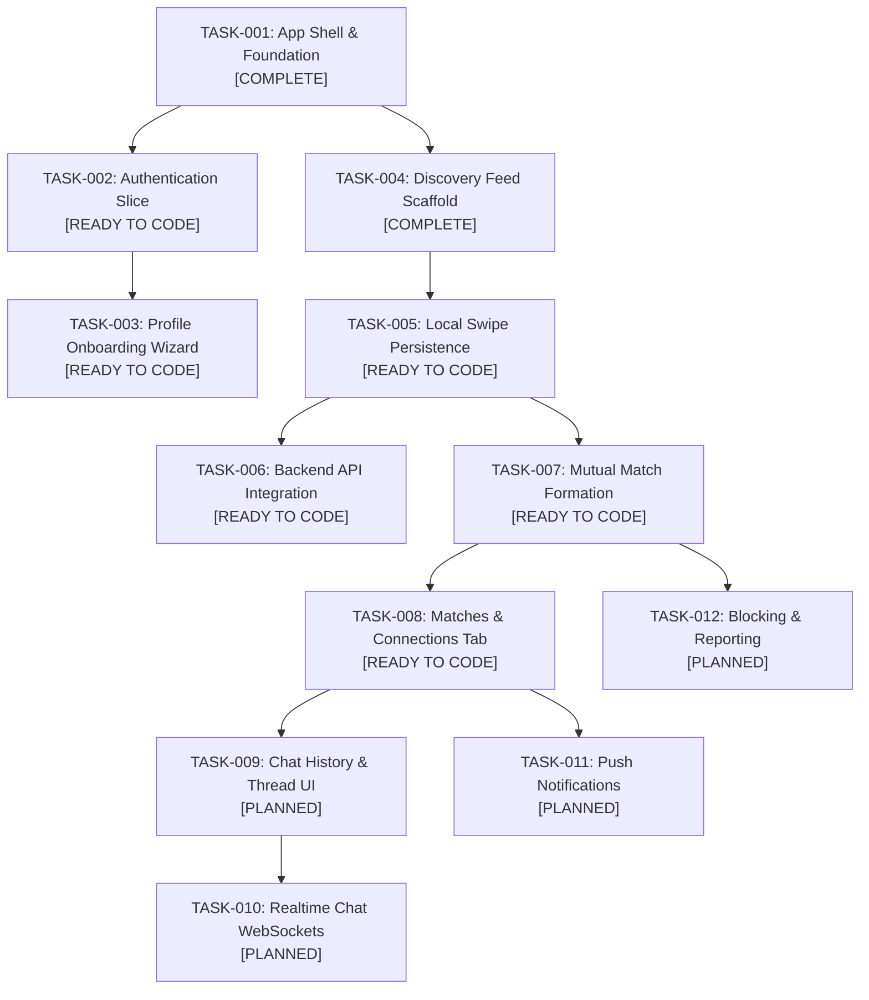

# Garblo Master Product Backlog for Coding Agents

This backlog is the single source of truth for AI coding agents and the solo fullstack engineer. Tasks are structured as **bounded vertical slices** with explicit in-scope criteria, negative boundaries (anti-scope), locked files, finite state machine matrices, and automated verification commands.

---

## 1. Vertical Slice Dependency Graph



---

## 2. Master Sprint & Task Status Matrix

| Task ID | Phase | Feature Title | Target Directory | Status | Specification Card |
|---|---|---|---|---|---|
| **TASK-001** | Phase 1 | App Shell & Multi-Platform Scaffold | `lib/app/` | `COMPLETED` | Architecture baseline |
| **TASK-004** | Phase 1 | Discovery Feed & Adaptive Layout | `lib/features/discovery/` | `COMPLETED` | [APRD-001](../specs/APRD-001-discovery.md) |
| **TASK-002** | Phase 2 | Authentication & Mock Session | `lib/features/auth/` | `READY TO CODE` | [TASK-002 Card](TASK-002-authentication.md) |
| **TASK-003** | Phase 2 | Multi-Step Profile Onboarding Wizard | `lib/features/onboarding/` | `READY TO CODE` | [TASK-003 Card](TASK-003-profile-onboarding.md) |
| **TASK-005** | Phase 3 | Local Swipe Persistence & Filtering | `lib/features/discovery/` | `READY TO CODE` | [TASK-005 Card](TASK-005-swipe-persistence.md) |
| **TASK-006** | Phase 3 | Backend FastAPI API Integration | `lib/core/networking/` | `READY TO CODE` | [TASK-006 Card](TASK-006-backend-api-integration.md) |
| **TASK-007** | Phase 3 | Mutual Match Formation & Celebration | `lib/features/matching/` | `READY TO CODE` | [TASK-007 Card](TASK-007-mutual-matching.md) |
| **TASK-008** | Phase 3 | Matches Carousel & Connections View | `lib/features/matching/` | `READY TO CODE` | [TASK-008 Card](TASK-008-matches-list.md) |
| **TASK-009** | Phase 4 | Chat History & Message Bubbles | `lib/features/chat/` | `PLANNED` | Phase 4 specification |
| **TASK-010** | Phase 4 | Realtime Chat via WebSockets | `lib/features/chat/` | `PLANNED` | Phase 4 specification |
| **TASK-011** | Phase 5 | Push & In-App Notifications | `lib/features/notifications/` | `PLANNED` | Phase 5 specification |
| **TASK-012** | Phase 5 | User Blocking & Content Reporting | `lib/features/moderation/` | `PLANNED` | Phase 5 specification |
| **TASK-013** | Phase 5 | Automated Content Moderation | `backend/app/api/v1/` | `PLANNED` | Phase 5 specification |
| **TASK-014** | Phase 6 | Premium Subscriptions & Paywall | `lib/features/profile/` | `PLANNED` | Phase 6 specification |
| **TASK-015** | Phase 6 | Performance & Accessibility Polish | `lib/` | `PLANNED` | Phase 6 specification |

---

## 3. Protocol for Coding Agents Picking Up a Task

When starting any task card from this backlog, the coding agent MUST execute the following 5-step loop:

1. **Ingest Directives & Task Card**:
   - Read [`.github/copilot-instructions.md`](../../.github/copilot-instructions.md).
   - Read the specific task card (e.g. [`TASK-002-authentication.md`](TASK-002-authentication.md)).
   - Check the **Locked Files** list: do NOT modify any file listed under Locked Files.
2. **Review Anti-Scope**:
   - Explicitly confirm what is NOT being built in this prompt session.
3. **Inspect Target Bounded Context**:
   - Inspect files in the target directory using `view_file` or directory tools.
4. **Implement Vertical Slice**:
   - Follow the unidirectional flow: Domain $\rightarrow$ Data Repository $\rightarrow$ ViewModel/State $\rightarrow$ Presentation/Widgets.
5. **Verify Against Definition of Done**:
   - Run the specified verification commands:
     ```bash
     dart format --output=none --set-exit-if-changed .
     flutter analyze
     flutter test test/features/<feature>/
     ```
   - Only declare completion once all tests pass with zero warnings.
