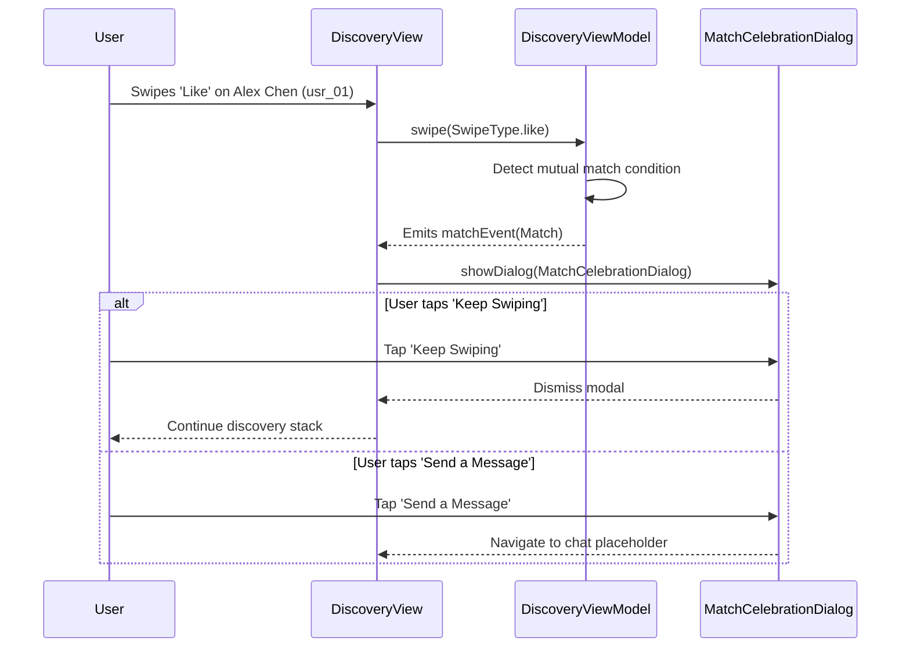

# TASK-007: Mutual Match Formation & Celebration Overlay (Vertical Slice)

> **Sprint**: Phase 3 (Core Social Mechanics)  
> **Status**: Ready for Agent Execution  
> **Target Bounded Context**: `lib/features/matching/` & `lib/features/discovery/`  
> **Dependencies**: TASK-004 (Discovery Scaffold), TASK-005 (Swipe Persistence)  
> **Estimated Agent Prompts**: 1 bounded session  

---

## 1. Context & Objective
When a user likes or superlikes a candidate who also likes them, a **Mutual Match** is formed. This vertical slice adds mutual match detection to the swiping flow, displays a celebratory modal overlay ("It's a Match!") with avatars of both users, and provides two actions: "Keep Swiping" (closes dialog) and "Send a Message" (navigates to conversation placeholder).

---

## 2. File Confinement

### Files to CREATE or MODIFY
- `lib/features/matching/domain/match.dart` (Match entity: id, matchedUserId, matchedUserProfile, createdAt)
- `lib/features/matching/data/matching_repository.dart` (Record match contract & mock store)
- `lib/features/matching/presentation/match_celebration_dialog.dart` (Celebration modal with scale animation)
- `lib/features/discovery/presentation/discovery_view_model.dart` (Detect match from swipe outcome and trigger celebration event)
- `lib/features/discovery/presentation/discovery_view.dart` (Listen to match event and show modal)
- `test/features/matching/domain/match_test.dart`
- `test/features/matching/presentation/match_celebration_dialog_test.dart`
- `test/features/discovery/presentation/discovery_view_model_match_test.dart`

### LOCKED Files (Strict Anti-Touch)
- `lib/features/auth/*`
- `lib/features/onboarding/*`

---

## 3. In-Scope vs. Explicit Anti-Scope

### In-Scope (Strict Requirements)
- `Match` domain entity containing matched profile data and match timestamp.
- Trigger celebration overlay when swiping "like" on predefined match candidates (e.g. `usr_01` Alex Chen in mock data triggers mutual match).
- `MatchCelebrationDialog` widget:
  - Header: "It's a Match!" with celebratory gradient typography.
  - Subtitle: "You and Alex Chen liked each other."
  - Two overlapping circular avatar previews with heart badge in center.
  - Primary button: "Send a Message".
  - Secondary outlined button: "Keep Swiping".
- Responsive modal: Card size constrained to max width `400px` on desktop and full width sheet/dialog on mobile.
- Tests verifying match trigger and dialog action callbacks.

### Anti-Scope (Strictly Forbidden)
- **NO third-party confetti particle library** (keep UI clean with Flutter native curves/animations).
- **NO audio sound effects playback**.
- **NO push notification dispatch**.

---

## 4. Finite State Machine & Interaction Flow



---

## 5. Acceptance Criteria (Gherkin Format)

### Scenario 1: Match Celebration Appears on Mutual Like
```gherkin
Given the user is viewing candidate "usr_01" (Alex Chen)
When the user taps the 'Like' or 'Superlike' button
Then a MatchCelebrationDialog must be rendered on screen
And the text "It's a Match!" must be visible
And candidate name "Alex Chen" must be displayed in the subtitle
```

### Scenario 2: Keep Swiping Dismisses Dialog
```gherkin
Given the MatchCelebrationDialog is currently visible
When the user taps "Keep Swiping"
Then the dialog must be closed
And the user must see the next candidate card in the Discovery feed
```

### Scenario 3: Regular Swipe Does Not Trigger Match
```gherkin
Given the user is viewing candidate "usr_02" (Elena Rostova - non-match in mock)
When the user taps 'Like'
Then no MatchCelebrationDialog must appear
And the feed must smoothly advance to candidate "usr_03"
```

---

## 6. Verification Commands

```bash
dart format --output=none --set-exit-if-changed .
flutter analyze
flutter test test/features/matching/
```

