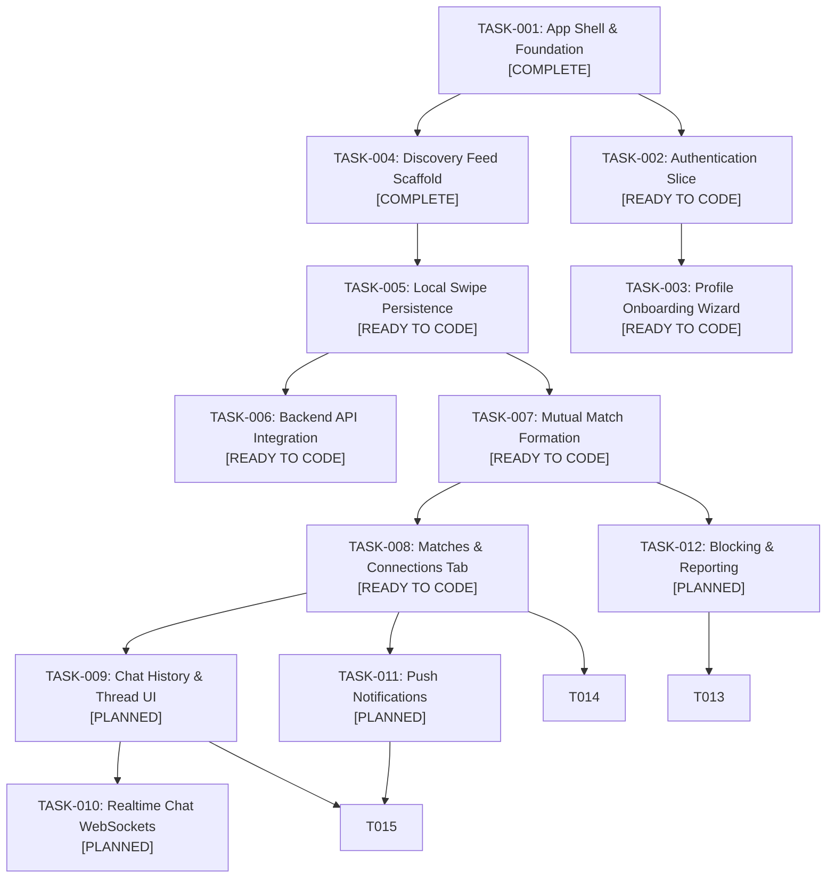

# Garblo Master Product Backlog for Coding Agents

> **⚠ Superseded (2026-10-29, [CHG-003](../../changes/CHG-003-wardrobe-direction-phase-1.md)).**
> The product direction is now **wardrobe/outfit**
> ([TASK-001](../mobile/TASK-001-product-domain-alignment.md)). Everything from
> §1 onward describes the retired dating product. It is kept unchanged for history
> only; do not implement it. The active backend and AI work is the wardrobe
> handoff below.

## Read this first: Garblo is not a dating app

Garblo is a **lookbook generating and matching** app: it turns photos of the
user's own clothes into **Pieces** in their **Archive**, then drafts
**Fits** (outfits) from those Pieces for the day ahead. There are no other
people, profiles, matches between users, or chats.

Some spec and data names sound like the retired dating product. They mean:

| Name (spec / code) | Means in Garblo | Does **not** mean |
|---|---|---|
| Gu Match | The styling pillar: drafting Fits from your own Pieces | Matching people |
| `match_pct` / "82% FIT" | How well a Fit suits the day (context fit score) | Compatibility between users |
| swipe, `swipe_status` | Deciding on a Fit: Pass or Add to Rotation | Liking a person |
| `CardAction.LIKE_SAVE` | "Add to Rotation": keep a Fit. The UI never says "Like" (T7 › G4) | A like on a profile |
| deck, candidate (`outfit_candidates`) | The session's up to 8 Fits | A queue of people |
| Wear today (`wear_events`) | The user wore that Fit today | — |

The existing FastAPI code in `backend/` (`discovery.py`, `/api/v1/swipes`,
`matches.py`, `chat.py`, `models/profile.py`, `sample_data.py`) is the
**retired dating mock**. Do not extend it for wardrobe work; see
[BE-005](BE-005-retire-dating-mock-api.md). Wardrobe endpoints live under
`/v1/studio`, `/v1/wardrobe` and `/v1/gu-match` (spec T2 › API surface).

## Wardrobe handoff for backend and AI engineers

Mobile Phase 1 (spec T6 **P1 Clickable offline app**) needs **no** backend or
AI work: it runs on in-memory repositories and fakes. The cards below record
the contracts that the Phase 1 fakes define, so the real services can replace
them in spec phases P3–P5 without changing the mobile features. None is
`Ready` until BE-001 is decided.

| ID | Owner | Task | Spec phase | Replaces Phase 1 fake | Status |
|---|---|---|---|---|---|
| [BE-001](BE-001-platform-decision.md) | Backend + EM | Platform decision: FastAPI mock (D-004) vs. MongoDB + PowerSync + auth (spec T4) | before P3 | — | **Acknowledged · decide before P3** |
| [BE-002](BE-002-studio-pipeline.md) | Backend | Studio API: batches, consent, analysis jobs, review drafts, atomic commit | P4 | `MockStudioRepository` | Blocked by BE-001 |
| [BE-003](BE-003-wardrobe-and-wear-api.md) | Backend | Wardrobe items API, item-type catalog, wear events, dormancy parity | P3–P4 | `MockWardrobeRepository`, `MockWearRepository` | Blocked by BE-001 |
| [BE-004](BE-004-gu-match-api.md) | Backend | Gu Match sessions, context events, rule-based generator, interactions, swap | P4 | `MockGuMatchRepository` | Blocked by BE-001 |
| [BE-005](BE-005-retire-dating-mock-api.md) | Backend | Retire the dating mock API (`/api/v1/discovery`, `/swipes`, `/profiles`, `/matches`, `/chat`, `/auth` placeholder) and rewrite `backend/README.md` for the wardrobe product | before BE-002 | — | Proposed · needs a CHG |
| [AI-001](AI-001-outfit-extraction.md) | AI | Outfit extraction (segmentation, attributes, confidence, embeddings), pose/scene | P5 | Fixture items in `MockStudioRepository` | Blocked by BE-002 |
| [AI-002](AI-002-virtual-try-on.md) | AI + Backend | Virtual try-on render pipeline and body-photo consent | P5 | "Try-on is coming soon" | Blocked by BE-004, SP-3 |
| [AI-003](AI-003-agent-context-and-styling.md) | AI + Backend | Agent context (calendar, weather, mobility), LLM intent/naming, PII scrubber, embedding-ranked generator | P5 | Fixture context cards, `FakeCandidateGenerator` | Blocked by BE-004, SP-7 |

---

## Retired dating backlog (history)

This backlog is the single source of truth for AI coding agents and the solo fullstack engineer. Tasks are structured as **bounded vertical slices** with explicit in-scope criteria, negative boundaries (anti-scope), locked files, finite state machine matrices, and automated verification commands.

---

## 1. Vertical Slice Dependency Graph



---

## 2. Master Sprint & Task Status Matrix

| Task ID | Phase | Feature Title | Target Directory | Status | Specification Card |
|---|---|---|---|---|---|
| **TASK-001** | Phase 1 | App Shell & Multi-Platform Scaffold | `lib/app/` | `COMPLETED` | Architecture baseline |
| **TASK-004** | Phase 1 | Discovery Feed & Adaptive Layout | `lib/features/discovery/` | `COMPLETED` | [APRD-001](../specs/APRD-001-discovery.md) |
| **TASK-002** | Phase 2 | Authentication & Mock Session | `lib/features/auth/` | `READY TO CODE` | [Task](TASK-002-authentication.md) · [APRD](../specs/APRD-002-authentication.md) |
| **TASK-003** | Phase 2 | Multi-Step Profile Onboarding Wizard | `lib/features/onboarding/` | `READY TO CODE` | [Task](TASK-003-profile-onboarding.md) · [APRD](../specs/APRD-003-profile-onboarding.md) |
| **TASK-005** | Phase 3 | Local Swipe Persistence & Filtering | `lib/features/discovery/` | `READY TO CODE` | [Task](TASK-005-swipe-persistence.md) · [APRD](../specs/APRD-005-swipe-persistence.md) |
| **TASK-006** | Phase 3 | Backend FastAPI API Integration | `lib/core/networking/` | `READY TO CODE` | [Task](TASK-006-backend-api-integration.md) · [APRD](../specs/APRD-006-backend-api-integration.md) |
| **TASK-007** | Phase 3 | Mutual Match Formation & Celebration | `lib/features/matching/` | `READY TO CODE` | [Task](TASK-007-mutual-matching.md) · [APRD](../specs/APRD-007-mutual-matching.md) |
| **TASK-008** | Phase 3 | Matches Carousel & Connections View | `lib/features/matching/` | `READY TO CODE` | [Task](TASK-008-matches-list.md) · [APRD](../specs/APRD-008-matches-list.md) |
| **TASK-009** | Phase 4 | Chat History & Message Bubbles | `lib/features/chat/` | `PLANNED` | [Task](TASK-009-chat-history.md) |
| **TASK-010** | Phase 4 | Realtime Chat via WebSockets | `lib/features/chat/` | `PLANNED` | [Task](TASK-010-realtime-chat.md) |
| **TASK-011** | Phase 5 | Push & In-App Notifications | `lib/features/notifications/` | `PLANNED` | [Task](TASK-011-push-notifications.md) |
| **TASK-012** | Phase 5 | User Blocking & Content Reporting | `lib/features/moderation/` | `PLANNED` | [Task](TASK-012-blocking-reporting.md) |
| **TASK-013** | Phase 5 | Automated Content Moderation | `backend/app/api/v1/` | `PLANNED` | [Task](TASK-013-automated-moderation.md) |
| **TASK-014** | Phase 6 | Premium Subscriptions & Paywall | `lib/features/profile/` | `PLANNED` | [Task](TASK-014-premium-subscriptions.md) |
| **TASK-015** | Phase 6 | Performance & Accessibility Polish | `lib/` | `PLANNED` | [Task](TASK-015-performance-accessibility.md) |

---

## 3. Technical Delivery View

This table is the manager's implementation handoff. A task is not ready for coding unless its contract, state behavior, test surface, and file boundary are clear.

| Task | Primary contract | State/behavior to verify | Required test surface | Boundary |
|---|---|---|---|---|
| TASK-001 / TASK-004 | App shell, `Profile`, `DiscoveryRepository` | `initial`, `loading`, `loaded`, `empty`, `error` | Domain, repository, ViewModel, widget, mobile/desktop | `lib/app/`, `lib/features/discovery/` |
| TASK-002 | `AuthSession`, auth repository, `LocalStorage` token key | `unauthenticated`, `authenticating`, `authenticated`, `error` | Session, repository, ViewModel, form | `lib/features/auth/`, auth endpoints |
| TASK-003 | `OnboardingDraft`, step validation, profile conversion | Editing steps, `submitting`, `completed` | Draft/validation, ViewModel, wizard widgets | `lib/features/onboarding/` |
| TASK-005 | `LocalStorage` swipe-ID contract | Filtered loaded feed, empty after exhaustion, reset | Storage/repository filtering, ViewModel, reset action | Discovery and core storage only |
| TASK-006 | `ApiClient`, HTTP repository, Pydantic JSON shape | Remote success, server error, network fallback | Client, repository mapping, backend endpoint | Networking and discovery data |
| TASK-007 | `Match`, matching repository, swipe outcome event | Match event versus ordinary swipe | Entity, repository, ViewModel event, dialog | Matching plus declared Discovery integration |
| TASK-008 | Match list repository and `/matches` route | `loading`, `loaded`, `empty`, `error`, search | ViewModel filtering and responsive widgets | Matching presentation and router |
| TASK-009 | `Conversation` and `Message` contracts | Loading, loaded, empty, error, send-local-message | Models, repository, ViewModel, thread widgets | Chat feature only |
| TASK-010 | WebSocket transport lifecycle | Connected, reconnecting, disconnected, error | Transport, lifecycle cleanup, backend endpoint | Chat/networking integration |
| TASK-011 | Notification entity and unread repository | Loading, loaded, empty, error, read mutation | Repository, ViewModel, badge/list widgets | Notifications only |
| TASK-012 | Report reason/request and block repository | Confirmation, submitting, success, error | Validation, repository, confirmation UI, endpoint | Moderation and explicit integration points |
| TASK-013 | Pydantic moderation request/decision | Safe, review, rejected, validation error | Schema and endpoint tests | Backend moderation endpoint only |
| TASK-014 | Subscription plan/status contract | Loading, loaded, error, dismissed paywall | Repository, state, paywall widgets | Profile/subscription feature |
| TASK-015 | Recorded performance/accessibility baseline | Measured before/after behavior | Semantics, keyboard, constraint, performance tests | Only affected files |

### Technical readiness gate

Before changing code, the manager or coding agent must confirm:

- The task dependencies are complete or explicitly stubbed by an existing contract.
- The APRD and task card agree on scope, anti-scope, state behavior, and acceptance criteria.
- Allowed and locked files are explicit.
- Domain/API serialization names are documented where data crosses a boundary.
- Failure behavior is defined; no silent fallback is implied.
- Tests identify the measurable behavior rather than only checking widget existence.
- The verification command is runnable in the repository's actual toolchain.

If any gate is missing, update the documentation before implementation.

## 4. Protocol for Coding Agents Picking Up a Task

When starting any task card from this backlog, the coding agent MUST execute the following 5-step loop:

1. **Ingest Directives & Task Card**:
   - Read [`.github/copilot-instructions.md`](../../.github/copilot-instructions.md).
   - Read the specific task card (e.g. [`TASK-002-authentication.md`](TASK-002-authentication.md)).
   - Check the **Locked Files** list: do NOT modify any file listed under Locked Files.
2. **Review Anti-Scope**:
   - Explicitly confirm what is NOT being built in this prompt session.
3. **Inspect Target Bounded Context**:
   - Inspect files in the target directory using `view_file` or directory tools.
4. **Implement Vertical Slice**:
   - Follow the unidirectional flow: Domain $\rightarrow$ Data Repository $\rightarrow$ ViewModel/State $\rightarrow$ Presentation/Widgets.
5. **Verify Against Definition of Done**:
   - Run the specified verification commands:
     ```bash
     dart format --output=none --set-exit-if-changed .
     flutter analyze
     flutter test test/features/<feature>/
     ```
   - Only declare completion once all tests pass with zero warnings.
