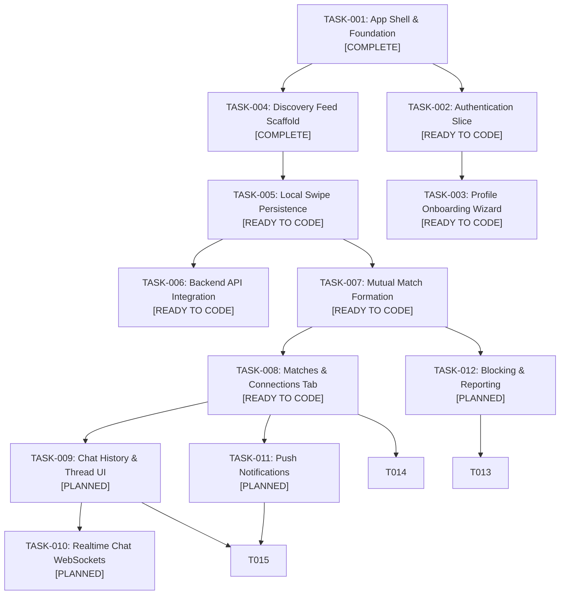

# Garblo Master Product Backlog for Coding Agents

> **⚠ Superseded (2026-10-29, [CHG-003](../../changes/CHG-003-wardrobe-direction-phase-1.md)).**
> The product direction is now **wardrobe/outfit**
> ([TASK-001](../mobile/TASK-001-product-domain-alignment.md)). Everything from
> §1 onward describes the retired dating product. It is kept unchanged for history
> only; do not implement it. The active backend and AI work is the wardrobe
> handoff below.

## Read this first: Garblo is not a dating app

Garblo is a **lookbook generating and matching** app: it turns photos of the
user's own clothes into **Pieces** in their **Archive**, then drafts
**Fits** (outfits) from those Pieces for the day ahead. There are no other
people, profiles, matches between users, or chats.

Some spec and data names sound like the retired dating product. They mean:

| Name (spec / code) | Means in Garblo | Does **not** mean |
|---|---|---|
| Gu Match | The styling pillar: drafting Fits from your own Pieces | Matching people |
| `match_pct` / "82% FIT" | How well a Fit suits the day (context fit score) | Compatibility between users |
| swipe, `swipe_status` | Deciding on a Fit: Pass or Add to Rotation | Liking a person |
| `CardAction.LIKE_SAVE` | "Add to Rotation": keep a Fit. The UI never says "Like" (T7 › G4) | A like on a profile |
| deck, candidate (`outfit_candidates`) | The session's up to 8 Fits | A queue of people |
| Wear today (`wear_events`) | The user wore that Fit today | — |

The existing FastAPI code in `backend/` (`discovery.py`, `/api/v1/swipes`,
`matches.py`, `chat.py`, `models/profile.py`, `sample_data.py`) is the
**retired dating mock**. Do not extend it for wardrobe work; see
[BE-005](BE-005-retire-dating-mock-api.md). Wardrobe data goes through the one
write endpoint `POST /v1/sync/tx` (Flow Spec v2.8 T4 › DB5); the former
`/v1/studio`, `/v1/wardrobe` and `/v1/gu-match` REST routes were removed from the spec.

## Wardrobe handoff for backend and AI engineers

Mobile Phases 1–2 are green and run on local repositories and fakes. The backend
work is split into two tracks ([CHG-014](../../changes/CHG-014-mock-first-backend-track.md), Draft):

- **Track M · mock first.** A deterministic FastAPI mock of the Flow Spec **v2.8**
  contract: a dev token, the one write endpoint `POST /v1/sync/tx`, fake side
  effects (fake extraction, fake context, rule-based deck, fake erasure, in-memory
  files) and a dev-only change feed standing in for Sync Streams. No database, no
  external service, no wall clock. It fits D-004 as written, so it does **not**
  wait for BE-001, and it lets the mobile app integrate before P3
  ([TASK-010](../mobile/TASK-010-mock-backend-integration.md)).
- **Track R · real platform.** MongoDB, PowerSync, auth, RustFS, real models. It
  reuses Track M's rules and contract tests and waits for BE-001.

Spec v2.8 removed the REST + SSE "API surface" (T2 › *Sync contract (replaces the
API surface)*). Every card below targets the sync contract. Spec files:
[Flow Spec v2.8](<../../specs/Garblo Flow Spec.md>),
[DB handbook](<../../specs/Garblo — Đặc tả cơ sở dữ liệu (DRS + DDS).md>)
(relocation open in [DOC-002](../docs/DOC-002-flow-spec-v2-8-relocation.md)).

### Track M · mock first (priority order)

| # | ID | Owner | Task | Mock of | Blocked by | Status |
|---|---|---|---|---|---|---|
| 0 | [BE-010](BE-010-restore-backend-gate.md) | Backend | Restore the backend gate: packaging, Python pin, `uv.lock`, CI job (`uv run pytest` fails to build today) | — | — | Draft |
| 1 | [BE-005](BE-005-retire-dating-mock-api.md) | Backend | Retire the dating mock API; rewrite `backend/README.md` | — | BE-010 | Draft |
| 2 | [BE-011](BE-011-mock-platform-core.md) | Backend | Sync row models (phone schema), ObjectId parity, injected clock, in-memory `Store`, dev token, mock controls | P4-B01 (dev token) | BE-005 | Draft |
| 3 | [BE-012](BE-012-mock-write-handler.md) | Backend | `POST /v1/sync/tx`: PUT/PATCH/DELETE rules, owner checks, allow-lists, idempotency, atomicity, I1/I2/I4/I6 | P4-B02, P4-B03 | BE-011 | Draft |
| 4 | [BE-013](BE-013-mock-change-feed.md) | Backend | Dev change feed per Sync Stream, write checkpoints, catalog and demo-wardrobe seeds | P3-02, P3-03 | BE-012 | Draft |
| 5 | [AI-005](AI-005-model-ports-and-fakes.md) | AI | Model ports + deterministic fakes (extractor, person detector, context sources, rule generator, namer) | P5 seams | BE-011 | Draft |
| 6 | [BE-014](BE-014-fake-studio-side-effects.md) | Backend | Studio side effects: photo × task jobs, fake extraction, review, atomic commit, outcome scenarios | P4-B05 | BE-012, BE-013, AI-005 | Draft |
| 7 | [BE-015](BE-015-fake-gu-match-side-effects.md) | Backend | Gu Match side effects: session status, context cards, ≤ 8 Fits, swipes, swap | P4-B07 | BE-012, BE-013, AI-005 | Draft |
| 8 | [BE-016](BE-016-wear-rules-parity.md) | Backend | Shared wear rules: dormancy, gap days, rescue eligibility, golden parity | P4-B08 (rules part) | BE-012, TASK-012 | Draft |
| 9 | [BE-017](BE-017-fake-privacy-requests.md) | Backend | `privacy_requests`: BODY and ALL erasure in memory, proof function | P4-B09 | BE-012, BE-013 | Draft |
| 10 | [BE-018](BE-018-mock-attachments.md) | Backend | Attachment tickets, in-memory file store, JPEG/PNG + EXIF verification | P4-B04, P4-B06 | BE-012, BE-013 | Draft |
| 11 | [AI-006](AI-006-pii-scrubber-and-eval-harness.md) | AI | PII scrubber v0 (red-team fixtures) and offline evaluation harness with fake baselines | P5-A03, P5-A04 prep | AI-005 | Draft |

### Track R · real platform (after BE-001)

| ID | Owner | Task | Spec phase | Mock predecessor | Status |
|---|---|---|---|---|---|
| [BE-001](BE-001-platform-decision.md) | Backend + EM | Platform decision; now gates Track R only | before P3 | — | **Acknowledged · decide before P3** |
| [BE-006](BE-006-phone-schema-sync-parity.md) | Backend + DevOps | MongoDB collections, validators and Sync Streams match the phone schema | P3 | BE-011, BE-013 | Blocked by BE-001, TASK-011 |
| [BE-019](BE-019-auth-service.md) | Backend | Auth service: anonymous JWT, JWKS, refresh rotation, Google link | P4-B01 | BE-011 dev token | Blocked by BE-001, SP-6 |
| [BE-020](BE-020-write-handler-on-mongodb.md) | Backend | Write handler on MongoDB, same rules and tests | P4-B02, B03 | BE-012 | Blocked by BE-001, BE-006 |
| [BE-002](BE-002-studio-pipeline.md) | Backend | Studio pipeline on the real store and job runner | P4-B05, B06 | BE-014 | Blocked by BE-001 |
| [BE-003](BE-003-wardrobe-and-wear-api.md) | Backend | Catalog stream, wear-event validator, server dormancy | P3–P4 | BE-013, BE-016 | Blocked by BE-001 |
| [BE-004](BE-004-gu-match-api.md) | Backend | Gu Match on the real store; weather API; `recent` flag; `deck_history` | P4-B07 | BE-015 | Blocked by BE-001 |
| [BE-007](BE-007-privacy-erasure-and-export.md) | Backend | Erasure on MongoDB + RustFS with proof query; export after UC-19 | P4-B09 | BE-017 | Blocked by BE-001, gap ④ |
| [BE-008](BE-008-rustfs-tickets-and-verify.md) | Backend + DevOps | RustFS buckets, ticket issuer, verify worker | P4-B04, B06 | BE-018 | Blocked by BE-001, SP-R1 |
| [BE-009](BE-009-sync-nudge.md) | Backend | Data-free push when results are ready | P4 | — | Blocked by BE-001 |
| [AI-001](AI-001-outfit-extraction.md) | AI | Outfit extraction models behind the AI-005 ports | P5 | AI-005 fakes | Blocked by BE-002, SP-2 |
| [AI-002](AI-002-virtual-try-on.md) | AI + Backend | Virtual try-on (`vton_jobs` command row) | P5 | — | Blocked by BE-004, SP-3 |
| [AI-003](AI-003-agent-context-and-styling.md) | AI + Backend | Agent context, LLM intent and naming, name detection, generator v2 | P5 | AI-005, AI-006 | Blocked by BE-004, SP-7 |
| [AI-004](AI-004-on-device-blur-and-duplicates.md) | AI + Mobile | On-device bystander blur and duplicate detection | P5 | — | Blocked by SP-1, SP-4 |

### Requests to other roles (found during the analysis)

| ID | For | Problem | Blocks |
|---|---|---|---|
| [TASK-010](../mobile/TASK-010-mock-backend-integration.md) | App Developer + EM | No HTTP transport and no approved HTTP dependency; dev sync connector to the mock | Mobile integration of Track M |
| [TASK-011](../mobile/TASK-011-phone-schema-v2-alignment.md) | EM + App Developer | Phone schema v1 lacks v2.8 tables and columns; the phone writes server-owned tables | BE-006, P3-04 |
| [TASK-012](../mobile/TASK-012-shared-golden-fixtures.md) | App Developer + EM | Parity fixtures exist only inside Dart tests | BE-016; parity in BE-011, BE-013, AI-005 |
| [DOC-002](../docs/DOC-002-flow-spec-v2-8-relocation.md) | APM + EM + human | Spec moved to `docs/specs/` (uncommitted); dead links; D-/CHG- ID collisions in the DB handbook; snake_case and pytest naming policy | Links in every card |
| [DOC-003](../docs/DOC-003-archive-legacy-backend-cards.md) | APM + EM | 14 retired dating cards in this folder collide with mobile TASK IDs | Unambiguous scenario-ID search |

### Requests from the mobile analysis ([CHG-015](../../changes/CHG-015-mobile-contract-alignment-and-p3-p5-plan.md), 2026-10-31)

| ID | For | Problem | Blocks |
|---|---|---|---|
| [BE-022](BE-022-mock-contract-requests-from-mobile.md) | Backend + EM | The phone's v1 rows use camelCase enums, local times and date-times for dates; keep the mock strict on v2.8, read the shared table classes, export recorded responses | TASK-010, TASK-018, TASK-024…027 |
| [BE-021](BE-021-fake-try-on-side-effects.md) | Backend | `vton_jobs` is refused in the mock until AI-002; a fake render unblocks the phone's try-on flow | TASK-030 |
| [DOC-004](../docs/DOC-004-mobile-contract-decisions.md) | APM + EM | Contract decisions (time zone, `upload_batches.status` writers, save-for-later, action names, Fit item shape) | BE-012, BE-015, BE-016 |

---

## Retired dating backlog (history)

This backlog is the single source of truth for AI coding agents and the solo fullstack engineer. Tasks are structured as **bounded vertical slices** with explicit in-scope criteria, negative boundaries (anti-scope), locked files, finite state machine matrices, and automated verification commands.

---

## 1. Vertical Slice Dependency Graph



---

## 2. Master Sprint & Task Status Matrix

| Task ID | Phase | Feature Title | Target Directory | Status | Specification Card |
|---|---|---|---|---|---|
| **TASK-001** | Phase 1 | App Shell & Multi-Platform Scaffold | `apps/mobile/lib/app/` | `COMPLETED` | Architecture baseline |
| **TASK-004** | Phase 1 | Discovery Feed & Adaptive Layout | `apps/mobile/lib/features/discovery/` | `COMPLETED` | [APRD-001](../../archive/legacy/specs/APRD-001-discovery.md) |
| **TASK-002** | Phase 2 | Authentication & Mock Session | `apps/mobile/lib/features/auth/` | `READY TO CODE` | [Task](TASK-002-authentication.md) · [APRD](../../archive/legacy/specs/APRD-002-authentication.md) |
| **TASK-003** | Phase 2 | Multi-Step Profile Onboarding Wizard | `apps/mobile/lib/features/onboarding/` | `READY TO CODE` | [Task](TASK-003-profile-onboarding.md) · [APRD](../../archive/legacy/specs/APRD-003-profile-onboarding.md) |
| **TASK-005** | Phase 3 | Local Swipe Persistence & Filtering | `apps/mobile/lib/features/discovery/` | `READY TO CODE` | [Task](TASK-005-swipe-persistence.md) · [APRD](../../archive/legacy/specs/APRD-005-swipe-persistence.md) |
| **TASK-006** | Phase 3 | Backend FastAPI API Integration | `apps/mobile/lib/core/networking/` | `READY TO CODE` | [Task](TASK-006-backend-api-integration.md) · [APRD](../../archive/legacy/specs/APRD-006-backend-api-integration.md) |
| **TASK-007** | Phase 3 | Mutual Match Formation & Celebration | `apps/mobile/lib/features/matching/` | `READY TO CODE` | [Task](TASK-007-mutual-matching.md) · [APRD](../../archive/legacy/specs/APRD-007-mutual-matching.md) |
| **TASK-008** | Phase 3 | Matches Carousel & Connections View | `apps/mobile/lib/features/matching/` | `READY TO CODE` | [Task](TASK-008-matches-list.md) · [APRD](../../archive/legacy/specs/APRD-008-matches-list.md) |
| **TASK-009** | Phase 4 | Chat History & Message Bubbles | `apps/mobile/lib/features/chat/` | `PLANNED` | [Task](TASK-009-chat-history.md) |
| **TASK-010** | Phase 4 | Realtime Chat via WebSockets | `apps/mobile/lib/features/chat/` | `PLANNED` | [Task](TASK-010-realtime-chat.md) |
| **TASK-011** | Phase 5 | Push & In-App Notifications | `apps/mobile/lib/features/notifications/` | `PLANNED` | [Task](TASK-011-push-notifications.md) |
| **TASK-012** | Phase 5 | User Blocking & Content Reporting | `apps/mobile/lib/features/moderation/` | `PLANNED` | [Task](TASK-012-blocking-reporting.md) |
| **TASK-013** | Phase 5 | Automated Content Moderation | `backend/app/api/v1/` | `PLANNED` | [Task](TASK-013-automated-moderation.md) |
| **TASK-014** | Phase 6 | Premium Subscriptions & Paywall | `apps/mobile/lib/features/profile/` | `PLANNED` | [Task](TASK-014-premium-subscriptions.md) |
| **TASK-015** | Phase 6 | Performance & Accessibility Polish | `apps/mobile/lib/` | `PLANNED` | [Task](TASK-015-performance-accessibility.md) |

---

## 3. Technical Delivery View

This table is the manager's implementation handoff. A task is not ready for coding unless its contract, state behavior, test surface, and file boundary are clear.

| Task | Primary contract | State/behavior to verify | Required test surface | Boundary |
|---|---|---|---|---|
| TASK-001 / TASK-004 | App shell, `Profile`, `DiscoveryRepository` | `initial`, `loading`, `loaded`, `empty`, `error` | Domain, repository, ViewModel, widget, mobile/desktop | `apps/mobile/lib/app/`, `apps/mobile/lib/features/discovery/` |
| TASK-002 | `AuthSession`, auth repository, `LocalStorage` token key | `unauthenticated`, `authenticating`, `authenticated`, `error` | Session, repository, ViewModel, form | `apps/mobile/lib/features/auth/`, auth endpoints |
| TASK-003 | `OnboardingDraft`, step validation, profile conversion | Editing steps, `submitting`, `completed` | Draft/validation, ViewModel, wizard widgets | `apps/mobile/lib/features/onboarding/` |
| TASK-005 | `LocalStorage` swipe-ID contract | Filtered loaded feed, empty after exhaustion, reset | Storage/repository filtering, ViewModel, reset action | Discovery and core storage only |
| TASK-006 | `ApiClient`, HTTP repository, Pydantic JSON shape | Remote success, server error, network fallback | Client, repository mapping, backend endpoint | Networking and discovery data |
| TASK-007 | `Match`, matching repository, swipe outcome event | Match event versus ordinary swipe | Entity, repository, ViewModel event, dialog | Matching plus declared Discovery integration |
| TASK-008 | Match list repository and `/matches` route | `loading`, `loaded`, `empty`, `error`, search | ViewModel filtering and responsive widgets | Matching presentation and router |
| TASK-009 | `Conversation` and `Message` contracts | Loading, loaded, empty, error, send-local-message | Models, repository, ViewModel, thread widgets | Chat feature only |
| TASK-010 | WebSocket transport lifecycle | Connected, reconnecting, disconnected, error | Transport, lifecycle cleanup, backend endpoint | Chat/networking integration |
| TASK-011 | Notification entity and unread repository | Loading, loaded, empty, error, read mutation | Repository, ViewModel, badge/list widgets | Notifications only |
| TASK-012 | Report reason/request and block repository | Confirmation, submitting, success, error | Validation, repository, confirmation UI, endpoint | Moderation and explicit integration points |
| TASK-013 | Pydantic moderation request/decision | Safe, review, rejected, validation error | Schema and endpoint tests | Backend moderation endpoint only |
| TASK-014 | Subscription plan/status contract | Loading, loaded, error, dismissed paywall | Repository, state, paywall widgets | Profile/subscription feature |
| TASK-015 | Recorded performance/accessibility baseline | Measured before/after behavior | Semantics, keyboard, constraint, performance tests | Only affected files |

### Technical readiness gate

Before changing code, the manager or coding agent must confirm:

- The task dependencies are complete or explicitly stubbed by an existing contract.
- The APRD and task card agree on scope, anti-scope, state behavior, and acceptance criteria.
- Allowed and locked files are explicit.
- Domain/API serialization names are documented where data crosses a boundary.
- Failure behavior is defined; no silent fallback is implied.
- Tests identify the measurable behavior rather than only checking widget existence.
- The verification command is runnable in the repository's actual toolchain.

If any gate is missing, update the documentation before implementation.

## 4. Protocol for Coding Agents Picking Up a Task

When starting any task card from this backlog, the coding agent MUST execute the following 5-step loop:

1. **Ingest Directives & Task Card**:
   - Read [`.github/copilot-instructions.md`](../../../.github/copilot-instructions.md).
   - Read the specific task card (e.g. [`TASK-002-authentication.md`](TASK-002-authentication.md)).
   - Check the **Locked Files** list: do NOT modify any file listed under Locked Files.
2. **Review Anti-Scope**:
   - Explicitly confirm what is NOT being built in this prompt session.
3. **Inspect Target Bounded Context**:
   - Inspect files in the target directory using `view_file` or directory tools.
4. **Implement Vertical Slice**:
   - Follow the unidirectional flow: Domain $\rightarrow$ Data Repository $\rightarrow$ ViewModel/State $\rightarrow$ Presentation/Widgets.
5. **Verify Against Definition of Done**:
   - Run the specified verification commands:
     ```bash
     dart format --output=none --set-exit-if-changed .
     flutter analyze
     flutter test test/features/<feature>/
     ```
   - Only declare completion once all tests pass with zero warnings.

## Change history

| Date | CHG | Change |
|---|---|---|
| 2026-10-29 | [CHG-003](../../changes/CHG-003-wardrobe-direction-phase-1.md) | Superseded banner, "not a dating app" glossary and wardrobe handoff added; dating backlog kept as history |
| 2026-10-30 | [CHG-014](../../changes/CHG-014-mock-first-backend-track.md) | Handoff rewritten: Track M (mock first) before Track R (real); spec v2.8 sync contract; requests to other roles. Table added (it was missing; README §3 rule 7) |
| 2026-10-31 | [CHG-015](../../changes/CHG-015-mobile-contract-alignment-and-p3-p5-plan.md) | Added "Requests from the mobile analysis" (BE-021, BE-022, DOC-004) |
