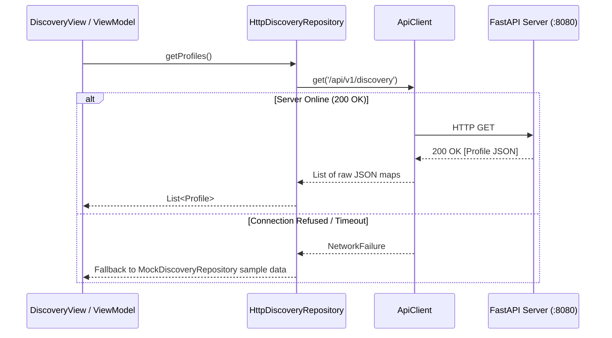

# TASK-006: Backend Discovery API Integration (Vertical Slice)

> **Sprint**: Phase 3 (Core Social Mechanics)  
> **Status**: Ready for Agent Execution  
> **Target Bounded Context**: `apps/mobile/lib/features/discovery/data/` & `apps/mobile/lib/core/networking/`  
> **Companion Backend API**: `backend/app/api/v1/endpoints/discovery.py`  
> **Dependencies**: TASK-004 (Discovery Scaffold), TASK-005 (Swipe Persistence)  
> **Estimated Agent Prompts**: 1 bounded session  

---

## 1. Context & Objective
Connect the Flutter client to the secondary Python/FastAPI mock server. Implement `HttpDiscoveryRepository` that uses `ApiClient` to fetch `/api/v1/discovery` and submit swipes via `POST /api/v1/swipes`. Provide graceful fallback to in-memory mock data if the backend server is unreachable.

---

## 2. File Confinement

### Files to CREATE or MODIFY
- `apps/mobile/lib/core/networking/http_api_client.dart` (Implementation of `ApiClient` using `http` or `dart:io` standard library / package)
- `apps/mobile/lib/app/providers.dart` (Configure baseUrl via String environment `API_BASE_URL` with default `http://localhost:8080`)
- `apps/mobile/lib/features/discovery/data/http_discovery_repository.dart` (`DiscoveryRepository` implementation consuming FastAPI)
- `apps/mobile/lib/features/discovery/data/discovery_repository.dart` (Switchable provider based on environment flag or fallback)
- `apps/mobile/test/features/discovery/data/http_discovery_repository_test.dart`
- `apps/mobile/test/core/networking/http_api_client_test.dart`

### LOCKED Files (Strict Anti-Touch)
- `apps/mobile/lib/features/discovery/presentation/*` (UI widgets should NOT need any modification!)
- `apps/mobile/lib/features/auth/*`
- `apps/mobile/lib/features/chat/*`

---

## 3. In-Scope vs. Explicit Anti-Scope

### In-Scope (Strict Requirements)
- Lightweight HTTP client wrapper implementing `ApiClient` (`get`, `post`).
- `HttpDiscoveryRepository` calling `GET /api/v1/discovery`, deserializing JSON into `List<Profile>`.
- `HttpDiscoveryRepository` calling `POST /api/v1/swipes` with `{ "profileId": "...", "swipeType": "..." }`.
- Robust error handling: maps HTTP 4xx/5xx and socket exceptions to `ServerFailure` and `NetworkFailure`.
- Graceful offline fallback: if backend is offline, log warning and fallback to local sample data.
- Unit tests mocking HTTP responses using `MockClient` or fake `ApiClient`.

### Anti-Scope (Strictly Forbidden)
- **NO Dio or Retrofit code-generation packages** (use standard `http` package or standard client).
- **NO GraphQL or gRPC integration**.
- **NO production TLS certificate pinning**.

---

## 4. Finite State Machine & Network Flow



---

## 5. Acceptance Criteria (Gherkin Format)

### Scenario 1: Successful Remote Fetch
```gherkin
Given the FastAPI mock backend is running at http://localhost:8080
When DiscoveryViewModel.loadProfiles() executes
Then HttpDiscoveryRepository must perform GET /api/v1/discovery
And the returned profiles must match the backend sample profiles (Alex Chen, Elena Rostova, etc.)
And state.status must transition to DiscoveryStatus.loaded
```

### Scenario 2: Remote Swipe Recording
```gherkin
Given a candidate profile "usr_01" is currently active
When the user records a "like" swipe
Then HttpDiscoveryRepository must perform POST /api/v1/swipes with body:
  {"profileId": "usr_01", "swipeType": "like"}
And the backend response {"success": true, "matched": true} must be acknowledged
```

### Scenario 3: Graceful Offline Resilience
```gherkin
Given the backend server is NOT running
When the client attempts to fetch discovery profiles
Then HttpDiscoveryRepository must intercept the connection error
And gracefully fallback to local sample candidates without crashing
And the user must still be able to browse mock profiles
```

---

## 6. Technical Implementation Contract

- **Boundary:** `HttpDiscoveryRepository` is the only Discovery layer that translates `ApiClient` responses into `Profile` entities.
- **Serialization:** use the existing camelCase API fields `profileId`, `swipeType`, `distanceKm`, and `imageUrls`.
- **Failure behavior:** map non-success HTTP responses to `ServerFailure`; map connection/timeout failures to `NetworkFailure`; fallback is allowed only for network failure and must be observable.
- **Test matrix:** HTTP method/path/body, response decoding, each failure mapping, fallback behavior, and backend endpoint compatibility.

## 7. Verification Commands

```bash
# Frontend checks
dart format --output=none --set-exit-if-changed .
flutter analyze
flutter test test/features/discovery/

# Backend verification
cd backend
uv run pytest
```
